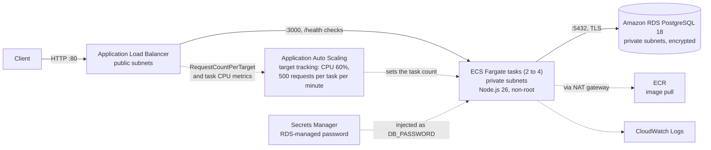
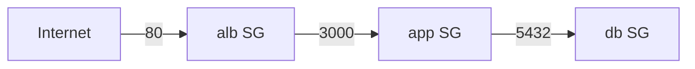
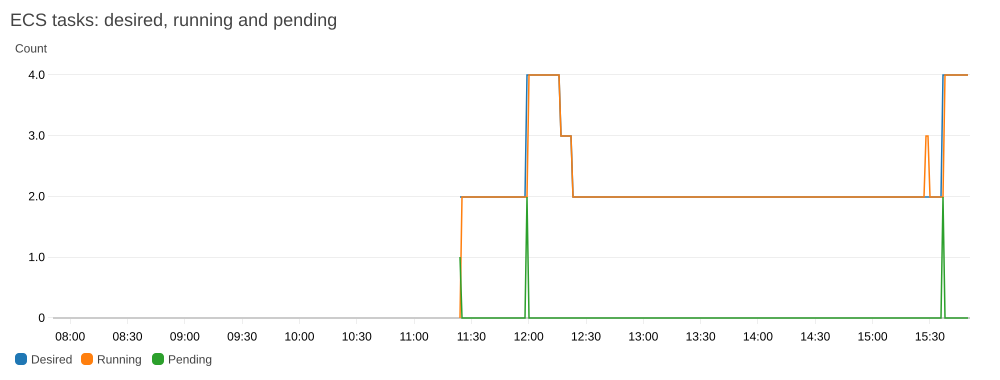
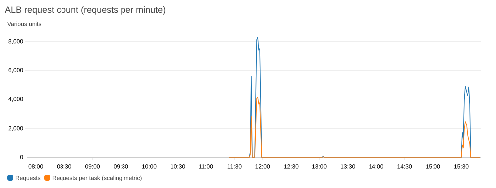
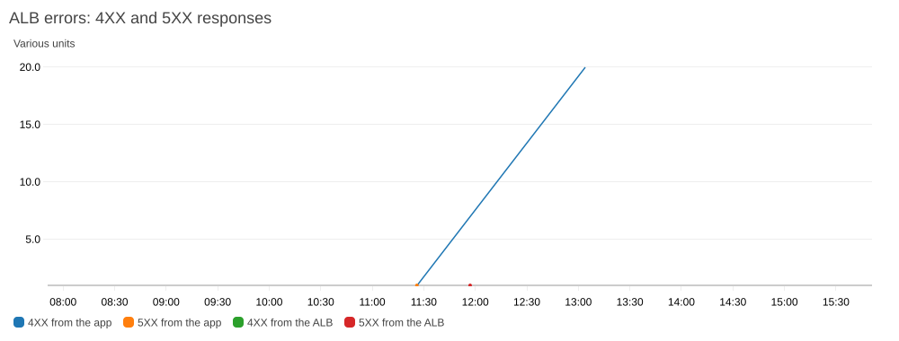

# Secure Containerized Microservices on AWS: Product Service

A small containerized REST API built the way a production one should be: a minimal non-root image, a private database, least-privilege
IAM, secrets that never appear in code or state, and a load balancer as the only public entry point. Everything is Terraform.

A client sends `GET /products` to an Application Load Balancer. The ALB forwards it to a Node.js (Express) container running on ECS Fargate in a
private subnet, which queries an Amazon RDS for PostgreSQL instance and returns the rows as JSON. The database password is generated by RDS, held in
Secrets Manager and injected into the container at start, so no credential is committed, baked into the image or stored in Terraform variables.

**State:** deployed and verified in AWS (`us-east-1`) on 2026-10-31. The full stack was applied, the schema was loaded by the one-off migration task, and `/health` and `/products` were checked through the load
balancer: tasks healthy in private subnets, RDS reachable only from the app, and the database not reachable from the internet. Also verified: Auto Scaling (scale-out 2 to 4 tasks, and scale-in beginning), the CloudWatch dashboard,
ALB access logs, CloudTrail, RDS logs and S3 access logs (the last took about 49 minutes to deliver its first file). Full results, what was not tested, and an incident where the load balancer was briefly left open to the internet are in
[docs/E2E_Test_Results.md](docs/E2E_Test_Results.md). The stack is torn down after testing, because it costs about $0.14 to $0.17 an hour. Applying it also needs IAM permissions that the PowerUserAccess permission set lacks; see [Try it](#try-it).

## Architecture

The complete picture, with every AWS service, the request and deployment flows, and how least privilege and defense in depth are applied end to end, is in **[docs/Architecture.md](docs/Architecture.md)**. The short version:



**Network layout:** one VPC (`10.0.0.0/16`) across two availability zones, each with a public subnet (ALB, NAT gateway) and a private subnet (tasks, database).
Security groups chain the layers, and each accepts traffic only from the one before it.



## What this demonstrates

- **Containerization done properly:** a multi-stage Dockerfile that installs production dependencies only, runs as the unprivileged `node` user on plain Alpine with only the `node` binary copied in (no npm, 220 MB),
  has a `HEALTHCHECK`, and starts `node` directly so `SIGTERM` reaches the app for a graceful shutdown.
- **Infrastructure as code:** the whole stack (network, database, registry, cluster, load balancer, IAM) in Terraform.
- **Security by default:** a private database, chained security groups, an encrypted database, a read-only container filesystem, and a password RDS generates and rotates in Secrets Manager.
- **Operability:** a health endpoint that checks the database, ALB health checks, container logs in CloudWatch, Container Insights, and a [runbook](docs/runbook.md).
- **Cost awareness:** the hourly cost is stated up front, with the largest items named (see [Cost awareness](#cost-awareness)).

## Security design

| Area | What is in place |
|---|---|
| **Network exposure** | Only the ALB is public. Tasks and the database are in private subnets with no public IPs, and the database has `publicly_accessible = false`. |
| **Security groups** | Internet → ALB (80) → app (3000) → database (5432). The database group admits only the app group, and the ALB can only send to port 3000 inside the VPC. The app group's outbound rules allow only TCP 443 (AWS services) and PostgreSQL to the database group. The ALB's source range is a **required** variable (`alb_ingress_cidr`, no default), and `0.0.0.0/0` is refused unless `allow_public_alb = true`, so an open load balancer is always a deliberate choice. (A plan once silently fell back to an open default during the AWS test; see [docs/E2E_Test_Results.md](docs/E2E_Test_Results.md#incident-the-alb-was-briefly-open-to-the-internet).) |
| **IAM trust and deployments** | Both ECS roles can only be assumed by ECS acting for tasks in this account (`aws:SourceAccount` and `aws:SourceArn` conditions). The ECS service has a deployment circuit breaker with automatic rollback. An S3 gateway endpoint keeps image-layer pulls off the NAT gateway. |
| **Database credentials** | `manage_master_user_password = true`: RDS generates the password and stores it in Secrets Manager. The password is never in code, variables, the image or the Terraform state. ECS injects it as `DB_PASSWORD` at start. |
| **Encryption** | RDS storage is encrypted. The app connects to RDS over TLS (`DB_SSL` defaults to on). ECR is encrypted at rest. |
| **Image** | Plain Alpine 3.24.3 plus only the `node` binary (no npm, npx, corepack or yarn), production dependencies only, runs as the non-root `node` user, `.dockerignore` keeps `.env`, `.git` and `node_modules` out, ECR scans each image on push. |
| **Container hardening** | The task definition sets `readonlyRootFilesystem = true`. |
| **Least-privilege IAM** | The execution role has the AWS-managed ECS execution policy plus `secretsmanager:GetSecretValue` on the one database secret. The task role has no permissions. |
| **Query handling** | The only query is a fixed `SELECT` with no user input, so there is nothing to inject into. |
| **Leak prevention** | Every change is scanned for secrets, credentials, confidential data, PII and AWS account or resource IDs before it is committed. `.gitignore` excludes `.env` files, keys, Terraform state, `*.tfvars` and saved plans. A pre-commit hook runs `scripts/secret-scan.py` on every commit (enable it once per clone with `./scripts/install-hooks.sh`), and the same scan runs as a required check on every pull request before merge. See [SECURITY.md](SECURITY.md). |
| **Error hygiene** | Errors return generic messages, and the database error is logged server-side, never returned to the client. |

### Security scan results: before and after

The image, Dockerfile and Terraform were scanned with Trivy, Checkov and `npm audit`, and the findings were fixed or documented as accepted exceptions. Full detail, with every CVE and check ID, is in
[docs/vulnerability-scan-report.md](docs/vulnerability-scan-report.md).

| Area | Before | After | What changed |
|---|---|---|---|
| Image vulnerabilities | 17 (6 HIGH, 10 MEDIUM, 1 LOW), all in npm's bundled packages | **0** | The runtime stage is plain Alpine with only the `node` binary, so npm and its bundled packages are never in the image |
| Image size on disk | 258 MB | **220 MB** | Minimal runtime stage. The `node` binary alone is about 146 MB, so there is little more to cut. |
| Image secrets | 0 | 0 | Secrets-only scan over all layers |
| Application dependencies | 0 | 0 | `npm audit` and Trivy |
| Dockerfile misconfigurations | not scanned | 0 failed (27 passed) | |
| Terraform, Checkov | 80 passed, 28 failed | **166 passed, 1 failed** (55 resources, including the optional logging resources) | ALB drops invalid headers, descriptions on every security group and rule, default security group locked down, tags copied to RDS snapshots, least-privilege egress, and 22 reviewed exceptions in [.checkov.yaml](.checkov.yaml) |
| Terraform, Trivy `config` | 19 failed (2 CRITICAL) | 15 distinct checks fail (2 CRITICAL). It was 10 before the logging resources were added; the new ones are customer-managed-key, versioning and CloudTrail-to-CloudWatch checks on the log buckets and trail | The rest are known demo trade-offs, listed below, with a reason for each. Trivy doesn't read `.checkov.yaml`, so it still reports them. |
| Brotli CVE-2026-111497 | Unknown | Patched in Node 26.12.1 and later, per public sources | Not tested on the image |

The accepted exceptions are suppressions, not fixes, and the one Checkov failure left (mutable ECR tags) waits for git SHA image tagging.

### Open security gaps

What is still open after the scans in [docs/vulnerability-scan-report.md](docs/vulnerability-scan-report.md), highest risk first. Accepted Terraform exceptions, each with a reason, are in
[.checkov.yaml](.checkov.yaml).

| Risk | Gap | Detail | Planned fix |
|---|---|---|---|
| Medium | **No authentication on the API** | Anyone who can reach the ALB can read `/products` | A Cognito or JWT authorizer, or restrict the ALB by CIDR |
| Medium | **HTTP only** | Traffic between the client and the ALB is unencrypted (Trivy CRITICAL AWS-0054; Checkov CKV_AWS_2 and related) | ACM certificate, HTTPS listener and an HTTP redirect (needs a domain) |
| Low | **Brotli CVE-2026-111497: patched per public sources, not tested** | Node 26.12.1 and later cherry-pick the upstream fix, so the `1.2.0` the image reports is a stale label. The 26.13.0 claim comes from a secondary source, and the image was not tested with crafted input. Trivy can't see this class of issue. | Keep the base image current, and read the official 26.13.0 notes |
| Low | **HTTPS egress to anywhere from the app security group** | Outbound is already limited to TCP 443 and PostgreSQL, but 443 goes to `0.0.0.0/0` so tasks can reach AWS service endpoints through the NAT (Trivy flags this, AWS-0104) | Interface VPC endpoints for ECR, Secrets Manager and CloudWatch Logs (about $0.01 an hour each per zone), then remove the rule |
| Low | **Database TLS doesn't verify the server certificate** | The app encrypts its connection to RDS, but `db.js` defaults to `rejectUnauthorized: false`, so the RDS certificate isn't checked. Someone with a network position inside the VPC could in theory impersonate the database. The service was run against real RDS over TLS in the AWS test (`/health` passes). | Bundle the AWS RDS certificate authority file into the image and set `DB_SSL_REJECT_UNAUTHORIZED=true` |
| Low | **Mutable image tags** | `latest` can be overwritten, and a rollback by tag needs unique tags (Trivy HIGH AWS-0031) | Tag images with the git SHA and make the ECR repository immutable |
| Low | **Little visibility by default** | ALB access logs are always on, in one central private S3 bucket. CloudTrail, S3 access logs and RDS logs are written but **off by default** (switches, see [Logging](#logging)); there are no VPC flow logs and no alarms for errors or unhealthy targets. All four were enabled and verified on a running stack: CloudTrail (first file in about 3 minutes), RDS logs (active immediately, 14-day retention) and S3 access logs (first file after about 49 minutes; the log correctly attributed the engineer's own console browsing). | Enable and verify each switch, then add flow logs and CloudWatch alarms |
| Low | **No WAF or rate limiting** | The public ALB has no request filtering | AWS WAF with a per-IP rate rule |
| Low | **AWS-managed keys, not customer-managed** | ECR and CloudWatch logs aren't encrypted with a KMS key you control | A KMS key (adds cost) |
| Low | **Database access and resilience** | Password authentication only (IAM authentication off), deletion protection off, single-AZ, and no Performance Insights | IAM authentication, `deletion_protection = true`, `multi_az = true` |
| Low | **No code or infrastructure scanning in CI** | The scans were run by hand once. The secret-scan hook is local and can be skipped. | CI jobs for Trivy, Checkov and `secret-scan.py` on every pull request |
| Low | **ALB 502 during the load test: fix deployed, evidence not conclusive** | Node's default `keepAliveTimeout` was 5 seconds and the ALB's idle timeout is 60. During the first load test one request (out of about 40,000) got a 502 from the ALB, which fits this known mismatch; the cause is probable but not proven. `server.js` now sets `keepAliveTimeout` to 65 seconds and `headersTimeout` to 66, a local test showed the connection now survives an idle period the old image dropped, and the fix was deployed. A repeat load test (33,600 requests over 8 minutes) produced **zero 5XX**, but at the original rate about 0.8 errors were expected, so a clean run is consistent with the fix and does not prove it (see [docs/E2E_Test_Results.md](docs/E2E_Test_Results.md#the-alb-502-what-was-found)) | Repeat the load test longer, or on a schedule, and watch the ALB 5XX count |
| Low | **No distributed tracing (X-Ray)** | Requests aren't traced through the ALB, the app and the database. X-Ray tracing was not added because there is no Lambda function to trace, and adding it for ECS would need the X-Ray SDK in the app and an X-Ray or ADOT sidecar | Add the SDK and a sidecar, and task-role permissions for X-Ray |
| Low | **No static code analysis** | Nothing checks the app code for injection-style flaws, and Trivy doesn't | Semgrep or CodeQL in CI |
| Low | **Base image pinned by tag, not digest** | `node:26.13.0-alpine3.24` (build stage) and `alpine:3.24.3` (runtime stage) can in theory be republished, and the two versions are bumped separately | Pin the image digest and update it deliberately |
| Low | **Deploy permissions have no permissions boundary** | The scoped IAM policy for the PowerUserAccess permission set is verified: `CreateRole`, `PutRolePolicy`, `AttachRolePolicy` and `PassRole` all worked during the apply. It is limited to `product-service-*` roles, but it doesn't force a permissions boundary on them | Add a permissions boundary condition, as in the other projects |
| Low | **Shared state bucket** | State is in S3 with versioning, encryption and native locking (migrated 2026-10-31), in a bucket shared with other projects under separate keys | A dedicated bucket and access policy per project, with MFA delete or Object Lock |

## Monitoring and scaling

A CloudWatch dashboard (`terraform/monitoring.tf`) shows ECS capacity and task counts and ALB traffic and errors. The charts below were rendered from the dashboard's own widget definitions with the CloudWatch
`GetMetricWidgetImage` API during the AWS test (last 8 hours, local time UTC-7); they are not console screenshots. All 8 charts are in [docs/E2E_Test_Results.md](docs/E2E_Test_Results.md#cloudwatch-dashboard).

**Auto Scaling in action, over two load tests.** The first (about 11:47 to 11:58) took the service from 2 to 4 tasks at about 11:58; it began scaling back in (4 to 3) at about 12:16, about 18 minutes after the load ended, and was back at 2 soon after. The second, an 8-minute test at 15:31 after the redeploy, took it from 2 to 4 again at about 15:36 (the brief dip to 3 just before it is the rolling deploy replacing the tasks).







The single 502 from the ALB at the load peak is investigated in [docs/E2E_Test_Results.md](docs/E2E_Test_Results.md#the-alb-502-what-was-found): the probable cause is that Node's 5-second keep-alive timeout is shorter than the ALB's 60-second idle timeout.

## Logging

All file-based logs go to **one central, private S3 bucket** (`terraform/logging.tf`): public access blocked, SSE-S3 encrypted, TLS-only, and a narrowly scoped statement in the bucket policy for each writer. Each prefix expires on its own schedule.
The only cost is S3 storage (cents). Extra logs are switches that default to **off**, so the default deployment stays cheap.

| Log | Switch (default) | Where it goes | Retention | Approximate cost |
|---|---|---|---|---|
| Application logs (structured JSON: requests with a `request_id` that matches the ALB trace ID, errors with a stack on a 500, database up/down changes) | always on | CloudWatch Logs `/ecs/product-service` | 14 days | cents. Deployed and verified: JSON lines in CloudWatch, with the `request_id` matching the ALB access log. |
| ALB access logs | always on | `alb/` in the bucket | 30 days (`log_retention_days`) | cents |
| CloudTrail (multi-region, log file validation) | `enable_cloudtrail` (`false`) | `cloudtrail/` | 90 days (`cloudtrail_log_retention_days`) | free for the account's first trail, otherwise about $2 per 100,000 events |
| S3 server access logs for the log bucket (who read or changed the log files) | `enable_s3_access_logging` (`false`) | A **separate small bucket**, `central-logs/` prefix, so the central bucket never logs into itself | 30 days | cents (storage only) |
| RDS PostgreSQL and upgrade logs | `enable_rds_logs` (`false`) | **CloudWatch Logs**, not S3 (RDS can't write to S3 directly) | 14 days | about $0.50 per GB, cents for a quiet database |

Writing the RDS logs on to the central bucket (CloudWatch Logs to Firehose to S3) is planned but not built. The step-by-step commands to turn each log on, verify it, read it and turn it off are in the [logging runbook](docs/Logging_Runbook.md).

## Cost awareness

Built for a personal AWS account, so cost is a design constraint. **This stack is not free-tier friendly**, and the NAT gateway and ALB bill every hour even with no traffic.
Approximate us-east-1 on-demand prices:

| Resource | Approximate cost per hour |
|---|---|
| NAT gateway | $0.045 plus $0.045 per GB processed |
| Application Load Balancer | about $0.03 |
| ECS Fargate, 2 tasks (0.25 vCPU, 0.5 GB each) | about $0.025 |
| RDS `db.t4g.micro` plus 20 GB gp3 | about $0.02 |
| Public IPv4 addresses (1 NAT, 2 ALB) | $0.015 |
| **Total** | **about $0.14, or roughly $3.30 a day** |

A short demo costs cents. **Run `terraform destroy` when you are done**, and set an AWS Budgets alert as a safety net. Setting `desired_count = 1` saves about $0.012 an hour.

## Repository layout

```
product-service/
├── Dockerfile            # multi-stage build, non-root, production dependencies only, HEALTHCHECK
├── .dockerignore
├── .env.example          # database settings for local runs
├── package.json          # express and pg
├── db/schema.sql         # products table and seed rows
└── src/
    ├── server.js         # listens on :3000, graceful shutdown on SIGTERM
    ├── app.js            # GET /products, GET /health
    ├── db.js             # PostgreSQL pool, configured from environment variables
    ├── logger.js         # structured JSON logging (levels, no dependency)
    └── migrate.js        # one-off schema loader, run by the ECS migration task
test/app.test.js          # 8 automated tests (npm test, Node's built-in runner): routing, request IDs, log fields, no secrets; not part of the image
terraform/
├── network.tf            # VPC, subnets, NAT, route tables, security groups
├── rds.tf                # PostgreSQL 18, encrypted, private, managed password
├── ecr.tf                # image repository and lifecycle policy
├── ecs.tf                # cluster, IAM, task definition, service, ALB
├── migrate.tf            # one-off Fargate task that loads db/schema.sql into the private database
├── autoscaling.tf        # Application Auto Scaling: 2 to 4 tasks, tracking CPU and ALB requests per task
├── monitoring.tf         # CloudWatch dashboard: ECS capacity and task counts, ALB traffic and errors
├── logging.tf            # central private S3 log bucket: ALB logs (always on), CloudTrail and S3 access logs (switches, off by default)
├── variables.tf  outputs.tf  versions.tf
└── README.md             # variables, usage, design notes, production hardening
docs/
├── runbook.md                    # deploy, verify, release, roll back, troubleshoot, tear down
├── ECR_Runbook.md                # create the ECR repository, authenticate Docker, build, tag and push the image
├── Architecture.md               # end-to-end architecture diagrams, every AWS service, least privilege and defense in depth
├── E2E_Test_Results.md           # results of the first full deployment and verification in AWS
├── Deployment.md                 # deploy, verify and debug: commands for the pipeline and Terraform, rollback, troubleshooting table
├── CICD.md                       # GitHub Actions + CodeDeploy blue/green pipeline: flow, one-time setup, rollback, security design
├── Logging_Runbook.md            # turn on, verify, read and turn off ALB, CloudTrail, S3 access and RDS logs
├── images/                       # CloudWatch dashboard charts from the AWS test (8) and architecture diagram images (6)
├── vulnerability-scan-report.md  # image and Terraform scan findings, remediation, before and after
└── iam/product-service-iam-policy.json  # scoped IAM policy that lets a PowerUserAccess role create the stack's two ECS roles
scripts/
├── check-appspec.py      # offline check that appspec.yaml matches Terraform and every action is SHA-pinned
├── secret-scan.py        # secret and sensitive-data scanner (pre-commit hook)
├── install-hooks.sh      # enables the pre-commit hook for a clone
└── verify-deployment.sh  # read-only check of a deployed stack: 31 checks on endpoints, security groups, IAM, logs, scaling
.github/workflows/        # validate.yml (pull requests, no AWS access) and deploy.yml (push to main: build, push, CodeDeploy blue/green)
.github/dependabot.yml    # weekly updates for GitHub Actions, npm packages, Docker base images and Terraform providers
appspec.yaml              # CodeDeploy blue/green appspec (task definition placeholder filled in by deploy.yml)
.githooks/pre-commit      # runs the secret scan before every commit
.checkov.yaml             # reviewed Checkov exceptions, each with a reason
SECURITY.md               # how secrets are kept out, and how to report a vulnerability
```

## Try it

Terraform, the AWS CLI and Docker are required. The tasks cannot start until an image exists in ECR, so the order matters: create the ECR repository first, push the image, then apply the rest. The full procedure,
with the schema load and troubleshooting, is in the [runbook](docs/runbook.md), and the ECR steps in the [ECR runbook](docs/ECR_Runbook.md).

**Permissions:** the stack creates two IAM roles for ECS. The AWS-managed PowerUserAccess permission set excludes IAM, so `terraform apply` fails with `AccessDenied` on `iam:CreateRole` (this happened on the first attempt). Add
[docs/iam/product-service-iam-policy.json](docs/iam/product-service-iam-policy.json), a policy limited to roles named `product-service-*`, to the permission set, or use a role that can create IAM roles.

`alb_ingress_cidr` (your address as a `/32`) is **required**, so every plan below needs it: put it in an untracked `terraform/demo.auto.tfvars` (see the [logging runbook](docs/Logging_Runbook.md#step-0-set-variables)) or add `-var="alb_ingress_cidr=<your-ip>/32"` to each plan. `0.0.0.0/0` is refused unless `allow_public_alb = true`.

```bash
# 1. Create only the ECR repository (see docs/ECR_Runbook.md for the full explanation)
terraform -chdir=terraform init
terraform -chdir=terraform plan -target=aws_ecr_repository.app -target=aws_ecr_lifecycle_policy.app -out=ecr.tfplan
terraform -chdir=terraform apply ecr.tfplan

# 2. Log in, build and push the image
REPO=$(terraform -chdir=terraform output -raw ecr_repository_url)
aws ecr get-login-password --region us-east-1 | docker login --username AWS --password-stdin "${REPO%%/*}"
docker build --platform linux/amd64 --tag "$REPO:latest" product-service
docker push "$REPO:latest"

# 3. Create everything else (about $0.14 an hour while it runs)
terraform -chdir=terraform plan -out=full.tfplan
terraform -chdir=terraform apply full.tfplan

# 4. Try it
curl "http://$(terraform -chdir=terraform output -raw alb_dns_name)/health"
curl "http://$(terraform -chdir=terraform output -raw alb_dns_name)/products"
```

`/products` returns `500` until `db/schema.sql` is loaded into the private database. Run the one-off migration task defined in `terraform/migrate.tf` (`aws ecs run-task`, no `psql` or bastion
needed); the commands are in the [runbook](docs/runbook.md#2-load-the-database-schema).

| Response | Meaning |
|---|---|
| `200` | A JSON array of products: `id`, `name`, `description`, `price` (a number), `created_at` |
| `500` | The query failed (for example the `products` table has not been created yet) |
| `404` | Any other path |

`GET /health` returns `200` when the database answers `SELECT 1` and `503` otherwise.

## Design decisions

- **PostgreSQL 18 on RDS.** The newest major version RDS offers, so it avoids paid extended support. The minor is pinned (`18.6`) for repeatable builds, and automatic minor upgrades stay on for security patches; `ignore_changes` on `engine_version` stops Terraform from trying to undo them.
- **Fargate, not EC2.** No hosts to patch or scale, and the task definition is the whole runtime contract.
- **Private tasks behind a NAT gateway.** Tasks need to reach ECR, Secrets Manager and CloudWatch. The alternative, VPC endpoints, costs more for a small deployment.
- **One NAT gateway.** This saves about $0.045 an hour. A zone failure would cut outbound access for tasks in the other zone, which is acceptable for a demo and noted under hardening.
- **RDS-managed password, not a variable.** Nothing secret passes through Terraform inputs or state.
- **A minimal runtime stage built from plain Alpine.** The final image starts from `alpine:3.24.3`, adds only `libstdc++` and `libatomic`, and copies the `node` binary from the official image. That keeps npm and its
  bundled packages (17 findings in the first scan) out of the image and makes it about 15% smaller. The trade-offs: it is less standard than `FROM node`, the Alpine and Node versions are bumped separately, and a future
  Node version might need other system libraries, which only a run test would reveal (the first build of this variant failed at runtime for lack of `libatomic`).
- **`node` instead of `npm start` in the image.** `npm` does not forward `SIGTERM`, so the app would not shut down gracefully.
- **Express and `pg` only.** Two dependencies keep the image small and the attack surface low.
- **Separate Terraform directory and runbook.** Infrastructure reference and operating procedures are kept apart so each stays short.

## Known limitations and roadmap

| Gap | Impact | Next step |
|---|---|---|
| **Only partly tested live** | The stack was deployed and verified in AWS once (see [docs/E2E_Test_Results.md](docs/E2E_Test_Results.md)). Not tested: stopping a task and the replacement, a deployment rollback, and the runbook's rollback and scaling commands | Run those tests and record the results |
| **Schema migration is run by hand** | The one-off Fargate task in `terraform/migrate.tf` runs `node src/migrate.js` from the app image to load `db/schema.sql`. It worked in AWS (exit 0, `/products` returned the 3 products afterwards), and it is safe to run again. It is started manually with `aws ecs run-task`, and it needs an image that was built after `migrate.js` was added. | Run it from a pipeline after each deploy |
| **HTTP only** | Traffic between the client and the ALB is unencrypted | An ACM certificate, an HTTPS listener and an HTTP redirect (needs a domain) |
| **No authentication on the API** | Anyone who can reach the ALB can read the products | A Cognito or JWT authorizer, or restrict the ALB by CIDR |
| **Pipeline: rollback untested** | GitHub Actions + CodeDeploy blue/green ([docs/CICD.md](docs/CICD.md)) deployed successfully four times on 2026-11-01 (the first deployment, then three more). Switching to blue/green replaced the ECS service (a short outage). The automatic rollback has not been tested | Deploy a deliberately failing image and confirm traffic stays on the old tasks |
| **Secret scan is also a CI check** | The pre-commit hook can be skipped (`--no-verify`) or never enabled, so the pull request check re-runs the scan on every commit and all tracked files | Make the check required once branch protection is applied (docs/CICD.md) |
| **No automated tests** | The service is verified by hand only | Unit tests for the routes with the pool mocked |
| **State bucket is shared** | The S3 state bucket is versioned, encrypted and locked, but shared with the other portfolio projects; the bootstrap stack's state is still a local file | A dedicated bucket per project; move the bootstrap state too |
| **Single NAT gateway and single-AZ database** | A zone failure affects outbound access or the database | One NAT per zone, `multi_az = true` |
| **Deletion safeguards are off** | `deletion_protection = false`, `skip_final_snapshot = true` | Flip both for anything that holds real data |
| **Auto Scaling: CPU-based scaling not tested** | Target tracking on CPU and requests per task is defined in `terraform/autoscaling.tf` (2 to 4 tasks). Verified in AWS: 5 minutes of traffic took the service from 2 to 4 healthy tasks, 2 per availability zone, and about 18 minutes after the load ended the service began scaling back in (4 to 3 tasks); see [docs/E2E_Test_Results.md](docs/E2E_Test_Results.md). Scaling on real CPU load was not tested, because `/health` is too light to raise CPU. Nothing notifies anyone of errors: there are no CloudWatch alarms of our own. Database connections peaked at 13 during the test, but the 4-task ceiling hasn't been tested near the `db.t4g.micro` limit. | Observe scale-in, and add alarms on 5xx responses and unhealthy targets |
| **Mutable `latest` tag** | A rollback by tag needs unique tags | Tag images with the git SHA |

### Out of scope on purpose

| Not done | Why |
|---|---|
| Create, update and delete endpoints | The project demonstrates one read path through a containerized stack. |
| Pagination | The sample table is small; a real catalogue would need a limit and a continuation token. |
| A custom domain | Needs a domain the project does not own. The ALB's default DNS name is used. |
| **Lambda metrics and X-Ray tracing on a Lambda function** (part of the monitoring requirement) | **This project has no Lambda function**: the service is a container on ECS Fargate behind an ALB, so there are no Lambda `Invocations` or `Errors` to chart and no function to trace. They were deliberately not added just to fill the dashboard. The dashboard uses the equivalents that exist here: ECS metrics from Container Insights and ALB request and error metrics. If a Lambda is added later, add its widgets and set `tracing_config { mode = "Active" }`. |

## Related

[secure-serverless-api-aws](https://github.com/bdahiya2007/secure-serverless-api-aws) and
[secure-event-driven-orders-aws](https://github.com/bdahiya2007/secure-event-driven-orders-aws) are companion projects that build on
serverless and event-driven designs with the same Terraform and OIDC pipeline approach.
[three-tier-web-app-aws](https://github.com/bdahiya2007/three-tier-web-app-aws) applies the same approach with CloudFormation.

## License

All rights reserved. This repository is a portfolio project, published for viewing. No license is granted to copy, modify or redistribute
the code. You are welcome to read it and to fork it on GitHub.
