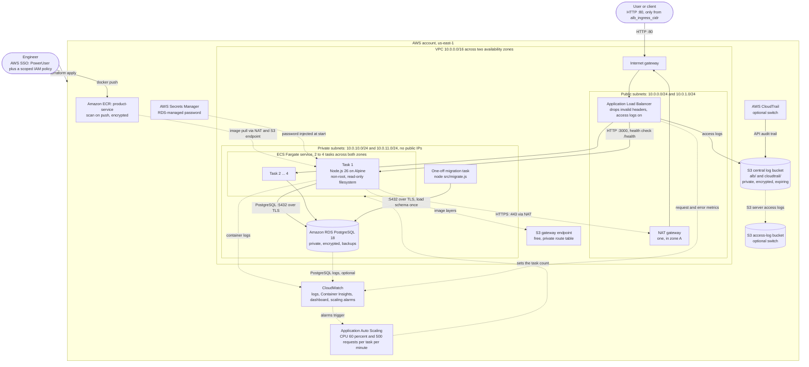
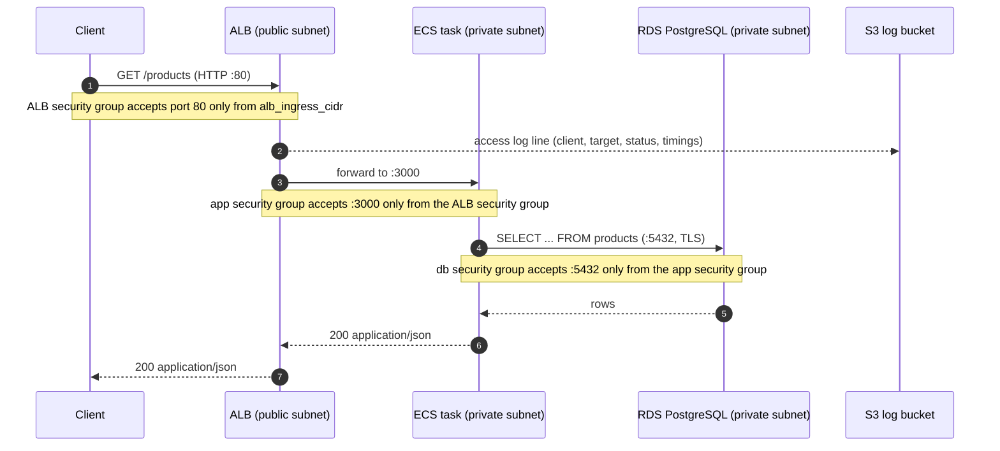
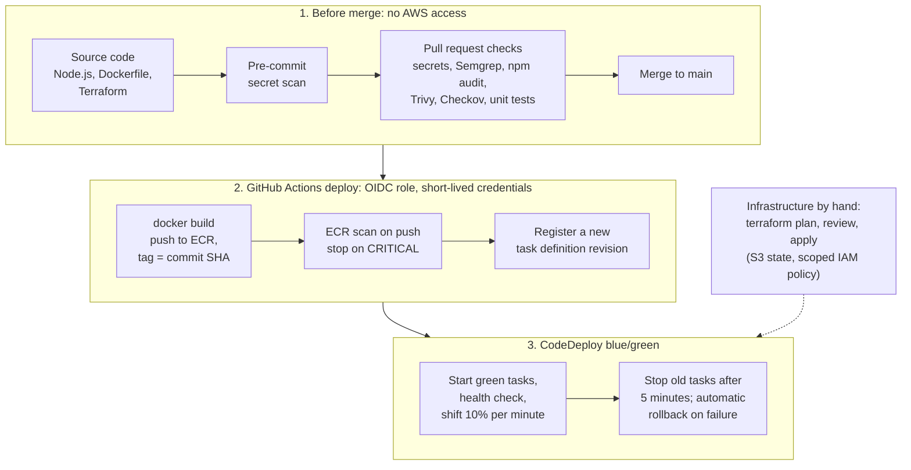
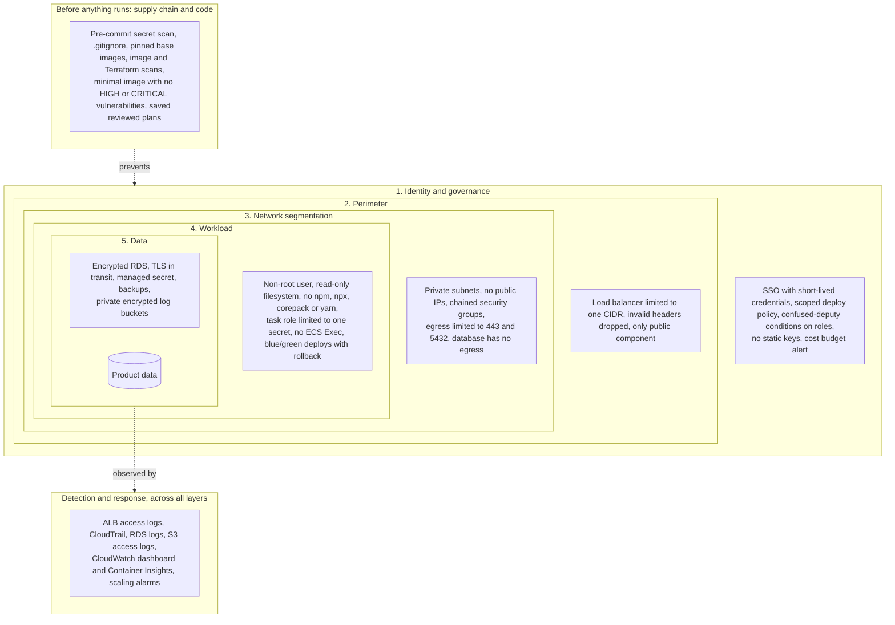
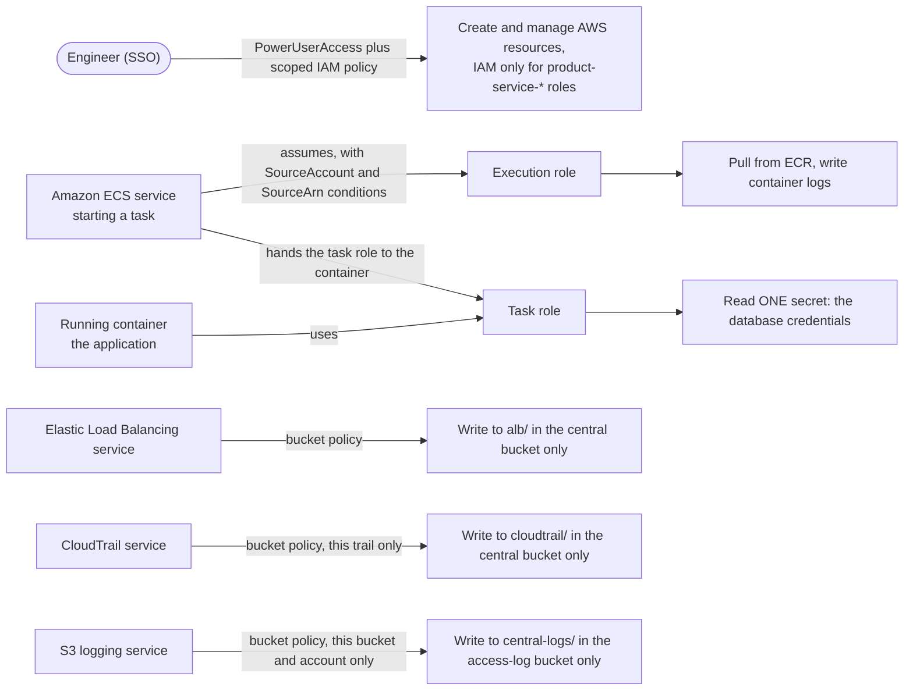
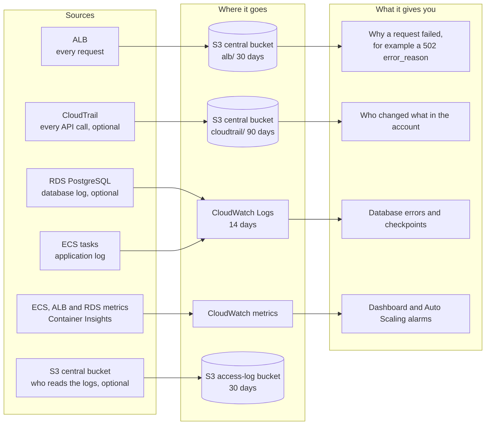

# Architecture

End-to-end architecture of the Product Service: a Node.js REST API in a container, running on Amazon ECS (Fargate) behind an Application Load Balancer, reading products from Amazon RDS for PostgreSQL, built and deployed entirely with Terraform.
This document explains each AWS service, and how the **principle of least privilege** and **defense in depth** are applied from the developer's laptop to the data.

**Status:** deployed and verified in AWS (`us-east-1`) on 2026-10-31; see [E2E_Test_Results.md](E2E_Test_Results.md). Everything described here is in the Terraform in `terraform/`, unless marked *optional* (a switch that defaults to off) or *gap* (not built). Diagrams are Mermaid, which GitHub and VS Code render.

## Contents

1. [End-to-end architecture](#1-end-to-end-architecture)
2. [Request flow](#2-request-flow)
3. [Build and deploy flow](#3-build-and-deploy-flow)
4. [AWS services and how each is secured](#4-aws-services-and-how-each-is-secured)
5. [Defense in depth](#5-defense-in-depth)
6. [Least privilege: who can do what](#6-least-privilege-who-can-do-what)
7. [Network security](#7-network-security)
8. [Data protection](#8-data-protection)
9. [Logging, monitoring and detection](#9-logging-monitoring-and-detection)
10. [Scaling and resilience](#10-scaling-and-resilience)
11. [Known gaps](#11-known-gaps)
12. [Cost](#12-cost)

## 1. End-to-end architecture

## 2. Request flow

What happens on `GET /products`, and what each hop is allowed to do:

Before the first request, ECS does the start-up work using the **execution role**, not the app: it pulls the image from ECR (through the NAT gateway, with the layers coming from S3 through the gateway endpoint),
and starts the container with the **name** of the database secret (not its value). The running app then reads the credentials from Secrets Manager itself, using its **task role**, which holds one permission: read that one secret. The password is never in the task definition or in an environment variable. See [Secrets.md](Secrets.md).

## 3. Build and deploy flow

Infrastructure changes (Terraform) are still reviewed and applied by hand; the pipeline deploys only the application. Details: [CICD.md](CICD.md).

| Stage | What it does | Security value |
|---|---|---|
| Secret scan and `.gitignore` | Blocks credentials, account IDs, personal data, state and key files from being committed | Keeps secrets out of the repository |
| Multi-stage build | Installs dependencies in a build stage and copies only the `node` binary, the modules and the app into plain Alpine; npm, npx, corepack and yarn never reach the final image | Smaller attack surface (239 MB including the AWS SDK; no HIGH or CRITICAL vulnerabilities in the Trivy scan on 2026-11-01) |
| Pull request checks | Secret scan, Semgrep (code), `npm audit` and Trivy (libraries, image, Dockerfile), Checkov (Terraform), unit tests; none has AWS access | Findings fixed or recorded as reviewed exceptions: see [vulnerability-scan-report.md](vulnerability-scan-report.md) |
| GitHub Actions deploy | Authenticates through GitHub OIDC to a role limited to one ECR repository, task definitions and one CodeDeploy deployment group | No stored AWS keys; only reviewed code on `main` can assume the role |
| ECR push and scan | Image tagged with the commit SHA; ECR scans it and the job stops on a CRITICAL finding | Each running image maps to one commit |
| CodeDeploy blue/green | New tasks start in the idle target group and must pass the ALB health check before traffic shifts, 10% per minute; old tasks stay 5 minutes | Safe releases; the automatic rollback was tested with a broken release ([Rollback_Test.md](Rollback_Test.md)) |
| `terraform plan -out`, then `apply` of the saved plan | What you reviewed is exactly what is applied (infrastructure, by hand) | No surprise changes |

## 4. AWS services and how each is secured

| Service | Role in this project | Key configuration | Security notes |
|---|---|---|---|
| **Amazon VPC** (subnets, route tables, internet gateway) | The private network everything runs in | `10.0.0.0/16`, 2 public and 2 private subnets in 2 zones; public subnets route to the internet gateway, private subnets route out only through the NAT gateway; the VPC's default security group is emptied | Segmentation: only the load balancer and NAT sit in public subnets |
| **NAT gateway** | Lets private tasks reach AWS service endpoints over HTTPS | One, in zone A, with an Elastic IP | Outbound only: nothing on the internet can start a connection to a task. A single NAT is a resilience gap. |
| **S3 gateway endpoint** | Carries ECR image-layer traffic to S3 | Free; attached to the private route table | Pulls stay on the AWS network and bypass the NAT |
| **Security groups** | Stateful firewalls for each tier | `alb`, `app`, `db`, chained (see [section 7](#7-network-security)) | Each accepts traffic only from the tier in front of it; every rule has a description |
| **Application Load Balancer** | The only public entry point; spreads traffic over the tasks and checks their health | HTTP :80 listener, target group on :3000 with `/health` checks, 30-second connection draining, access logs on | Source range limited by `alb_ingress_cidr`; drops invalid HTTP headers. HTTP only and no authentication are gaps. |
| **Amazon ECS on AWS Fargate** | Runs the containers with no servers to manage | Cluster with Container Insights; service of 2 to 4 tasks; 0.25 vCPU and 512 MB each; CodeDeploy blue/green with automatic rollback (the deployment circuit breaker when `enable_blue_green` is off); 60-second health-check grace period; capacity providers `FARGATE` and `FARGATE_SPOT`, with an optional on-demand-plus-Spot strategy (`enable_fargate_spot`, off by default; see [Fargate_Spot.md](Fargate_Spot.md)) | `awsvpc` networking, no public IPs, non-root user, read-only root filesystem, no ECS Exec, task role with no permissions |
| **Amazon ECR** | Stores the container image | Repository `product-service`, scan on push, AES-256 encryption, keeps the last 10 images | Private; pulled only by the execution role. Mutable tags are a gap. |
| **Amazon RDS for PostgreSQL** | Stores the products | PostgreSQL 18.6 on `db.t4g.micro`, 20 GB gp3, single-AZ, 7-day backups, tags copied to snapshots | In private subnets, **not publicly accessible**, encrypted at rest, reachable only from the app security group, no outbound rules |
| **AWS Secrets Manager** | Holds the database credentials | RDS creates and manages the master password (`manage_master_user_password`) and rotates it every 7 days; the app reads it at runtime ([Secrets.md](Secrets.md)) | No password in code, in the image, in the task definition, in Terraform variables or in state; only the task role can read this one secret |
| **AWS IAM** | Decides who and what can do what | Execution role, task role (read one secret), scoped deploy policy, service-linked roles | See [section 6](#6-least-privilege-who-can-do-what) |
| **AWS CodeDeploy** | Blue/green deployments of the ECS service | Application and deployment group (`terraform/codedeploy.tf`, behind `enable_blue_green`); two target groups; linear 10% per minute; automatic rollback; service role limited to this account | Started only by the pipeline role |
| **GitHub Actions + IAM OIDC** | Builds and deploys the application | Role `product-service-deploy-role` trusts only this repository (immutable owner and repository ID) in the `dev` environment; permissions are limited to the ECR repository, task definitions, two `PassRole` targets and one deployment group; created by a separately applied bootstrap stack | No stored AWS keys; the role cannot change itself |
| **Application Auto Scaling** | Adds and removes tasks with load | Two target-tracking policies: CPU 60 percent and 500 requests per task per minute; 2 to 4 tasks; scale out after 60 seconds, scale in after 300 | Capped at 4 so database connections stay bounded (10 per task) |
| **Amazon CloudWatch** | Logs, metrics, dashboard, scaling alarms | Container logs (14 days), Container Insights, an 8-chart dashboard, alarms created by Auto Scaling | Log groups have retention, so nothing is kept forever |
| **Amazon S3** (log buckets) | Stores log files | One central bucket (`alb/`, `cloudtrail/`), and an optional separate bucket for S3 access logs | Public access fully blocked, SSE-S3 encryption, TLS-only policy, one narrow policy statement per writer, per-prefix expiry |
| **AWS CloudTrail** *(optional)* | Records every API call in the account | Multi-region trail with log file validation, 90-day retention, writes to the central bucket | Audit trail of who changed what; digest files detect tampering. Account-wide. |
| **AWS Budgets** | Cost alert | $5 monthly budget with alerts at 70, 80, 90 and 100 percent, plus a forecast alert | Limits the cost of a forgotten test stack |
| **AWS SSO (IAM Identity Center)** | How the engineer signs in | PowerUserAccess permission set plus a scoped IAM policy | Short-lived credentials, no stored access keys |

### Fargate instead of EC2: what differs

This project has run on Fargate since its first deployment; it never had an EC2 launch type, so there was nothing to migrate. This section records what moving an ECS service from the EC2 launch type to Fargate involves and where each piece lives here, so the choice is explicit and checkable. For the broader comparison, the trade-offs and when to pick each, see [EC2_vs_Fargate.md](EC2_vs_Fargate.md). The application is unchanged by it: the same image, port 3000, `/health`, ALB, database and secrets.

| Concern | With the EC2 launch type | Fargate, as built here | Where |
|---|---|---|---|
| **Task definition** | `requiresCompatibilities = ["EC2"]`; any network mode; CPU and memory can be set per container | `["FARGATE"]`; `awsvpc` is required; CPU and memory are set for the whole task from the allowed pairs (256 and 512 here); `runtimePlatform` must match the image (X86_64, so the image is built with `--platform linux/amd64`) | `terraform/ecs.tf` |
| **Service** | `launch_type = "EC2"`, or a capacity provider backed by an Auto Scaling group | `launch_type = "FARGATE"`; no capacity providers | `ecs.tf`, `codedeploy.tf` |
| **Networking** | Tasks share the instance's network (`bridge` or `host`) with dynamic host ports; security groups sit on the instances | `awsvpc`: every task has its own network interface and private IP, and its own security group; the target group uses `target_type = "ip"`; tasks run in private subnets with no public IP and reach ECR and Secrets Manager through the NAT gateway (image layers through the S3 gateway endpoint) | `terraform/network.tf`, `ecs.tf` |
| **IAM** | An instance role and instance profile (`ecsInstanceRole`) so the ECS agent can register and pull; a task execution role if secrets or log drivers need it; a task role | No instance role at all (there are no instances). Only the **execution role** (ECR pull, logs) and the **task role** (read the one database secret); both trust `ecs-tasks.amazonaws.com` with `aws:SourceAccount` and `aws:SourceArn` conditions | `ecs.tf` |
| **Capacity and patching** | You run, scale and patch the instances (AMI, agent, Docker) and keep them in step with task demand | AWS runs the compute; only the service's task count is scaled (Application Auto Scaling, 2 to 4 tasks) | `terraform/autoscaling.tf` |
| **Host access** | SSH to instances, host volumes, privileged containers possible | None: read-only root filesystem, non-root user, no ECS Exec, no host mounts | `ecs.tf`, `product-service/Dockerfile` |
| **Cost** | Instance hours, whether or not tasks fill them | Per task, per second, for the vCPU and memory requested (about $0.012 an hour for one 0.25 vCPU and 512 MB task in us-east-1, before the NAT gateway, ALB and RDS) | [Cost](#12-cost) |

**What to check if you migrate a service like this:** that the image matches the CPU architecture; that the `awsvpc` security groups allow the load balancer to reach the task port; that the target group type is `ip`; that private subnets have a route to ECR (NAT or interface endpoints); and that the execution role can pull the image and read any secrets named in the task definition. Tasks that fail to start with an ECR or Secrets Manager error are almost always one of these.

**Verification:** `scripts/verify-deployment.sh` has a "Fargate (no EC2)" section with three checks: the service and every running task report the `FARGATE` launch type; the task definition is `["FARGATE"]` only, uses `awsvpc` and has an execution role; and the cluster has no EC2 container instances and no capacity providers. On 2026-11-01 all three pass, and the two running tasks report platform version 1.4.0.

## 5. Defense in depth

An attacker, or an honest mistake, has to get past several independent layers. No single control is trusted to be enough.

| Layer | Controls in this project | What it stops |
|---|---|---|
| **0. Supply chain and code** | Secret scanner as a pre-commit hook; `.gitignore` for keys, state and `*.tfvars`; pinned Node and Alpine images; Trivy and `npm audit` on the image; Trivy and Checkov on Terraform; a multi-stage build that leaves npm out; saved plans | Secrets in git, vulnerable dependencies and base images, insecure infrastructure code, unreviewed changes |
| **1. Identity and governance** | SSO sign-in; the engineer's IAM policy limited to `product-service-*` roles; trust policies requiring `aws:SourceAccount` and `aws:SourceArn`; a budget alert | Stolen long-lived keys, privilege escalation through role creation, the confused-deputy problem, runaway cost |
| **2. Perimeter** | The ALB is the only internet-facing resource; `alb_ingress_cidr` limits who can reach it; invalid headers are dropped | Direct access to tasks or the database, malformed-request attacks. *Gap: HTTP only, no authentication, no WAF.* |
| **3. Network segmentation** | Tasks and database in private subnets with no public IPs; security groups that only accept the previous tier; app egress only to 443 and the database; no database egress; S3 gateway endpoint | Lateral movement, data exfiltration over unexpected ports, inbound connections to private resources |
| **4. Workload** | Non-root `node` user; read-only root filesystem; minimal image with no npm, npx, corepack or yarn; task role limited to the one database secret; no ECS Exec; health checks; CodeDeploy blue/green with automatic rollback (the ECS circuit breaker is used only when `enable_blue_green` is off) | A compromised container being able to write files, escalate, call AWS APIs, or stay broken after a bad release |
| **5. Data** | RDS encrypted at rest and private; TLS to the database; password only in Secrets Manager; private encrypted S3 buckets with a TLS-only policy; 7-day backups | Reading data at rest or in transit, leaked credentials, public log buckets |
| **Detection** | ALB access logs, CloudTrail with log file validation, RDS logs, S3 access logs, Container Insights, dashboard | Attacks and mistakes going unnoticed, and tampering with the audit trail |

## 6. Least privilege: who can do what

Every identity gets only what it needs, and each grant is scoped to named resources.

| Principal | Allowed | Specifically not allowed |
|---|---|---|
| **ECS execution role** (used by ECS to start a task) | The AWS-managed ECS execution policy (pull images, write logs) and nothing else | Reading any secret (the database secret is read by the task role, not by this role), any other AWS service, any other AWS service, or acting as anyone else. Only ECS in this account can assume it (`aws:SourceAccount`, `aws:SourceArn`). |
| **ECS task role** (the app's own identity) | `secretsmanager:GetSecretValue` on the one database secret, so the app can read its credentials at runtime | Every other AWS API call. A compromised app cannot read S3, other secrets or the account. |
| **Engineer (SSO)** | PowerUserAccess for everything except IAM, plus the scoped policy ([iam/product-service-iam-policy.json](iam/product-service-iam-policy.json)): create and manage roles named `product-service-*`, attach **only** the ECS execution policy, and pass those roles **only** to `ecs-tasks.amazonaws.com` | Creating other roles or users, attaching broad policies such as AdministratorAccess to the roles, or passing roles to other services |
| **ALB (ELB service account)** | `s3:PutObject` under `alb/AWSLogs/<account>/` in the central bucket | Reading logs, writing elsewhere |
| **CloudTrail** | `s3:GetBucketAcl` and `s3:PutObject` under `cloudtrail/AWSLogs/<account>/`, only for this trail's ARN and with bucket-owner ownership | Any other write |
| **S3 server access logging** | `s3:PutObject` under `central-logs/` in the access-log bucket, only for the central bucket and this account | Any other write |
| **Database** | Accepts connections from the app security group on 5432 | Everything else: no inbound from anywhere else, **no outbound rules** |
| **Application Auto Scaling, ELB, RDS, ECS** | Service-linked roles that AWS creates with fixed permissions | Not managed by this project |

## 7. Network security

Traffic is allowed only from the tier in front, and only on the port needed.

| Security group | Inbound | Outbound |
|---|---|---|
| **`alb`** (load balancer) | TCP 80 from `alb_ingress_cidr` | TCP 3000 to the VPC CIDR |
| **`app`** (ECS tasks) | TCP 3000 from the `alb` group only | TCP 443 to `0.0.0.0/0` (AWS service endpoints through the NAT), and TCP 5432 to the `db` group |
| **`db`** (RDS) | TCP 5432 from the `app` group only | **None** |
| **VPC default security group** | None | None (emptied, so nothing can use it by accident) |

Other network controls: tasks and the database have no public IPs; the private route table reaches the internet only through the NAT gateway (outbound only); an S3 gateway endpoint keeps image-layer traffic off the NAT; the load balancer drops invalid HTTP headers.
`alb_ingress_cidr` is a **required** variable with no default, and `0.0.0.0/0` is refused unless `allow_public_alb = true`, so an open load balancer is always deliberate. (This was added after a plan without the settings file silently fell back to an open default and reopened the load balancer during the AWS test; see [E2E_Test_Results.md](E2E_Test_Results.md).)
**Gaps:** traffic to the ALB is plain HTTP and the API has no authentication; the 443 egress rule allows any destination.

## 8. Data protection

| Data | At rest | In transit | Access |
|---|---|---|---|
| Product data (RDS) | Encrypted (AWS-managed key), 7-day backups | TLS from the app. The server certificate is **not verified** (gap) | Only the app security group, with the managed password |
| Database credentials | In Secrets Manager, created and managed by RDS, rotated automatically every 7 days (the secret's metadata shows a first rotation shortly after creation; a forced rotation was tested live: a retry race was found and fixed, and the re-test passed; see [Secrets.md](Secrets.md#live-rotation-test)) | Fetched by the app at runtime over TLS with its task role, and again after a rotation ([Secrets.md](Secrets.md)) | The task role, for that one secret; never in code, image, task definition, variables or state |
| Container image | ECR, AES-256 | Pulled over HTTPS | The execution role |
| Log files (S3) | SSE-S3, public access blocked, expiring | TLS-only bucket policy | Narrow per-writer policy statements |
| Client traffic | n/a | **HTTP only** (gap: needs a domain and an ACM certificate) | Limited by `alb_ingress_cidr` |

## 9. Logging, monitoring and detection

| Log or metric | Answers | Stored | Retention |
|---|---|---|---|
| ALB access logs | Which client called which URL, which task answered, status, timings, `error_reason` for 5XX | S3 `alb/` | 30 days |
| CloudTrail *(optional)* | Who made which API call, from where, and whether it changed anything | S3 `cloudtrail/` | 90 days |
| RDS PostgreSQL and upgrade logs *(optional)* | Database errors, checkpoints, upgrades | CloudWatch Logs | 14 days |
| S3 server access logs *(optional)* | Who read or changed the log files | Separate S3 bucket | 30 days |
| Application logs | Each request (method, path, status, duration, a `request_id` matching the ALB's trace ID), errors with a stack on a 500, database up and down changes. Structured JSON; no query strings or passwords. *(Deployed and verified in AWS.)* | CloudWatch Logs `/ecs/product-service` | 14 days |
| Container Insights and the dashboard | CPU and memory reserved and used, desired, running and pending tasks, request count, 4XX and 5XX, latency, target health | CloudWatch metrics | CloudWatch default |

The commands to turn each on and read it are in the [logging runbook](Logging_Runbook.md). **Gap:** there are no alarms of our own (for example on 5XX responses or unhealthy targets); only the scaling alarms exist.

## 10. Scaling and resilience

| Concern | What exists | Evidence |
|---|---|---|
| Spread over zones | Tasks in two private subnets (two zones); ALB across two public subnets | 2 tasks per zone at 4 tasks in the test |
| Scale out and in | Auto Scaling, 2 to 4 tasks, CPU and request-rate targets | Scale-out 2 to 4 within about 6 minutes of sustained load; scale-in began about 18 minutes after the load ended |
| Safe releases | CodeDeploy blue/green with automatic rollback, 60-second grace period, 30-second drain | Many successful deployments; a broken release was tested: no failed request and a rollback in about 35 seconds, but CodeDeploy did not fail it by itself in 30 minutes ([Rollback_Test.md](Rollback_Test.md)) |
| Self-healing | ECS replaces failed tasks; the ALB health check stops sending traffic to an unhealthy one | Not yet tested by stopping a task |
| Data durability | 7-day automated RDS backups | Not restored in a test |
| **Gaps** | One NAT gateway (zone A) and a single-AZ database: a zone failure would affect outbound access or the database | |

## 11. Known gaps

These are deliberate demo trade-offs or work not yet done. The full table, with the planned fix for each, is in the [README](../README.md#open-security-gaps).

| Gap | Why it matters |
|---|---|
| HTTP only, no authentication, no WAF | Traffic is unencrypted and anyone allowed through the security group can read the products. The fix needs a domain and certificate. |
| Database TLS does not verify the server certificate | A network-position attacker could in theory impersonate the database |
| Mutable ECR tags | `latest` can be overwritten, and rollbacks by tag are unreliable |
| Single NAT gateway and single-AZ RDS | Not resilient to a zone failure |
| HTTPS egress to anywhere (443) | The remaining open outbound rule; interface VPC endpoints would remove it, at extra cost |
| No alarms for errors or unhealthy targets | Failures are visible only if someone looks |
| No distributed tracing; no Lambda in this project | X-Ray tracing would need the SDK and a sidecar; there is no Lambda function to trace |
| Infrastructure applied by hand, shared state bucket, one environment, `main` not protected while the repo is private | Single-operator; the pipeline deploys only the application; see the README roadmap |
| One ALB 502 during a load test, cause probable but not proven | Node's 5-second keep-alive was shorter than the ALB's 60-second idle timeout; the fix is deployed (`server.js`), and a repeat 8-minute load test (33,600 requests) had zero 5XX, which is consistent with the fix but not proof |

## 12. Cost

The stack costs about **$0.14 to $0.17 an hour** while running (NAT gateway about $0.045, ALB about $0.03, Fargate tasks about $0.012 each per hour, RDS about $0.02, public IPv4 addresses about $0.015, plus small CloudWatch and S3 charges).
It is designed to be created for a test and destroyed: nothing is left billing after `terraform destroy` except cents of ECR storage. Optional logs add cents. A $5 budget alert is in place. Details are in the [README](../README.md#cost-awareness).

## Image copies of the diagrams

The Mermaid diagrams above are the source. For viewers that don't render Mermaid, PNG copies are in `docs/images/`: [overview](images/architecture-overview.png), [request flow](images/architecture-request-flow.png),
[build and deploy](images/architecture-build-deploy.png), [defense in depth](images/architecture-defense-in-depth.png), [least privilege](images/architecture-least-privilege.png) and [logging](images/architecture-logging.png).
All six diagrams were rendered with `mermaid-cli` 12.0.0 on 2026-10-31, which confirms their syntax. The PNGs are generated from the Mermaid text, so they go stale if a diagram is edited; regenerate them with `mmdc -i diagram.mmd -o diagram.png`.
The overview is tall because it shows every connection, so open the image at full size.

## Related documents

| Document | Contents |
|---|---|
| [README](../README.md) | Overview, security design, gaps and how to try it |
| [terraform/README.md](../terraform/README.md) | Every Terraform file, variable and output, and the network diagram |
| [Secrets.md](Secrets.md) | The database credentials in Secrets Manager: how the app reads them, rotation, IAM, rollout and debugging |
| [runbook.md](runbook.md) | Deploy, release, roll back, scale, troubleshoot, tear down |
| [Fargate_Spot.md](Fargate_Spot.md) | Fargate and Fargate Spot capacity providers: strategy, high availability, enabling and checking it |
| [EC2_vs_Fargate.md](EC2_vs_Fargate.md) | EC2 and Fargate compared: differences, cost, trade-offs, when to use which, and why this project uses Fargate |
| [ECR_Runbook.md](ECR_Runbook.md) | Create the repository, authenticate, build and push the image |
| [Logging_Runbook.md](Logging_Runbook.md) | Turn on, verify and read each log |
| [vulnerability-scan-report.md](vulnerability-scan-report.md) | Scans, findings, fixes and accepted exceptions |
| [E2E_Test_Results.md](E2E_Test_Results.md) | What was deployed and verified in AWS, and the incident |
