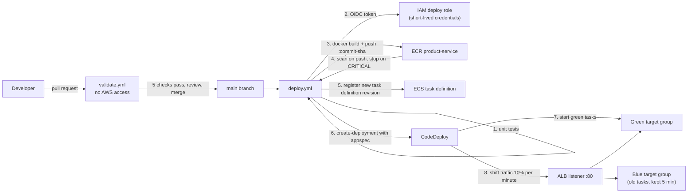

# CI/CD: GitHub Actions and CodeDeploy blue/green

Commands, verification and troubleshooting for day-to-day deployments are in [Deployment.md](Deployment.md); this page explains the design and the one-time setup.

A push to `main` that changes the application or its deployment files (`product-service/**`, `appspec.yaml`, `deploy.yml`) builds the Docker image, pushes it to the existing ECR repository and deploys it to the existing ECS service with an AWS CodeDeploy blue/green deployment. Pull requests run checks only and never touch AWS.

> **Status (2026-11-01): deployed and verified once.** The first real run (a push to `main`, commit `80fae1d`) built the image, pushed it tagged with the commit SHA, passed the ECR scan gate, registered a new task definition revision and ran a CodeDeploy blue/green deployment with the linear 10%-per-minute config. Traffic moved from the old to the new target group in about 10 minutes, the old tasks were stopped after the 5-minute wait, the deployment ended `Succeeded` (about 16 minutes in total), and `/health` and `/products` returned 200 throughout. Five more deployments followed (the merges of PRs #9, #10, #11 and #16, and a manual run that moved the tasks to the new task definition) and also succeeded. The verify script reports no failures (the drift check is run separately: no changes). The automatic rollback and the request-based scaling expression were tested on 2026-11-02: see [Rollback_Test.md](Rollback_Test.md) (a crashing release never reached users; the rollback restored the original state in about 35 seconds, but CodeDeploy had not failed the deployment by itself after 30 minutes) and [Load_Test_and_Optimization.md](Load_Test_and_Optimization.md). Before that, validation covered `terraform fmt`/`validate` on both stacks, both `terraform plan` runs, `actionlint`, Checkov, Semgrep, Trivy and `npm audit`, with all six pull request checks passing in GitHub Actions.

## Why GitHub Actions instead of CodePipeline and CodeBuild

The original requirement named CodePipeline and CodeBuild. This project uses GitHub Actions for the pipeline instead (the same approach as the sibling `secure-event-driven-orders-aws` repository), and keeps CodeDeploy for the blue/green part:

| Requirement item | How it is met |
|---|---|
| CodePipeline stages | Jobs in `.github/workflows/deploy.yml` (`test`, then `deploy`) |
| CodeBuild project, `buildspec.yml` | Not needed. The `docker build` runs on the GitHub runner, so there is no `buildspec.yml` |
| Push to the existing ECR repository | `deploy.yml`, tagged with the git commit SHA |
| Task definition update | `deploy.yml` copies the running task definition, swaps the image and registers a new revision |
| CodeDeploy application and deployment group | `terraform/codedeploy.tf` |
| `appspec.yaml` | [appspec.yaml](../appspec.yaml) |
| IAM roles | CodeDeploy service role (`terraform/codedeploy.tf`) and the GitHub OIDC deploy role (`terraform/bootstrap/`) |
| Template language | Terraform, as in the rest of the project (not CloudFormation) |

## Flow



1. **Unit tests** (`npm ci`, `npm test`).
2. **Authenticate** with GitHub OIDC. The job gets short-lived credentials for `product-service-deploy-role`. No AWS keys are stored.
3. **Build and push** the image, tagged with the commit SHA (`:latest` is not touched), so every running image maps to one commit.
4. **Gate on the ECR scan.** The job waits for the scan that runs on push and stops if there is a CRITICAL finding.
5. **Register a task definition revision.** The current task definition is the template, so CPU, memory, roles, environment and secrets stay as Terraform defined them. Only the image changes.
6. **Start the CodeDeploy deployment** with `appspec.yaml`, where `<TASK_DEFINITION>` is replaced by the new revision's ARN.
7. **CodeDeploy** starts the new tasks in the idle target group and waits for them to pass the ALB health check (`/health`).
8. **Traffic shifts** gradually (`CodeDeployDefault.ECSLinear10PercentEvery1Minutes`, about 10 minutes). The old tasks stay for 5 minutes after the switch, so a rollback is instant.
9. **`:latest` moves to the deployed image.** After a successful deployment the image also gets the `latest` tag, so a service that Terraform creates or recreates can always pull its image (see the table below).
10. **Automatic rollback.** If the new tasks never become healthy, traffic never moves and the deployment fails. The workflow fails and prints CodeDeploy's error.

## One-time setup

Run these yourself, in order. Nothing here is run by the pipeline.

### 1. GitHub repository

The repository `secure-containerized-microservices-app-aws` has the same name as this folder. It was created private; the settings below match the sibling repository where the plan allows.

```bash
git push -u origin main        # after the first commit (scan first: python3 scripts/secret-scan.py --all-tracked)
```

After the first push, protect `main` (the check names come from `validate.yml`):

```bash
gh api -X PUT repos/bdahiya2007/secure-containerized-microservices-app-aws/branches/main/protection --input - <<'EOF'
{
  "required_status_checks": {"strict": true, "contexts": [
    "Validate Terraform and appspec", "Scan for secrets and sensitive data",
    "Product Service unit tests", "Build and scan the container image", "Code security scan (Semgrep)", "Terraform security scan"]},
  "enforce_admins": true,
  "required_pull_request_reviews": {"required_approving_review_count": 0},
  "restrictions": null,
  "allow_force_pushes": false,
  "allow_deletions": false
}
EOF
```

Branch protection on a private repository needs a paid GitHub plan. It was refused here (HTTP 403), so `main` is **not protected yet**: apply the command above when the repository becomes public. Until then, use pull requests by habit and run the secret scan before merging.

### 2. Pin the OIDC trust to this exact repository

```bash
gh api -X PUT repos/bdahiya2007/secure-containerized-microservices-app-aws/actions/oidc/customization/sub -F use_default=true -F use_immutable_subject=true
gh api repos/bdahiya2007/secure-containerized-microservices-app-aws/actions/oidc/customization/sub --jq .sub_claim_prefix
```

The second command prints `repo:<owner>@<id>/<repo>@<id>`. A deleted and re-created repository with the same name gets a new ID, so it cannot assume the role.

### 3. Create the deploy role (bootstrap stack)

```bash
cd terraform/bootstrap
terraform init
terraform apply -var 'github_sub_prefix=repo:<owner>@<id>/<repo>@<id>'
terraform output -raw deploy_role_arn
```

**Permissions first.** The scoped policy in [iam/product-service-iam-policy.json](iam/product-service-iam-policy.json) was widened for this pipeline: it now also lets the engineer attach `AWSCodeDeployRoleForECS` and pass `product-service-*` roles to `codedeploy.amazonaws.com`. Update the policy on your SSO permission set (replace `ACCOUNT_ID`), then sign in again, before step 3 and step 5. A PowerUserAccess role cannot read or list IAM OIDC providers, so `aws iam get-open-id-connect-provider` is denied; that does not matter, because the bootstrap stack only builds the provider's ARN and never reads it. The deploy fails at the login step if the provider is missing.

This needs the account's GitHub OIDC provider (`token.actions.githubusercontent.com`) to exist. If it does not, create it once in IAM (audience `sts.amazonaws.com`); the bootstrap stack references it and does not create it. The deploying identity also needs permission to create a role named `product-service-deploy-role`; [iam/product-service-iam-policy.json](iam/product-service-iam-policy.json) allows roles named `product-service-*`.

### 4. Store the role ARN as a secret

```bash
gh secret set AWS_DEPLOY_ROLE_ARN -R bdahiya2007/secure-containerized-microservices-app-aws
```

Paste the ARN when asked. It is the only secret the pipeline needs.

### 5. Switch the stack to blue/green

> **This replaces the ECS service.** ECS cannot change a service's deployment controller in place, so Terraform deletes the rolling-update service and creates the CodeDeploy-controlled one. Expect a short outage while the new service starts its tasks. Do it in a quiet moment, and review the plan first.

```bash
cd terraform
terraform plan -var enable_blue_green=true      # expect: service replaced, + green target group, CodeDeploy app, deployment group, role
terraform apply -var enable_blue_green=true
```

The old and new services have the same name, and Terraform may start creating the new one while the old one is still draining. If the apply stops with an error that the service already exists (or is not idempotent), wait until `aws ecs describe-services` shows the old service as `INACTIVE`, then run the same apply again; it continues from where it stopped.

To keep it on, set `enable_blue_green = true` in `terraform/demo.auto.tfvars`. (`-var` applies to one run only.)

### 6. First deployment

Push to `main`, or run **Actions, Deploy, Run workflow**. Watch it in the Actions tab and in the CodeDeploy console.

## Rollback

- **Automatic:** a failed deployment returns traffic to the old tasks.
- **During the 5-minute wait after a successful switch:** in the CodeDeploy console, stop the deployment, or redeploy the previous commit by re-running the previous workflow run.
- **Later:** revert the commit on `main`. The workflow deploys the reverted code as a new blue/green deployment.

## Security scans

Every pull request runs these (none needs AWS access). All must pass before merge; the first four fail the check on HIGH or CRITICAL findings.

| Scan | Tool | Covers |
|---|---|---|
| Secrets and sensitive data | `scripts/secret-scan.py` | every commit in the PR and all tracked files (also the pre-commit hook) |
| Code (SAST) | Semgrep 1.183.0, rule sets `nodejs`, `javascript`, `owasp-top-ten`, `secrets` | `product-service/src` |
| Libraries | `npm audit --omit=dev` and Trivy `fs` on the lock file | production dependencies |
| Container image | Trivy `image` (vulnerabilities and embedded secrets) and Trivy `config` (Dockerfile) | the image built from the PR, never pushed |
| Infrastructure as code | Checkov 3.3.29 with the reviewed exceptions in `.checkov.yaml` | `terraform/`, including `terraform/region-b/` |
| Rotation function (DR design) | Python unit tests (standard library only, no AWS access) and Semgrep with the Python rules (`p/python`, `p/owasp-top-ten`, `p/secrets`) | `lambdas/db-rotation/` |

**Also, every week** (`.github/workflows/scheduled-scan.yml`, Mondays 06:17 UTC, and on demand): the image is rebuilt from `main` with a freshly pulled base image and scanned with Trivy (full findings go to the Security tab; the run fails on HIGH or CRITICAL findings that have a fix), and the production dependencies are audited. PR checks only run when something changes, so this is what catches a new vulnerability in the base image or a dependency in between. GitHub emails the owner if a run fails.

**Terraform validation** also covers the Region B stack: the validate job runs `terraform init -backend=false` and `terraform validate` for `terraform/`, `terraform/bootstrap/` and `terraform/region-b/`, and `terraform fmt -check` for all of them. Checkov ignores resources behind a switch that is off (`enable_aurora`), so checks on those resources first show up on code that builds them unconditionally; the exceptions in `.checkov.yaml` cover both.

On deploy, the ECR scan-on-push result is a final gate (CRITICAL stops the deployment). Dependabot proposes weekly updates for GitHub Actions, npm packages, the Docker base images and Terraform providers; each update goes through the same checks.

Trivy skips vulnerabilities that have no fixed version yet (`--ignore-unfixed`), because there is nothing to upgrade to; those still appear in the ECR scan. The scanner versions are pinned, so a new rule set arrives through a Dependabot or manual version bump, not silently. Not yet run in GitHub Actions: the first run may flag findings or need rule tuning.

## Security design

| Control | Detail |
|---|---|
| No stored AWS keys | GitHub OIDC; credentials last about an hour |
| Trust policy | Audience `sts.amazonaws.com`, subject pinned to this repository by immutable owner and repository ID, and to the `dev` GitHub environment. Pull requests, other branches and forks cannot match |
| Pull requests have no AWS access | `validate.yml` uses no credentials and `permissions: contents: read` |
| Deploy role is narrow | ECR push to one repository, register task definitions, PassRole only for the project's two ECS roles and only to `ecs-tasks.amazonaws.com`, `ecs:DescribeServices` on the one service (to read its Fargate / Fargate Spot strategy), create deployments only for one CodeDeploy deployment group. No Terraform, S3, RDS, VPC or IAM-change permissions |
| Role cannot change itself | Explicit deny on `iam:*` for its own role. The role is created by the manually applied bootstrap stack, never by the pipeline |
| Only reviewed code deploys | `main` requires a pull request and the six checks, administrators included; the `dev` environment accepts protected branches only |
| Supply chain | Every action is pinned to a full commit SHA (enforced by the repository setting and by `scripts/check-appspec.py`); Dependabot proposes updates weekly; `npm ci` installs the exact lock file; `npm audit` fails on high findings; the ECR scan gates the deployment |
| Secrets and sensitive data | The secret scan runs on every pull request and in the pre-commit hook; the account ID is masked in the logs |
| One deployment at a time | `concurrency` group, never cancelled midway |
| CodeDeploy service role | AWS managed policy `AWSCodeDeployRoleForECS`, trust limited to CodeDeploy acting for this account |

## Limitations and next steps

- **A bad release does not fail by itself.** A crashing release was deployed on 2026-11-02 ([Rollback_Test.md](Rollback_Test.md)): users were never affected and the rollback worked, but CodeDeploy was still retrying after 30 minutes, so the rollback was triggered by hand. A container that starts but fails its health check was not tested.
- **`main` is not protected** while the repository is private on a free plan (see step 1).
- **Dependabot's Terraform provider bump to 6.x** (pull request #2) is a major version change; plan it against the live state before merging.
- **Switching to blue/green replaces the service** and causes a short outage. Production would use a blue/green setup from the start.
- **No test listener or lifecycle hooks.** CodeDeploy shifts production traffic directly. Add a test listener port plus a `BeforeAllowTraffic` hook (a Lambda that calls `/products`) for pre-traffic checks.
- **No CloudWatch alarm rollback.** Add alarms (5xx rate, target response time) to the deployment group so a bad release rolls back on metrics, not only on failed health checks.
- **Terraform is still applied by hand.** The pipeline deploys the application only. A Terraform pipeline needs remote state and a separate, broader role.
- **Mutable ECR tags.** SHA tags are unique, but a tag can still be overwritten (`CKV_AWS_51`). Making the repository immutable also requires moving the Terraform task definition off `:latest`.
- **One environment** (`dev`). A `prod` environment with a required reviewer needs the repository to be public or a paid plan.
- **The ALB is restricted to one IP,** so the pipeline cannot run an end-to-end smoke test from the runner. CodeDeploy's health checks are the gate.

## Two target groups: what it changes

With `enable_blue_green`, CodeDeploy alternates live traffic between `product-service-tg` (blue) and `product-service-tg-green`, so anything that watches one target group sees nothing while the other is live. Found after the first deployment and handled:

- **Request-based scaling:** the built-in `ALBRequestCountPerTarget` metric names one target group. In blue/green mode the policy uses a metric-math expression instead: `(FILL(blue requests, 0) + FILL(green requests, 0)) / running tasks`, with the running-task count from Container Insights. The target value is the same `autoscaling_requests_per_target`. The CPU policy was never affected.
- **Dashboard:** the request-per-task and healthy-host charts show both target groups (the idle one reads zero), and response time uses the load-balancer-level metric.
- **`verify-deployment.sh`:** asks the listener which target group has the traffic.

## What the first runs found

Running against AWS exposed four problems that offline checks could not. All are fixed.

| Problem | Cause | Fix |
|---|---|---|
| Deploy failed at the AWS login | `AWS_DEPLOY_ROLE_ARN` was empty (a hidden paste in `gh secret set` came through empty) | Set the secret from the Terraform output with `printf '%s' "$ARN" \| gh secret set` |
| `terraform apply` failed creating the service | ECS keeps a deleted service in `DRAINING`, so the same name cannot be reused at once | Wait for `INACTIVE` and re-run the apply (documented in step 5) |
| `verify-deployment.sh` rollout check failed | A CodeDeploy-controlled service reports no `deployments`; steady state is on the task set | The script reads the primary task set when the controller is `CODE_DEPLOY` |
| A service recreated by Terraform could not start: `CannotPullContainerError ... failed to resolve ref` | Terraform's task definition names `:latest`. The pipeline pushes only commit-SHA tags, and the ECR rule "keep the last 10 images" had expired the original `latest` image, so the tag no longer existed (found when enabling Fargate Spot, which replaces the service; about 7 minutes of extra outage) | `:latest` was re-created by hand on the running image, and the workflow now moves `:latest` to every image that passed the scan and deployed successfully |
| After replacing the service, every request returned 503 although the tasks were healthy | CodeDeploy had left the listener on the green target group; a service created by Terraform registers in blue (found in the Fargate Spot test: about 8 extra minutes of outage) | The listener is pointed back at blue by hand, and Terraform now replaces the listener together with the service |
| Deploy failed at the ECR scan wait | `aws ecr wait image-scan-complete` fails with `ScanNotFoundException` right after the push | The step polls the scan status for up to 5 minutes |
