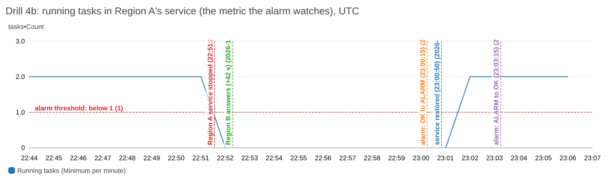
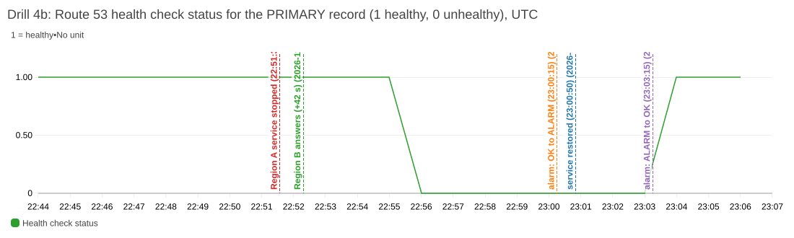
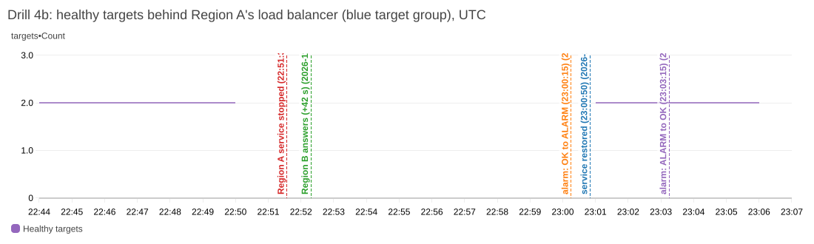
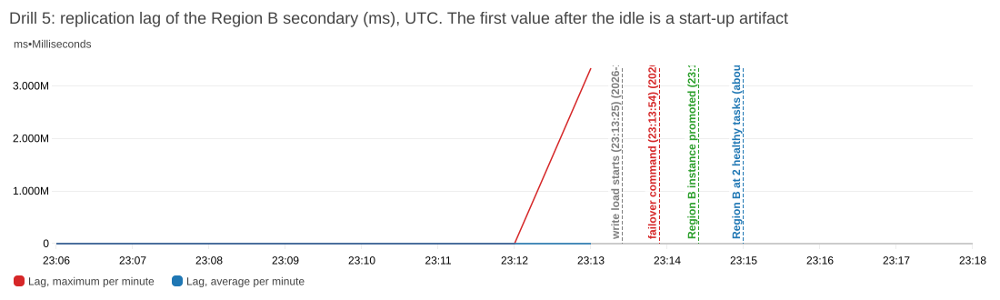
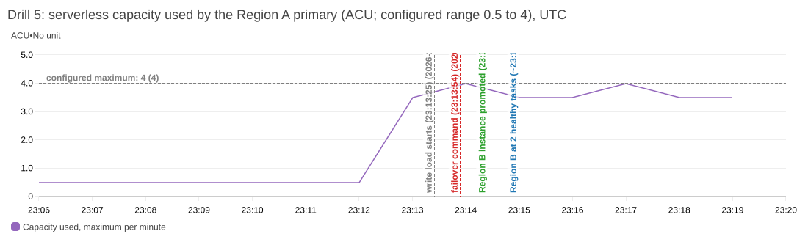
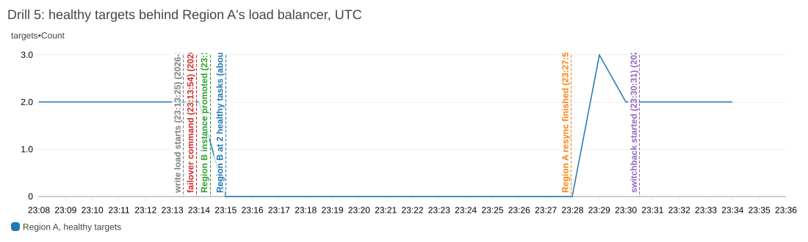
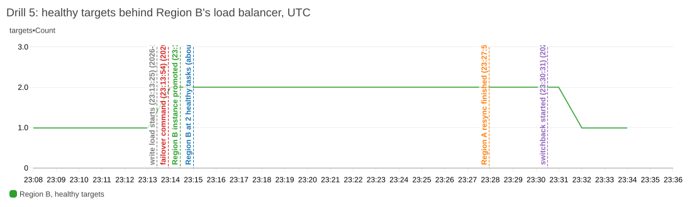

# Disaster recovery: what was built, what the drills showed, what went wrong, and how to troubleshoot

**Status: one paid session on 2026-11-07; all drills recorded.** Drills 1 to 5 are below, with CloudWatch evidence (alarm state history, per-minute data and charts) for 4b and 5. The stack is destroyed after the session; the teardown is recorded in [section 6](#6-teardown-and-leftovers). Everything here is measured from the live session unless it says "hypothesis". Costs are estimates; Cost Explorer lags by many hours.

How to read it: [the session in one table](#1-the-session-at-a-glance), [the results of each drill](#2-results-by-drill), [every problem, with cause and fix](#3-issues-found-and-how-they-were-resolved), [a troubleshooting guide by symptom](#4-troubleshooting-guide), and [what is still unproven](#5-what-is-still-unproven). The plan the session followed is [DR_Runbook.md](DR_Runbook.md), the design is [DR_Design_Decisions.md](DR_Design_Decisions.md).

## 1. The session at a glance

| | |
|---|---|
| **Date** | 2026-11-07 (times below are UTC) |
| **Shape** | Region A (us-east-1): the full stack on an **Aurora Global Database primary** (Serverless v2, 0.5 to 4 ACU). Region B (us-west-2): its own network, an **Aurora secondary**, an HTTPS load balancer and **one** ECS task. Route 53 failover for the main name. The database password is in a **self-managed, replicated secret** rotated by a Lambda function |
| **Build** | Main stack: 70 resources planned; the first apply stopped on two errors (section 3, issues 1 and 2) and a second apply (6 added, 1 destroyed) completed it. Region B stack: **43 resources, no errors** |
| **Verification** | `verify-deployment.sh`: **37 passed, 1 failed, 4 skipped**. The one failure was ALB access logs not yet delivered on a brand-new load balancer. All seven new HTTPS, Aurora, rotation and failover checks passed on their first real run |
| **Cost** | Region A's stack was up about 3 hours and Region B's about 2 hours 10 minutes: an estimated $1.50 to $2.00 (list prices; Cost Explorer lags by many hours). The AWS budget alert had been raised to $15 first |

**Results in one line each**

| Drill | Result |
|---|---|
| 1. Replication lag under write load | **Passed.** 30,295 inserts in 60 s: lag at most **728 ms**, average **64 ms** (target: under 60,000 ms) |
| 2. Password rotation end to end | **Failed first, a real flaw found and fixed; re-run passed.** 104 s, 141 of 141 requests answered |
| 3. Planned switchover to Region B and back | **Completed (56 s and 53 s), with a finding:** about **32 s of failed reads** on the main name; the expectation of "no gap" was wrong |
| 4. DNS failover (Region A's app stopped) | **Passed.** Region B answered the main name within about **56 s**; 12 failed probe requests over about 24 s; HTTPS stayed valid. The alarm path was **not** exercised (see 4b) |
| 4b. The alarm path (Region A kept down 9 minutes) | **Passed, with a correction to the design's assumptions.** Three separate signals fired at very different times: Region B answered at **+42 s**, the Route 53 health check went unhealthy at about **+4.5 to 5.5 min**, and the CloudWatch **alarm state** changed only at **+8 min 41 s**. Route 53 follows the metric's data, not the alarm's state |
| 5. Database failover with data loss allowed, under a write load of about 520 inserts a second | **Passed.** **0 rows lost** (20,764 acknowledged on Region A, 20,764 present in Region B). The database writer was ready in Region B **31 to 38 s** after the command; Region B had two healthy tasks at **+65 s**. The **main name was answered by Region B at +181 s**: users saw about **2 min 48 s** of failed requests, mostly because Region A's tasks kept running but failed their health checks. The old primary then **resynced for 13 min 20 s** before a fail-back was possible (the fail-back itself took 59 s) |

## 2. Results by drill

### Setup used by every drill

Shell variables, and the helper that says which Region is the writer (real names are kept out of the repository; angle brackets are placeholders):
```bash
export ACC=$(aws sts get-caller-identity --query Account --output text)
export MAIN=<main app name> USW2=<Region B name> GC=<project>-global
export ARN_A=arn:aws:rds:us-east-1:$ACC:cluster:<project>-aurora
export ARN_B=arn:aws:rds:us-west-2:$ACC:cluster:<project>-b-aurora
writer() { aws rds describe-global-clusters --region us-east-1 --global-cluster-identifier $GC \
  --query 'GlobalClusters[0].GlobalClusterMembers[?IsWriter==`true`].DBClusterArn' --output text | sed "s/$ACC/<acct>/"; }
```
**The probe** (a second terminal, started before every drill; one CSV line per request: time, HTTP status, seconds, answering address):
```bash
scripts/dr-probe.sh https://$MAIN 600 drill.csv          # while the drill runs
scripts/dr-probe.sh --summary drill.csv                  # afterwards: totals and the longest outage by timestamps
```
**Which Region answered** is read from the answering address: compare it with `dig +short <each load balancer's DNS name>`.

**A one-off task that runs a script against the database** (used by Drills 1 and 5) reuses the migration task definition with a command override. The task runs in the private subnets with the app security group:
```bash
aws ecs run-task --region us-east-1 --cluster <project>-cluster --task-definition <project>-migrate --launch-type FARGATE \
  --network-configuration "awsvpcConfiguration={subnets=[<private subnets>],securityGroups=[<app security group>],assignPublicIp=DISABLED}" \
  --overrides file://overrides.json --query 'tasks[0].taskArn' --output text
# overrides.json: {"containerOverrides":[{"name":"migrate","command":["node","-e","<script>"]}]}
```

### Drill 1: replication lag under write load

**Purpose.** Measure how far the Region B secondary falls behind the primary under a realistic write load, at the low capacity chosen to save money (0.5 to 4 ACU; AWS recommends 8 for a global primary).

**Steps and commands (as run).**
1. Start a one-off task whose script inserts rows for 60 seconds and then deletes them:
   ```js
   const db=require('./src/db');(async()=>{const end=Date.now()+60000;let n=0;
   while(Date.now()<end){await db.query("INSERT INTO products(name,description,price) VALUES($1,'lag test',1.23)",['load-'+n]);n++}
   console.log('inserted',n);await db.query("DELETE FROM products WHERE description='lag test'");console.log('cleaned up');process.exit(0)})()
   ```
2. While it runs, read the lag from Region B every minute:
   ```bash
   aws cloudwatch get-metric-statistics --region us-west-2 --namespace AWS/RDS --metric-name AuroraGlobalDBRPOLag \
     --dimensions Name=DBClusterIdentifier,Value=<project>-b-aurora --statistics Maximum Average --period 60 \
     --start-time <UTC> --end-time <UTC>
   ```
3. Read the task's log for "inserted N" and "cleaned up", and check that `/products` shows only the 3 original rows in both Regions.

**Pass criteria.** Steady-state lag well under 60,000 ms (the RPO target of about one minute); the cleanup restores the 3 rows.

**Result.**
A one-off task inserted rows for 60 seconds through the application's own database module (about 500 writes a second), then deleted them. The lag came from the Region B cluster's `AuroraGlobalDBRPOLag` metric.

| Minute | Max | Average |
|---|---|---|
| 1 (writes begin) | 2,154,963 ms | 10,142 ms |
| 2 (steady state) | **728 ms** | **64 ms** |
| 3 | 0 ms | 0 ms |

- **Reading it:** in steady state the secondary was under a second behind at 0.5 to 4 ACU, so AWS's recommendation of 8 ACU for the primary was not needed for this write rate. Cleanup left the 3 original rows in both Regions.
- **The first-minute value (about 36 minutes) cannot be real lag.** It appeared the moment the writes began after a long idle, when the metric read 0. **Hypothesis, not confirmed:** the metric compares against a stale timestamp until the first write is applied. To be re-checked in Drill 5, which also starts after an idle period.
- **Not measured:** how many ACUs the primary actually scaled to under this load.

### Drill 2: password rotation end to end

**Purpose.** Prove that the self-managed secret rotates end to end with the rotation function (create, set, test and finish steps), that the app keeps serving, and that the Region B replica follows.

**Steps and commands (as run).**
1. Start the probe on the main name.
2. Start the rotation: `aws secretsmanager rotate-secret --region us-east-1 --secret-id <secret name>` (note the time).
3. Watch the secret's labels in **both** Regions until the new version is current:
   `aws secretsmanager describe-secret --region <region> --secret-id <secret name> --query VersionIdsToStages`
4. Read the function's log: `aws logs tail /aws/lambda/<project>-db-rotation --region us-east-1 --since 10m`
5. Read the cluster's events and status: `aws rds describe-events --source-type db-cluster --source-identifier <cluster> --duration 30`, `aws rds describe-db-clusters ...`
6. Prove a **new** database connection works with the new password (running tasks keep older connections and prove nothing): run the one-off migration task and check it exits 0.
7. If the rotation stays `AWSPENDING` for more than 5 minutes, stop and use the manual recovery in the troubleshooting guide (section 4).

**Pass criteria.** The rotation finishes in under 5 minutes; the new version is `AWSCURRENT` and the old `AWSPREVIOUS` in both Regions; at most 2 failed requests; a fresh task logs in.

**Result.**
- **First run: did not complete.** The secret stayed `AWSPENDING` for 7 minutes (cause and fix: section 3, issue 6). The app answered every request throughout.
- **Recovery:** the rotation was finished by hand and a fresh task logged in with the new password (steps in the troubleshooting guide).
- **Re-run with the fixed function: passed.**
  - **Duration: 104 seconds** (22:03:42 to 22:05:26).
  - The function asked RDS for the change **once** (one "Reset master credentials" event). `testSecret` failed once, as expected, while RDS was resetting; the retry skipped the request, `testSecret` passed, and `finishSecret` made the new version current.
  - The new version was `AWSCURRENT` and the old one `AWSPREVIOUS` in **both Regions** (the Region B replica followed).
  - **141 of 141 probe requests returned 200**; Region B answered 200.

### Drill 3: planned switchover to Region B and back

**Purpose.** Move the global database's writer to Region B and back with no data loss (a planned switchover, RPO 0), and measure how long it takes and what it does to reads on the main name.

**Steps and commands (as run).**
1. Start the probe; confirm the writer is Region A (`writer`).
2. Switch over to Region B (the command goes to the Region where the **current primary** runs):
   ```bash
   aws rds switchover-global-cluster --region us-east-1 --global-cluster-identifier $GC --target-db-cluster-identifier $ARN_B
   ```
3. Poll every 10 seconds until `writer` prints Region B and the global database is `available` (`aws rds describe-global-clusters ... --query GlobalClusters[0].Status`); `curl` both names each time.
4. After 30 seconds, switch back (now the primary is in Region B):
   ```bash
   aws rds switchover-global-cluster --region us-west-2 --global-cluster-identifier $GC --target-db-cluster-identifier $ARN_A
   ```
5. Poll until `writer` prints Region A; summarise the probe.

**Pass criteria.** Each switchover completes in under 2 minutes; few or no failed requests. Stop rule: no flip after 10 minutes.

**Result.**
| | |
|---|---|
| Switchover to Region B | **56 s** |
| Switch back to Region A | **53 s** |
| End state | Writer is Region A, global database `available` |
| Probe on the main name (234 requests) | **19 failed (503)**, one run of about **32 s** (the first failures came as the writer flipped) |
| Region B's app | Returned 500 after the switch back (still 500 at 22:18:09) and was fine again by 22:24:51, about 7 minutes after the switch back. **The exact duration was not measured** (polling stopped too early) |

- **The expectation that failed:** "the app only reads, so a switchover shows no gap" was wrong.
- **Likely cause (hypothesis):** Region A's app connects to the cluster (writer) endpoint. When Region A becomes a secondary, that endpoint stops serving until the cluster is back as a reader, and the app's open connections break. Region B's app uses the **reader** endpoint.
- **Planned fix, not yet applied:** make the read-only app in Region A use the reader endpoint too (the migration task keeps the writer endpoint), then re-test a switchover.

### Drill 4: DNS failover with Region A's service stopped

**Purpose.** Show that the main name moves to Region B, with valid HTTPS, when Region A's app goes down, and measure how fast.

**Steps and commands (as run).**
1. Create the SECONDARY failover record: in the Region B stack set `enable_failover_record = true`, then `terraform plan -out=fo.tfplan` (1 to add) and `terraform apply fo.tfplan` (run by the owner).
2. Learn each load balancer's addresses: `dig +short <Region A ALB DNS name>` and `dig +short <Region B ALB DNS name>`.
3. Start the probe on the main name.
4. Allow Region A's autoscaling to hold zero tasks, then stop the service (note the time):
   ```bash
   aws application-autoscaling register-scalable-target --region us-east-1 --service-namespace ecs \
     --resource-id service/<project>-cluster/<project> --scalable-dimension ecs:service:DesiredCount --min-capacity 0 --max-capacity 4
   aws ecs update-service --region us-east-1 --cluster <project>-cluster --service <project> --desired-count 0
   ```
5. Every 10 seconds read the alarm, the Route 53 health check metric, the running tasks, and which Region answers the main name (with the certificate verified: a failure shows as status 000).
6. When Region B answers, wait 30 seconds, then restore: autoscaling minimum back to 2 and `--desired-count 2`; wait until Region A answers again.

**Pass criteria.** The main name is answered by Region B with a valid certificate; it returns to Region A after the restore. Stop rule: no failover after 10 minutes, then restore at once.

**Result.**
Region A's tasks were taken to zero (autoscaling minimum set to 0 first, then the service), and restored afterwards.

- **Region B answered the main name about 56 seconds after the service was stopped**, with HTTPS valid (Region B's certificate also covers the main name).
- **User-visible failures: 12 of 418 probe requests (503), one run of about 24 s**, all from Region A's load balancer once its targets were gone.
- **Restore:** two tasks running about 47 s after the restore, Region A answering again about 75 to 82 s.
- **Surprise:** the **CloudWatch alarm stayed `OK` and the Route 53 health check stayed healthy** for the whole outage, yet the name failed over. Drill 4b confirmed why: the PRIMARY record's alias has `evaluate_target_health` on, and the load balancer's healthy-target count had no data from 22:51, so Route 53 failed over within about a minute. The alarm-driven path needed several more minutes and was restored before it could trip, so this drill did **not** exercise it; Drill 4b did.

### Drill 4b: the alarm path

**Purpose.** Exercise the alarm-fed Route 53 health check (the backstop for a Region or load-balancer outage), which Drill 4 did not reach because Region A was restored too soon, and record the alarm's own state, the raw metric data and charts.

**Steps and commands (as run).** The same outage as Drill 4 (steps 3 to 6), but Region A's service is kept at zero until **both** the alarm is in `ALARM` **and** the health check is unhealthy (stop rule: 9 minutes). Evidence collected afterwards, all read-only:
```bash
aws cloudwatch describe-alarm-history --region us-east-1 --alarm-name <project>-no-running-tasks --history-item-type StateUpdate
aws cloudwatch get-metric-statistics ... --namespace ECS/ContainerInsights --metric-name RunningTaskCount ...      # the alarm's metric
aws cloudwatch get-metric-statistics ... --namespace AWS/Route53 --metric-name HealthCheckStatus --dimensions Name=HealthCheckId,Value=<id> ...
aws cloudwatch get-metric-statistics ... --namespace AWS/ApplicationELB --metric-name HealthyHostCount ...          # the load balancer's view
aws cloudwatch get-metric-widget-image --metric-widget '<widget JSON with event markers>' | base64 -d > chart.png
```
**Pass criteria.** The health check turns unhealthy and the alarm reaches `ALARM`; Region A recovers after the restore.

**Result.**
The same outage, but Region A's service was kept at zero tasks for 9 minutes so the alarm-driven path could trip (autoscaling minimum set to 0 first, service to 0 at **22:51:34 UTC**, restored at **23:00:50**).

**Timeline, from the CloudWatch data (UTC; seconds are after the service was stopped)**

| Time | Seconds | What |
|---|---|---|
| 22:51:34 | 0 | Region A's service set to zero tasks |
| 22:52:00 | | The service's `RunningTaskCount` reports **0**: its **last datapoint**. No data at all after this until the restore |
| 22:52:18 | **+42 s** | The main name is answered by **Region B** (HTTPS valid): the load balancer's own health, through the alias's `evaluate_target_health` |
| 22:56 | about **+4.5 to 5.5 min** | The **Route 53 health check** (which follows the alarm's metric) turns **unhealthy** (its status metric drops to 0) |
| 23:00:15 | **+8 min 41 s** | The **alarm state** changes `OK` to `ALARM` |
| 23:00:50 | | Region A's service restored to 2 tasks |
| 23:02:00 | | Two tasks running again (the metric reports 2) |
| 23:03:15 | restore + 2 min 25 s | The alarm changes `ALARM` to `OK` |
| 23:03:57 | | The main name is answered by Region A again |
| 23:04 | | The Route 53 health check reports healthy again |

**The alarm's state history, as CloudWatch recorded it** (`describe-alarm-history`; the alarm watches `RunningTaskCount` below 1, minimum statistic, 3 of 3 one-minute periods, missing data treated as breaching):

| UTC | Change | CloudWatch's stated reason |
|---|---|---|
| 20:59:15 | `INSUFFICIENT_DATA` to `OK` | 3 of the last 3 datapoints were 2.0, not less than the threshold (the alarm was new) |
| **23:00:15** | **`OK` to `ALARM`** | "1 out of the last 3 datapoints [0.0 (22:52:00)] was less than the threshold (1.0) and **2 missing datapoints were treated as [Breaching]**" |
| **23:03:15** | **`ALARM` to `OK`** | "1 out of the last 3 datapoints [2.0 (23:02:00)] was not less than the threshold (1.0) and 1 missing datapoint was treated as [Breaching]" |

**The raw per-minute data** (UTC; "no data" means CloudWatch holds no datapoint for that minute):

| Minute | Running tasks (min) | Route 53 health check (1 healthy) | Healthy targets (Region A, blue group) |
|---|---|---|---|
| 22:44 | 2 | 1 | 2 |
| 22:45 | 2 | 1 | 2 |
| 22:46 | 2 | 1 | 2 |
| 22:47 | 2 | 1 | 2 |
| 22:48 | 2 | 1 | 2 |
| 22:49 | 2 | 1 | 2 |
| 22:50 | 2 | 1 | 2 |
| 22:51 | 2 | 1 | no data |
| 22:52 | 0 | 1 | no data |
| 22:53 | no data | 1 | no data |
| 22:54 | no data | 1 | no data |
| 22:55 | no data | 1 | no data |
| 22:56 | no data | 0 | no data |
| 22:57 | no data | 0 | no data |
| 22:58 | no data | 0 | no data |
| 22:59 | no data | 0 | no data |
| 23:00 | no data | 0 | no data |
| 23:01 | 0 | 0 | 2 |
| 23:02 | 2 | 0 | 2 |
| 23:03 | 2 | 0 | 2 |
| 23:04 | 2 | 1 | 2 |
| 23:05 | 2 | 1 | 2 |
| 23:06 | 2 | 1 | no data |



*The metric the alarm watches: 2 tasks, then 0 at 22:52, then no data until the restore. The dashed lines mark the events in the table above; their labels are cut off at the edge of the chart, so use the table for exact times.*



*The health check turned unhealthy at 22:56, about four minutes before the alarm's state changed, and healthy again at 23:04.*



*The load balancer's healthy-target count has no data from 22:51 until 23:01. This is the signal behind the +42 s failover.*

**Reading it**
- **There were three layers, at very different speeds.** (1) The alias's target-health evaluation moved traffic in **42 seconds**. (2) The Route 53 health check, which follows the alarm's **metric stream**, turned unhealthy after about **5 minutes**. (3) The CloudWatch **alarm state** took **8 minutes 41 seconds**.
- **Route 53 does not use the alarm's state.** The health check went unhealthy while the alarm was still `OK`, which matches AWS's own note that Route 53 monitors the metric's data stream, not the alarm. With no data, it counts the check as unhealthy (the setting chosen in the design).
- **Why the alarm state is slow (hypothesis, not confirmed):** after the last datapoint at 22:52 the metric stopped reporting; CloudWatch's own reason at 23:00:15 still shows the window as "one real datapoint and two missing", which is a window about six minutes old, so it appears to evaluate missing data with a lag of several minutes. My earlier estimate of "3 to 4 minutes" for the alarm was wrong.
- **What the design gets from each layer:** the alias's evaluation protects users in the first minute when the load balancer is up but its targets are gone. The alarm-fed health check is the backstop for a whole-Region or load-balancer outage, where the load balancer's own health data would not be available; it needs about 5 minutes. The alarm's own state drives nothing else here: no notification is attached to it.
- **Probe on the main name: 408 requests, 16 failed, the longest run 14 (about 28 s).** All 16 failures were **503s from Region A's load balancer**, between 22:51:49 and 22:52:27: its targets were gone, and DNS answers still pointed at Region A for part of that window (alias answers live 60 seconds; the last failure was 9 seconds after the first Region B answer).
- **Restore:** both tasks were running again within about a minute, the alarm returned to `OK` 2 minutes 25 seconds after the restore command, and Region A answered the main name again after about 3 minutes.

### Drill 5: database failover with data loss allowed

**Purpose.** Rehearse the real disaster: promote Region B's database with data loss allowed, measure the recovery time and the **actual data loss** under a write load, then fail back.

**Steps and commands (as run).**
1. Confirm the start state (Region A is the writer; both apps healthy; Region A has 2 tasks) and record the idle lag baseline (the Drill 1 metric command).
2. Start the probe on the main name.
3. Start a write load in Region A that runs **through** the failover and logs a counter every 100 inserts:
   ```js
   const db=require('./src/db');(async()=>{let n=0;try{while(n<200000){
   await db.query("INSERT INTO products(name,description,price) VALUES($1,'rpo test',1.23)",['rpo-'+n]);n++;
   if(n%100===0)console.log('acked',n)}}catch(e){console.log('connection error after',n,'acked inserts:',e.code||e.message)}process.exit(1)})()
   ```
4. About 30 seconds later, fail over with data loss allowed (the command goes to the **secondary's** Region):
   ```bash
   aws rds failover-global-cluster --region us-west-2 --global-cluster-identifier $GC --target-db-cluster-identifier $ARN_B --allow-data-loss
   ```
5. Poll `writer` until it prints Region B; read the clusters' events (`aws rds describe-events ...`) for the true promotion times; scale Region B up and wait for two healthy targets:
   `aws ecs update-service --region us-west-2 --cluster <project>-b-cluster --service <project>-b --desired-count 2`
6. **Measure the data loss:** read the load task's last log line ("connection error after N acked inserts") and count the test rows in Region B by reading its own name: `curl -s https://$USW2/products` and count the entries whose description is `rpo test`. N minus the count is the rows lost.
7. **Wait for the resync** (the old primary is rebuilt as a secondary; watch for "Finished resynchronizing" in the Region A cluster's events), then fail back with a switchover (the primary is now in Region B):
   `aws rds switchover-global-cluster --region us-west-2 --global-cluster-identifier $GC --target-db-cluster-identifier $ARN_A`
8. Cleanup: scale Region B back to 1; run a one-off task that deletes the test rows (`DELETE FROM products WHERE description='rpo test'`); check `/products` shows 3 rows in both Regions.
9. At teardown, delete the system snapshot AWS took of the old primary (`rds:unplanned-global-failover-...`).

**Pass criteria.** Region B is the writer within a few minutes; the main name is served from Region B; data loss within the RPO target (about one minute of writes); the fail-back works. Stop rules: no promotion after 10 minutes (stop the load task, do not fail back).

**Result.**
**What was done.** With Region A as the writer and both apps healthy, a one-off task inserted rows into Region A at about **520 a second** and logged a counter every 100 inserts. 29 seconds after it started, `aws rds failover-global-cluster --allow-data-loss` promoted Region B. The failover demoted Region A, so the load task's connection broke: it printed its exact final count. After the promotion, the test rows in Region B were counted by reading Region B's own name. Region B was then scaled from 1 to 2 tasks. Later the global database was failed back to Region A (a switchover) and the test rows were deleted.

**Timeline (UTC, seconds after the failover command at 23:13:54)** from the cluster's own events and the probe:

| Time | Seconds | What |
|---|---|---|
| 23:13:25 | | The write load is running (14,000 inserts acknowledged by 23:13:52) |
| 23:14:07 | +13 | Writes blocked on Region A ("Attempt to block writes ... succeeded"); **the first failed request on the main name** |
| 23:14:11 | +17 | The control plane shows Region B as the writer |
| 23:14:25 | **+31** | Region B's instance promoted ("Completed customer initiated failover") |
| 23:14:32 | **+38** | "Global failover to DB cluster ... completed" |
| 23:14:37 | +43 | Region A starts **resynchronizing** as a secondary of Region B |
| about 23:15:00 | **+65** | Region B at **two healthy tasks** (scaled from one) |
| 23:16:55 | **+181** | **The first successful answer from Region B on the main name** |
| 23:27:57 | | Region A finished resynchronizing (13 min 20 s) |
| 23:30:31 | | The switchback command (the first attempts at 23:16 to 23:28 were refused, below) |
| 23:31:33 | +59 s after the command | Region A is the writer again; the global database `available` |

**Data loss: none.** The load task's last line was "connection error after **20764** acked inserts"; Region B held **20,764** test rows (counted twice, 20 seconds apart, the same both times). The cleanup task later deleted exactly 20,764. One run, at about 520 writes a second, with a write load that stopped when the connection broke: it supports the RPO target of about one minute; it is not a guarantee for other loads.

**What users saw: about 2 min 48 s of failed requests on the main name.** The probe sent 512 requests; 27 failed (24 timeouts and 3 503s), **all from Region A's load balancer**, from 23:14:07 to 23:16:55. Region B was ready much earlier (writer at +31 s, two tasks at +65 s) and its own name answered 200 throughout, except for one 503 during the promotion. The reason it took until +181 s is on Region A's side: its **tasks kept running but failed their health checks** (they could not reach the demoted database), so the load balancer needed two failed 30-second checks to mark them unhealthy, then Route 53 noticed, then DNS answers (60-second lifetime) expired. In Drill 4 the tasks were *gone*, which Route 53 noticed in about 42 seconds.

**Capacity:** the Region A primary scaled from **0.5 ACU at idle to 3.5 to 4.0 ACU** under the load, at the configured maximum of 4. A heavier write rate would need a higher maximum.

**The lag metric's start-up artifact, explained (consistent with, not proof).** In the minute the writes began the metric read **3,339,008 ms (about 55.7 minutes)**, after an idle where it read 0. In Drill 1 the same artifact read about 36 minutes. Both match the time since the last replicated write (about 55.6 minutes before 23:13 was the end of the previous switchback; about 36 minutes before 21:45 was an earlier write), so the metric appears to report the staleness of the last applied write when the first new write arrives. The real lag was too short to see: the failover came within 29 seconds of the load starting, so the steady-state lag under this load is the Drill 1 figure (at most 728 ms).

**The fail-back was refused for 13 minutes.** The first script retried the switchover every 30 seconds for 12 minutes and gave up; every attempt returned `InvalidDBClusterStateFault: The global cluster can't switch over because the target DB cluster is in the resyncing state`. After an unplanned failover AWS rebuilds the old primary as a secondary ("Started resynchronizing ... 23:14:37", "Finished resynchronizing ... 23:27:57"). The switchback was run by hand 2 min 34 s after it finished and took 59 s. Region B's own name returned a brief 503 as Region B was demoted again, and recovered by itself.

**Something AWS leaves behind:** a system snapshot of the old primary's volume, `rds:unplanned-global-failover-...`, created at 23:16:27. It costs storage until deleted, and is on the teardown checklist.



*Lag was 0 ms for the idle minutes, then a single start-up value of 3.3 million ms (the artifact above) in the minute the writes began; after the failover the metric no longer exists for that cluster.*



*The primary went from 0.5 ACU to the 4 ACU maximum under the write load.*



*Region A's targets went to 0 about a minute after the failover (their health checks failed) and stayed there until the cluster resynced and the switchback; the peak of 3 at 23:29 is a brief overlap of old and new tasks after the resync.*



*Region B went from 1 to 2 healthy targets after the scale-up and back to 1 after the cleanup.*

**Healthy targets, per minute** (UTC; "no data" means CloudWatch holds no datapoint):

| Minute | Region A | Region B |
|---|---|---|
| 23:12 | 2 | 1 |
| 23:13 | 2 | 1 |
| 23:14 | 2 | 2 |
| 23:15 | 0 | 2 |
| 23:16 | 0 | 2 |
| 23:17 | 0 | 2 |
| 23:18 | 0 | 2 |
| 23:19 | 0 | 2 |
| 23:20 | 0 | 2 |
| 23:21 | 0 | 2 |
| 23:22 | 0 | 2 |
| 23:23 | 0 | 2 |
| 23:24 | 0 | 2 |
| 23:25 | 0 | 2 |
| 23:26 | 0 | 2 |
| 23:27 | 0 | 2 |
| 23:28 | 0 | 2 |
| 23:29 | 3 | 2 |
| 23:30 | 2 | 2 |
| 23:31 | 2 | 2 |
| 23:32 | 2 | 1 |
| 23:33 | 2 | 1 |
| 23:34 | 2 | 1 |

**The end state, verified:** the writer is Region A, the global database is `available`, Region A has 2 tasks and Region B 1, `/products` returns the 3 original rows in both Regions, and the main name is answered by Region A.

**Teardown and leftovers** are recorded after the destroy (section 6).

## 3. Issues found and how they were resolved

### During the build, before the session
| # | Issue | Cause | Resolution |
|---|---|---|---|
| a | Semgrep flagged four log lines in the rotation function | Its logger rule flags messages containing "secret" or "password" next to a variable; the lines logged only a cluster name or a version ID | Messages reworded (not suppressed) |
| b | Checkov findings appeared only on the Region B cluster | Checkov skips resources behind a switch that is off, so the Aurora checks never ran on the Region A cluster | Documented exceptions with reasons for both clusters |
| c | Region B's certificate would have failed on the main name after a failover | It covered only Region B's own name | The certificate now also covers the main name (a subject alternative name) |
| d | First image push would have broken Region B's apply | ECR replication auto-creates a missing repository, so Terraform's later create would fail with "already exists" | Create Region B's repository first (targeted apply), then push |
| e | A plan wanted to replace the load balancer's security group | A security group description had been reworded, and AWS cannot change a description in place | Caught in an offline plan before any apply; the original wording was restored |

### During the session
| # | Issue | How it showed | Cause | Resolution | Status |
|---|---|---|---|---|---|
| 1 | Lambda not created | `AccessDeniedException: not authorized to perform iam:PassRole` | The scoped IAM policy allowed passing the project's roles only to ECS tasks and CodeDeploy, not to Lambda | `lambda.amazonaws.com` added to the policy; the owner updated their permission set and logged in again; apply continued | Fixed |
| 2 | Route 53 health check not created | `Route 53 does not support extended CloudWatch metric statistics` | The alarm used metric math over two target groups. Route 53 supports **no metric math, no extended statistics and no "M out of N" alarms** | One-metric alarm: ECS Container Insights `RunningTaskCount` below 1 for 3 of 3 minutes. Trade-off: it watches tasks, not the load balancer's view of them | Fixed |
| 3 | Docker could not save the ECR login | `error saving credentials: The stub received bad data` (Docker Desktop credential helper under WSL) | The credential helper | Pushed with a temporary Docker config folder holding the login, deleted afterwards | Worked around |
| 4 | One verify check failed | "ALB access logs were delivered today" | A brand-new load balancer has not delivered logs yet (they arrive in batches) | None needed; expected to pass later | Timing |
| 5 | Region B's ECR looked different from Region A's | A first check read only the first image record | The push creates an image index plus platform images; Region B lists them separately | None: both Regions held identical records | Not a problem |
| 6 | **Rotation never finished (Drill 2, first run)** | Secret `AWSPENDING` for 7 minutes; RDS events showed repeated "Reset master credentials"; the cluster cycled between `resetting-master-credentials` and `available` | `setSecret` asked RDS for the change; RDS spends about 90 s resetting credentials; `testSecret`, running right after, failed; **Secrets Manager retries the whole rotation from the start, so every retry asked RDS again and restarted the reset**. The unit tests used a fake that answered instantly | Finished by hand (steps below); the function now labels the pending version after RDS accepts the request and skips it on a retry; two tests replay the retry loop. Re-run passed | Fixed |
| 7 | A test script reported "still pending after 6 minutes" on a rotation that had finished | Secrets Manager leaves the `AWSPENDING` label on the version that just became current | The script's check was wrong; the label is only cosmetic | The function now removes the leftover label (in the repo; not deployed in the session) | Cosmetic |
| 8 | **About 32 s of failed reads during a planned switchover (Drill 3)** | 19 failed probe requests; the main name returned 503 and 500 | Region A's app uses the cluster (writer) endpoint (hypothesis) | Planned: use the reader endpoint in Region A's app | **Open** |
| 9 | Region B returned 500 after the switch back | `/products` returned 500 for a while | Not diagnosed (the logs were not read) | Recovered by itself | **Open** |
| 10 | The first-minute lag value of about 36 minutes (Drill 1) and 55.7 minutes (Drill 5) | An implausible spike in the minute writes began after an idle | The metric appears to report the staleness of the last applied write when the first new write arrives: both values match the idle time before the writes | None needed; documented | Understood (consistent with, not proven) |
| 11 | The alarm's state changed 8 min 41 s after the outage, later than the Route 53 health check | The alarm showed `OK` for 8 minutes while its metric had no data and the health check was already unhealthy | Route 53 reads the metric's data stream, not the alarm state (AWS documents this); CloudWatch evaluates missing data with a lag of several minutes (hypothesis) | None needed: the failover does not wait for the alarm state. Documented; the design doc's estimate of 3 to 4 minutes was wrong | Understood |
| 12 | Fail-back refused after the failover | `InvalidDBClusterStateFault: ... the target DB cluster is in the resyncing state` | After an unplanned failover AWS rebuilds the old primary as a secondary; here it took 13 min 20 s. The first script's retry limit (12 minutes) was too short | Waited; the switchback was run by hand after the resync finished (59 s). **Allow at least 15 to 30 minutes before failing back, and watch for the "Finished resynchronizing" event** | Understood |
| 13 | The probe's summary said "about 48 seconds" for an outage of 2 min 48 s | The summary estimated the outage as failed requests times 2 seconds, but a timed-out request takes 5 seconds | A flaw in the probe script | The summary now measures the outage from the timestamps (first failure to the first success after it) | Fixed |
| 14 | The database promotion first looked like 15 seconds | The script polled the control plane, which flips the writer flag early | The cluster's own events show the instance promoted at +31 s and the global failover completed at +38 s | The write-up uses the events | Corrected |
| 15 | **About 2 min 48 s of failed requests on the main name during a database failover** | 24 timeouts and 3 503s from Region A's load balancer | Region A's tasks kept running but failed their health checks; the load balancer, Route 53 and DNS caching each added time | Open improvements: let Region A's read-only app use the reader endpoint (the same change as issue 8), and shorten the load balancer's health-check interval and threshold so Route 53 reacts sooner | **Open** |
| 16 | The write load took the primary to its capacity cap | The primary reached 3.5 to 4.0 ACU at about 520 writes a second | The configured maximum is 4 ACU | None needed for this demo; a heavier write rate would need a higher maximum | Understood |

**Process notes, for honesty:** the plan expected a DNS failover in 4 to 6 minutes and got about 56 seconds (better, for a reason that was not predicted); and it expected no gap in the switchover and got 32 seconds (worse). Both predictions came from reading documentation, and both were corrected by running the thing.

## 4. Troubleshooting guide

Commands use placeholders in angle brackets. Run everything for Region B with `--region us-west-2`.

**An apply stops with `AccessDenied` on `iam:PassRole`.** The role is being handed to a service the scoped policy does not allow. Add the service (for example `lambda.amazonaws.com`) to the `iam:PassedToService` list in [`iam/product-service-iam-policy.json`](iam/product-service-iam-policy.json), update the permission set that uses it, run `aws sso login`, and apply again (it continues where it stopped).

**A Route 53 health check is refused (`extended CloudWatch metric statistics`).** The alarm uses metric math, a percentile statistic or "M out of N" evaluation. Use one metric, a standard statistic (Average, Minimum, Maximum, Sum, SampleCount), and the same number for `evaluation_periods` and `datapoints_to_alarm`.

**`docker push` to ECR fails to log in (`The stub received bad data`).** Use a temporary config: `export DOCKER_CONFIG=$(mktemp -d); echo '{}' > $DOCKER_CONFIG/config.json`, log in and push, then `rm -rf $DOCKER_CONFIG; unset DOCKER_CONFIG`.

**The Region B task does not start, or `/health` fails.** (1) Is the image in Region B? `aws ecr describe-images --region us-west-2 --repository-name product-service` (it must have been pushed after the replication rule existed, and Region B's repository must have been created first). (2) Does the replica secret exist? `aws secretsmanager describe-secret --region us-west-2 --secret-id <secret name>`. (3) Task logs: `aws logs tail /ecs/product-service-b --region us-west-2`.

**`/products` returns 500 but `/health` returns 200.** The schema is not loaded: run the one-off migration task ([runbook.md](runbook.md)).

**A rotation stays `AWSPENDING` after about 5 minutes.**
1. Check for the livelock: `aws rds describe-events --source-type db-cluster --source-identifier <cluster> --duration 30`. Repeated "Reset master credentials" events mean the function is asking RDS again on every retry (fixed in the current function).
2. Check the cluster: `aws rds describe-db-clusters ... --query 'DBClusters[0].[Status,PendingModifiedValues]'`. If it is `available` with no pending change, the database already holds the new password.
3. **Finish it by hand** (this is what the last step does; reversible by moving the label back):
   ```bash
   aws secretsmanager update-secret-version-stage --secret-id <name> --version-stage AWSCURRENT \
     --move-to-version-id <pending version id> --remove-from-version-id <current version id>
   aws secretsmanager update-secret-version-stage --secret-id <name> --version-stage AWSPENDING \
     --remove-from-version-id <that same pending version id>      # tidy the leftover label
   ```
4. Prove a **new** connection works (running tasks hold older connections and prove nothing): run the one-off migration task and check it exits 0.

**Reads fail for about 30 s on a switchover.** Check which endpoint the app uses (`DB_HOST` in the task definition). A cluster (writer) endpoint stops serving on a demoted cluster; a **reader** endpoint is the right one for a read-only app.

**The main name does not fail over to Region B.** (1) Does the SECONDARY record exist (`enable_failover_record`), with its own set identifier? (2) Is Region B healthy on its own name? (3) Look at both signals: the load balancer's target health (the alias's `evaluate_target_health`, fast) and the alarm-driven health check (`aws cloudwatch describe-alarms`, `AWS/Route53 HealthCheckStatus`, about 4 to 5 minutes). (4) Remember DNS caching: alias records are answered with a 60-second lifetime.

**The alarm still says `OK` minutes after the service stopped.** That is expected: CloudWatch evaluates a metric that has stopped reporting with a lag (8 min 41 s observed). Check the Route 53 health check instead (`AWS/Route53` `HealthCheckStatus`, 1 healthy / 0 unhealthy), which follows the metric's data stream and turned unhealthy after about 5 minutes; and the load balancer's `HealthyHostCount`, which drives the alias failover in about a minute. Do not rely on the alarm state to see a failover coming.

**A switchover or fail-back is refused with `the target DB cluster is in the resyncing state`.** After an unplanned failover AWS rebuilds the old primary as a secondary, which took 13 min 20 s here for a small database (and AWS says minutes to hours). Watch the cluster's events for "Finished resynchronizing" (`aws rds describe-events --source-type db-cluster --source-identifier <cluster>`), then retry; do not force anything. Remember AWS also leaves a system snapshot of the old primary (`rds:unplanned-global-failover-...`): delete it when you tear down.

**The probe says an outage was short but users complained for minutes.** Read the timestamps, not the failed-request count: a request that times out takes 5 seconds. `scripts/dr-probe.sh --summary` now measures the outage from the timestamps.

**HTTPS shows a certificate error after a failover.** Region B's certificate must list the main name as an alternative name (it does when `failover_domain` is set); check `openssl s_client -connect <name>:443 -servername <name>` and look at the subject alternative names.

**`terraform plan` in the Region B stack cannot read outputs.** The main stack must be applied first with `enable_aurora`, `enable_dr_replica`; the outputs it reads (`global_cluster_id`, `global_cluster_engine_version`, `db_secret_name`) are empty otherwise.

**A destroy stops with `ResourceInUse` on the green target group.** Plan and destroy again ([Deployment.md](Deployment.md), section 7); the listener that pointed at it is gone by then.

**After any switchover or failover, do not run Terraform** until the global cluster's writer is Region A again (`aws rds describe-global-clusters`): Terraform expects Region A to be the writer.

## 5. What is still unproven

- **A failover where the load balancer's own health data is unavailable** (a real Region or load balancer outage): Drill 4b exercised the alarm-fed health check but the alias's target health still worked.
- **Data loss under other loads:** Drill 5 measured 0 rows lost at about 520 writes a second, once; heavier or bursty loads, or a failover with a larger replication backlog, were not tried.
- **A switchover without a read gap** (needs the reader endpoint in Region A, then a re-test).
- **The cause of Region B's brief 500/503 responses each time its cluster is demoted** (Drills 3 and 5): not diagnosed (the logs were not read).
- **Faster failover after a database failover** (issue 15): the two open improvements have not been tried.
- **The scheduled 7-day rotation** (only manual rotations were run).
- **A real Region outage:** nothing here can simulate one; the drills stop services or move roles, which is the closest available.

## 6. Teardown and leftovers

Done on 2026-11-08 (UTC), after the drills and the architecture and security documentation, following [DR_Runbook.md](DR_Runbook.md), section 5. The owner ran each command; the outputs below are what they reported.

**Before:** the global database was checked first: Region A's cluster was the writer and Region B's the secondary, so no fail-back was needed.

| Step | Result |
|---|---|
| Region B stack: `plan -destroy -out`, then `apply` | Plan: 46 to destroy, 0 to add, 0 to change, with only Region B outputs removed. Apply: **46 destroyed.** The Aurora secondary's instance took **13 min 13 s**, its cluster **2 min 12 s**; the key, subnets, security groups and VPC went in seconds |
| Main stack: `plan -destroy -out`, then `apply` | Plan: 71 to destroy, 0 to add, 0 to change, with only main-stack outputs removed. Apply: **71 destroyed.** The Aurora primary's instance took **8 min 11 s**, its cluster **2 min 2 s**, the global cluster 3 s. **No `ResourceInUse` error** on the green target group this time (the listener dependency added in PR #34 worked). The log bucket and its contents were removed with it |
| Leftover check, both Regions | NAT gateways 0; load balancers none; Elastic IPs 0; Aurora clusters, instances and cluster snapshots none; ECR repositories none; ECS clusters none; Secrets Manager secrets none; `/ecs/product-service` log groups none. The two ACM certificates left in us-east-1 belong to other setups, not this project |

**The failover snapshot was not there.** The runbook says to delete the `rds:unplanned-global-failover-...` snapshot (created at 23:16:27 during Drill 5). The cluster snapshot lists in both Regions were empty at the check, so there was nothing to delete: it was removed together with the old primary cluster, or earlier. This was not investigated further. The runbook keeps the instruction because the listing is the way to be sure.

**Route 53 check:** the zone's record list was read after the destroy. The `products.` and `usw2.` records, the failover records and their certificate-validation records are gone; only records for other sites in the same zone remain (the apex and `www`, `orders.`, and their certificate validation records).

**Cleanup done:** all the saved plan files from the session were deleted (they hold an address and account details), and `demo.auto.tfvars` was restored to its pre-session values (the DR switches removed; CloudTrail, S3 access logging and RDS logs back on).

**The bill is not yet confirmed.** Cost Explorer was queried on 2026-11-08 and the session's usage had not posted yet (it lags by many hours; only an unrelated small charge showed for 2026-11-07). Check again in a day or two and compare with the estimate of about $0.35 to $0.50 an hour. KMS keys show as pending deletion for 7 days, which is expected.

**Order that worked:** Region B first, then the main stack; the destroys took about 20 minutes each, almost all of it the Aurora instance. Nothing needed a retry.
