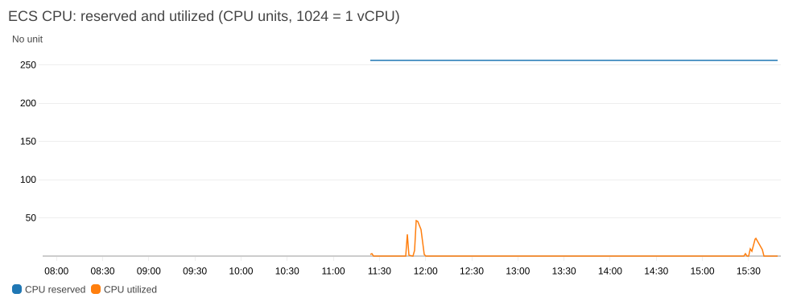
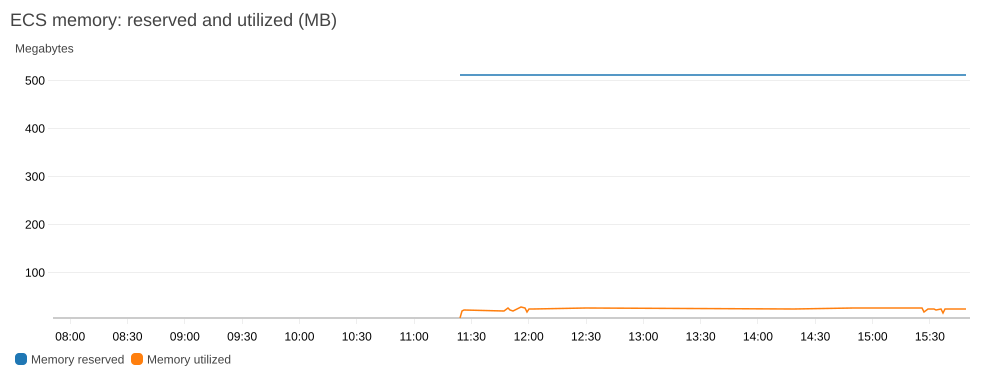
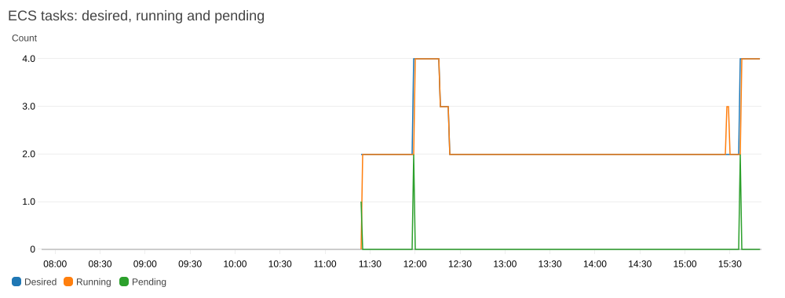
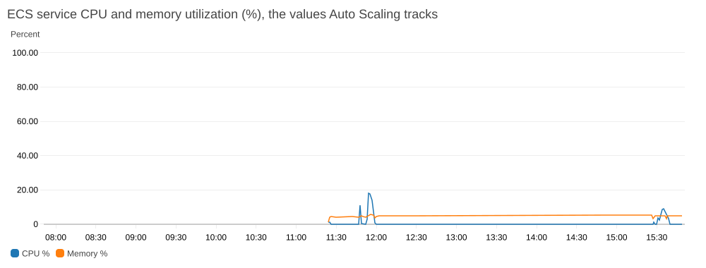
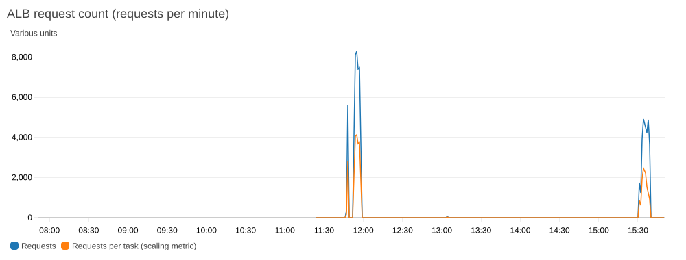
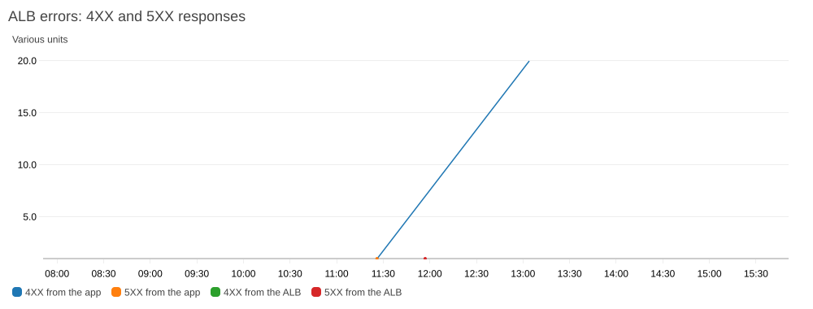
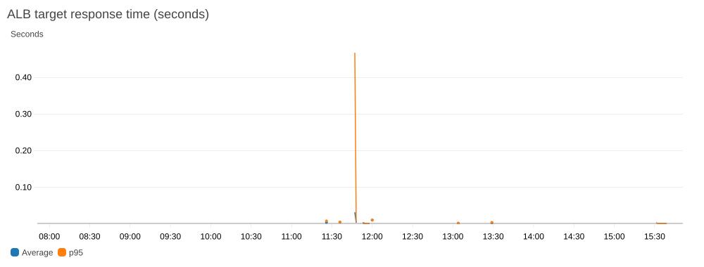
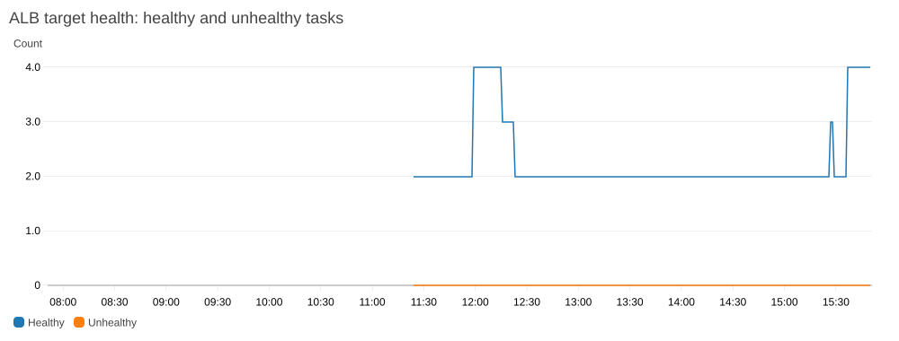

# End-to-end test results (AWS)

First full deployment and verification of the Product Service in AWS, run on 2026-10-31 in `us-east-1`. Account ID, your IP address, resource IDs and endpoints are masked or omitted.

| | |
|---|---|
| **What was deployed** | The full Terraform stack: VPC, 2 public and 2 private subnets, NAT gateway, S3 gateway endpoint, ALB, ECS cluster and service (2 Fargate tasks), RDS PostgreSQL 18.6, IAM roles, security groups, and the one-off migration task definition. The ECR repository already existed. |
| **Image** | `product-service:latest` from ECR: plain Alpine plus the `node` binary, about 220 MB, 0 vulnerabilities in Trivy |
| **Apply** | `terraform apply` of a reviewed, saved plan: **34 added, 1 changed, 0 destroyed**. RDS took 7 minutes 53 seconds, and the ECS service was created seconds after it. |
| **Access** | The ALB accepted port 80 from a single `/32` address only (the tester's), set with the `alb_ingress_cidr` variable |
| **Cost** | About $0.14 an hour while the stack runs. A $5 monthly budget alert was already in place. |

## Results

| Layer | Check | Result |
|---|---|---|
| Infrastructure | ECS service state | `ACTIVE`, 2 of 2 tasks running, rollout `COMPLETED`, steady state reached |
| Infrastructure | ALB targets | 2 healthy |
| Infrastructure | RDS | `available`, PostgreSQL 18.6, `db.t4g.micro`, not publicly accessible, storage encrypted, single-AZ |
| Database access | `/health` (runs `SELECT 1`) through the ALB | 200 `{"status":"ok"}`. This shows the app connected to RDS over TLS with the Secrets Manager password injected by ECS. |
| Data (before migration) | `/products` | 500, and the task log showed `relation "products" does not exist`, as expected |
| Data | Migration task (`node src/migrate.js`, one-off Fargate task) | Exit code 0, log line `Schema applied` |
| Data (after migration) | `/products` through the ALB | **200, `application/json`, 3 products, `price` as a number** |
| Routing | Unknown path | 404 `{"error":"Not found"}` |
| Network | Task network interfaces | Private IPs only, **no public IP**, one task per private subnet |
| Network | RDS endpoint from the tester's machine | Resolves to a private address; **port 5432 not reachable** |
| Security groups | ALB | Inbound 80 from one `/32` address; outbound 3000 to the VPC |
| Security groups | App | Inbound 3000 from the ALB group only; outbound only 5432 (database group) and 443 |
| Security groups | Database | Inbound 5432 from the app group only; no outbound rules |
| IAM | Trust policies of both ECS roles | `aws:SourceAccount` and `aws:SourceArn` conditions present |
| IAM | Scoped deploy policy on the PowerUserAccess permission set | `iam:CreateRole`, `PutRolePolicy`, `AttachRolePolicy` and `PassRole` all worked during the apply |
| Networking | S3 gateway endpoint | `available` |

## Auto Scaling test

Application Auto Scaling (2 to 4 tasks; target tracking on CPU at 60% and on ALB requests per task) was added to the running stack: **3 added, 0 changed, 0 destroyed**. To make a small test trigger scaling, the requests target was lowered
from 500 to 20 per task per minute (a one-resource change), and traffic was sent from the tester's machine to `/health` through the ALB.

| Step | Result |
|---|---|
| Registered | Scalable target min 2, max 4, with two target-tracking policies (`product-service-cpu` at 60 and `product-service-requests` at the test value) |
| First burst: 6,000 requests, 30 at a time, about 2 minutes | **No scaling.** The load balancer recorded two one-minute buckets above the target, but the scale-out alarm needs **3 consecutive minutes**, so it stayed `OK`. |
| Second run: 5 minutes of continuous traffic | The request-rate alarm went to `ALARM` about 5 minutes after the traffic started, and `desired` went **2 → 4**. All 4 tasks were running about a minute later. |
| After scaling | 4 healthy targets, 2 per availability zone; `/products` still 200; the service stayed at the maximum of 4 |
| Database | RDS connections peaked at 13 (limit not approached) |
| CPU policy | Did not trigger: `/health` is a trivial request, so CPU stayed low. The request-rate policy reacted first. |

| Scale-in | About 18 minutes after the load ended, the `AlarmLow` alarm fired and `desired` went **4 → 3** (12:16 local time), one task at a time, as target tracking is designed to do. It was still stepping down toward the minimum of 2 when this was written. |

**Not tested:** scaling on real CPU load (`/health` is too light to raise CPU), and the final return to 2 tasks.

## CloudWatch dashboard

A `product-service` dashboard (9 widgets) was added with Terraform: **1 added, 1 changed, 0 destroyed** (the change returned the requests scaling target from the test value of 20 to its default of 500).

| Check | Result |
|---|---|
| Widgets | 1 text and 8 metric charts, confirmed with `get-dashboard` |
| ECS | Container Insights data present: `CpuReserved` 256 and `MemoryReserved` 512 per task, and `DesiredTaskCount` 4.0 falling to 3.6 as scale-in began |
| ALB | `RequestCount` and `HealthyHostCount` (4.0, then 3.4 during scale-in) present |
| 4XX widget | Empty when first checked, because no 4XX response had occurred yet. After the 404 test requests it showed data: 1 and then 20 target 4XX responses in the hourly totals, and the errors chart (re-rendered over 8 hours) shows the series |
| `CPUReservation` and `MemoryReservation` | **Zero metrics exist on this Fargate cluster** (they are EC2-only), so the dashboard uses the Container Insights equivalents |
| Lambda metrics and X-Ray | Not applicable: the project has no Lambda function (see the README's out-of-scope table) |
| Errors seen | One 5XX from the app at about 11:26 (`/products` before the schema was loaded, expected) and **one 502 Bad Gateway generated by the ALB at 11:57, at the peak of the second load test** (about 7,500 new connections a minute, roughly 40,000 requests in total). No 4XX responses occurred. See the investigation below. |

### Charts

Rendered from the dashboard's widget definitions with the CloudWatch `GetMetricWidgetImage` API (these are API renderings, not console screenshots), covering the last 8 hours (all eight charts use the same window), in local time (UTC-7). The timeline:
the stack came up at about 11:25; the first traffic burst was at 11:47 (too short to scale); the second, at 11:53, triggered scale-out to 4 tasks at about 11:58; scale-in began at about 12:16 and the service was back at 2 tasks soon after; the new image was deployed at about 15:27 (the brief dip to 3 running tasks is the rolling deploy); and the 8-minute post-deploy load test at 15:31 took the service to 4 tasks again at about 15:36. The ALB 4XX points are the 20 `/nope` test requests at about 13:04 and a single earlier 404 (most likely the first `/nope` check; inferred from the timing, not confirmed).

## Central log bucket and ALB access logs

The central log bucket and ALB logging were applied to the running stack: **5 added, 1 changed (the load balancer, updated in place in 31 seconds), 5 destroyed** (the earlier ALB-only bucket, replaced by the renamed central one).

| Check | Result |
|---|---|
| Load balancer attributes | `access_logs.s3.enabled` is `true`, with the central bucket and prefix `alb` |
| Bucket settings | All public access blocked, SSE-S3 encryption, expiry rules for `alb/` (30 days) and `cloudtrail/` (90 days) plus an abort-incomplete-uploads rule, and a policy with only the ALB-write and deny-non-TLS statements |
| Delivery | Files appeared about **one minute** after 60 test requests, plus AWS's `ELBAccessLogTestFile` |
| Content | All 60 requests were logged: 40 with status 200 and 20 with status 404 (the `/nope` requests), 20 each for `/health`, `/products` and `/nope`; the task address was a private IP in the private subnet |
| 5XX | None in this traffic |

### CloudTrail (switch turned on)

`enable_cloudtrail = true` was applied: **1 added (the trail), 2 changed (the bucket policy and the ALB security group, see the incident below), 0 destroyed**. The account had no other trail, so this was the first (management events are free).

| Check | Result |
|---|---|
| Trail settings | `product-service-trail`: multi-region, log file validation on, global service events included, prefix `cloudtrail/` in the central bucket |
| Status | `IsLogging: true`, no delivery error |
| Delivery | The first file arrived about **3 minutes** after test API calls, under `cloudtrail/AWSLogs/<account>/CloudTrail/<region>/...` |
| Content | 75 events in the first file. The test calls (`ec2:DescribeVpcs`, `s3:ListBuckets`, `ecs:ListClusters`, `cloudtrail:DescribeTrails`/`GetTrailStatus`) appeared with the caller, the source IP and `readOnly=True`. It also recorded activity by the console and AWS services such as Resource Explorer. |
| Tamper check | `aws cloudtrail validate-logs` over the first 3 hours: **3 of 3 digest files valid and 41 of 41 log files valid**, so none of the delivered log files was altered or deleted |

### RDS logs to CloudWatch (switch turned on)

`enable_rds_logs = true` was applied: **2 added (the log groups), 1 changed (the RDS instance), 0 destroyed**. The database modification took 1 minute 32 seconds.

| Check | Result |
|---|---|
| Database | `available`, `EnabledCloudwatchLogsExports` is `["postgresql", "upgrade"]`, and `PendingModifiedValues` is empty, so the change was active immediately with no reboot or maintenance window |
| Log groups | `/aws/rds/instance/product-service-db/postgresql` and `/upgrade`, both with **14-day retention** (created by Terraform first, because RDS would otherwise create them with no expiry) |
| PostgreSQL log | One stream with the database log: a checkpoint every 5 minutes. It also included entries from before the change. A quiet database logs little with default settings. |
| Upgrade log | No streams yet (nothing has been upgraded), as expected |
| Service | `/health` and `/products` returned 200 after the change |

### S3 server access logs (switch turned on)

`enable_s3_access_logging = true` was applied: **6 added, 0 changed, 0 destroyed**. The central bucket's access logs go to a **separate bucket** (`central-logs/` prefix), not into itself.
The configuration was checked through the API: the logging setting targets the separate bucket and prefix, the bucket policy allows only `logging.s3.amazonaws.com` for the central bucket and this account (plus a deny for non-TLS), public access is blocked, encryption is SSE-S3, and expiry is 30 days.
**Delivery was observed, about 49 minutes after the switch was turned on.** Nothing appeared in the first 25 minutes (which looked the same as a wrong policy), the first file was listed at 14:12 local time (enabled at about 13:23), and 72 files had arrived by 15:22.
A sample of 219 records showed what the log records: the engineer's own calls (133), CloudTrail writing its files under `cloudtrail/` (32), and the load balancer's log delivery (1 write under `alb/`). 53 further records, 27 from an unnamed canonical ID and 26 anonymous `OPTIONS` preflight requests with no named requester, were all from a Windows browser at the engineer's own IP address between 13:24 and 14:05 local: the S3 console being browsed (bucket listing, versioning and ownership settings), plus its CORS preflight checks. Every record had status 200 or 404 (no 403s), and all writes to the central bucket were CloudTrail or ALB log delivery.

### Incident: the ALB was briefly open to the internet

While enabling CloudTrail, the settings file `terraform/demo.auto.tfvars` had not been created, so `alb_ingress_cidr` fell back to its default `0.0.0.0/0`. A chained command failed silently, the next plan changed the ALB's security group from the tester's single `/32` to `0.0.0.0/0`, and it was applied.
It was caught when the apply output was reviewed; a read-only check confirmed the rule was open, and a corrected plan (which showed the `0.0.0.0/0` rule being removed and the `/32` restored, with nothing destroyed) was applied. The ALB was verified back on the `/32`. During the window the app served only `/health` and `/products` (3 sample products, no secrets, no authentication), and the database was never reachable from the ALB path.
Changes made: warnings and a "check the file exists" step in the [logging runbook](Logging_Runbook.md), and then a permanent safeguard in the Terraform: `alb_ingress_cidr` no longer has a default, so a plan without it fails, and `0.0.0.0/0` is refused by a precondition unless `allow_public_alb = true`.
This was tested with plans against the live stack: with the settings file present there were no changes; `0.0.0.0/0` was refused; `0.0.0.0/0` with `allow_public_alb = true` was allowed (plan only, not applied); and with the settings file moved aside the plan stopped with "No value for required variable".

## Application logging (added after the first test, then deployed and verified)

During the test the app logged only plain-text start-up and error lines, with no per-request log and no way to match an error to an ALB log line. Structured JSON logging was added afterwards (`src/logger.js`, request logging in `app.js`) and tested locally:
**8 automated tests pass** (`npm test`), and a run against a throwaway Postgres showed: the ALB's `X-Amzn-Trace-Id` used as the `request_id` (a UUID otherwise), query strings never logged, successful health checks silent, `Database unavailable` logged **once** when the database was stopped and `Database recovered` once when it returned, a stack trace only on the 500, and the database password absent from every line.
The new image scans at 0 vulnerabilities and 0 secrets, and `npm audit` is clean.

**Deployed to AWS** (push, then `aws ecs update-service --force-new-deployment`; the rolling deploy replaced both tasks and the service returned to 2 of 2 healthy, with the old tasks' last lines in the old plain-text format): the first request after the deploy produced a JSON line in CloudWatch whose `request_id` was the ALB trace ID (`Root=1-...`), also returned in the `X-Request-Id` header. That ID found the matching line in the ALB access log in S3 (same request, same millisecond, ALB and target status 200, target address in the private subnet), so a request can be followed from the client to the app log to the ALB log.

## Final verification run (2026-10-31, after the project was renamed)

A read-only sweep of the live stack plus the project's own tests, run after everything above was built. It changes nothing in AWS. The live-stack part is now the reusable script `scripts/verify-deployment.sh` (28 checks, run once more as a script: **28 passed, 0 failed, 0 skipped**).

| Area | Result |
|---|---|
| **Live stack** (29 checks) | **29 pass.** Terraform shows no drift; the service has desired = running tasks, all targets healthy; `/health`, `/products` (3 products, numeric prices), `/nope` (404) and the `X-Request-Id` header behave as expected; the ALB accepts only one `/32`; tasks have no public IP; RDS is available, PostgreSQL 18, encrypted, private, with log exports on; port 5432 is not reachable from outside; the database group has no outbound rules; the app group allows only 443 and 5432; the default security group is empty; both ECS roles have the confused-deputy conditions; **the task role has no permissions**; Auto Scaling is 2 to 4 with two policies; the dashboard has 8 charts; app logs are JSON with a `request_id`; ALB, CloudTrail and S3 access logs are delivering; the central bucket blocks public access, is encrypted and denies non-TLS; ECR scans on push; a budget alert exists |
| **Automated tests** | 8 of 8 pass |
| **Terraform** | `fmt` and `validate` pass |
| **Secret scanner** | Self-test passes (18 rules, 8 file-name checks, 18 safe samples) |
| **Documentation** | **99 relative links, images and heading anchors across 9 files all resolve**; 14 PNG images are valid; all 10 Mermaid diagrams render |

Three checks failed on the first pass and were not defects in the service. Two (targets healthy, targets equal running tasks) ran while a **scale-in was finishing**: the load test had left 4 tasks, and a draining third target was still registered, which is visible in the app log as `Shutting down` with `SIGTERM`. They passed a minute later (2 targets, both healthy, 2 tasks).
The third (recent app log lines are JSON) was a mistake in the check script: the AWS CLI returns log events in pages, and then an option conflict made it print an error instead of the log line. A direct parse showed 4 of 4 request lines valid.
**Not tested in this run:** stopping a task (the resilience test), a deployment rollback, and the keep-alive fix over a long run.

## Problems found and how they were fixed

| Problem | Cause | Fix |
|---|---|---|
| `terraform apply` failed with `AccessDenied` on `iam:CreateRole` | The AWS-managed PowerUserAccess permission set excludes IAM | A scoped policy limited to `product-service-*` roles ([iam/product-service-iam-policy.json](iam/product-service-iam-policy.json)) |
| `ScanNotFoundException` reading ECR's scan results by tag | `latest` points to an image index, and results are stored under the image digest | Look the scan up by digest ([ECR_Runbook.md](ECR_Runbook.md) step 9) |
| The migration task would have pulled an image with 85 known vulnerabilities | The official `postgres:18-alpine` image, even though it was the latest | The task runs the app's own image instead ([vulnerability-scan-report.md](vulnerability-scan-report.md)) |
| The image pushed earlier had no `migrate.js` | It predated the migration change | Rebuilt and pushed, then checked with `ls /app/src /app/db` |
| One ALB-generated 502 during the load test | **Probable, not proven:** Node's default keep-alive timeout (5 seconds) is shorter than the ALB's idle timeout (60 seconds). See below. | Fix deployed (`server.js` keep-alive 65 s); repeat load test had zero 5XX, which is consistent with the fix but not proof (see below) |

### The ALB 502: what was found

A 502 generated by the ALB means it could not get a valid response from a target. The investigation used metrics, logs and ECS events (the ALB has no access logs, so the failed request itself can't be seen).

| Evidence | Finding |
|---|---|
| ALB metrics | Exactly one `HTTPCode_ELB_502_Count` at 11:57, and zero for 503, 504, `HTTPCode_Target_5XX_Count`, `TargetConnectionErrorCount` and `RejectedConnectionCount`. All targets stayed healthy (2 until 11:58, then 4, never unhealthy). |
| Timing | During sustained peak load, **before** the 11:58 scale-out, so it was not caused by the new tasks starting |
| ECS events | No task stopped, started or deregistered between 11:24 and 11:58:44 |
| App logs | No error lines in that window |
| Node settings | The deployed image runs Node v26.13.0 with `keepAliveTimeout` of **5,000 ms** (the default), and `server.js` doesn't change it. The ALB idle timeout is **60 s**. |

**Probable cause:** AWS recommends that a target's keep-alive timeout be **longer** than the load balancer's idle timeout. Here it is shorter, so Node can close an idle connection at the moment the ALB reuses it, and the ALB answers that one request with a 502.
This is consistent with the evidence (a rare, isolated 502, with healthy targets, no app errors and no task changes), but **it is not proven**: without ALB access logs there is no `error_reason` to confirm it, and one error in about 40,000 requests can't be reproduced on demand.

**ALB access logs were enabled afterwards** (`terraform/logging.tf`; see [runbook.md](runbook.md#7b-alb-access-logs)), so a repeat of the load test will record an `error_reason` for any 502. They only cover requests after they were switched on, so the original 502 at 11:57 can't be recovered.

**Fix (deployed):** `product-service/src/server.js` now sets `server.keepAliveTimeout = 65000` and `server.headersTimeout = 66000` (it must exceed the keep-alive timeout).
Local test (2026-10-31), one connection reused after 8 seconds idle (longer than Node's old 5-second default, shorter than the ALB's 60): the **image currently in ECR dropped the connection** (`RemoteDisconnected`), and the **fixed image kept it open** (HTTP 404 on the second request). That demonstrates the mechanism, not that it caused the 502.
Shutdown was checked too, because a longer keep-alive could slow it: with an idle connection held open, `docker stop` exited with code 0 in about 4.5 to 5 seconds for both the old and the new image (6 of 6 runs). An earlier harness run showed exit code 137 for both images, which nine further runs did not reproduce, so it is treated as a test-harness artifact (cause not identified).
The normal end-to-end check of the fixed image (schema load, `/health`, `/products`) passed.

**Repeat load test after the redeploy** (8 minutes, 30 requests at a time to `/health`, same pattern as the first test): **33,600 requests, every one returned 200 on the client side.** The ALB metrics showed 0 `HTTPCode_ELB_5XX`, 0 `HTTPCode_ELB_502`, 0 target 5XX and 0 4XX; the ALB access log held 33,601 lines (including one extra manual request), all with ALB status 200 and target status 200; and the app logged 0 error-level lines. Auto Scaling went back to 4 tasks during the run.
**How much this proves:** the original rate was one 502 in about 40,000 requests, so about 0.8 errors were expected in 33,600 requests; a clean run would happen about 43 percent of the time even with no fix. It is consistent with the fix and supports the mechanism shown by the local reuse test, but it is **not proof**. Only a much longer run, or a repeat over time, would be.

## Not tested

- **Resilience:** stopping a task and watching ECS replace it, and a deployment rollback.
- **TLS certificate verification:** the app encrypts the RDS connection but does not verify the certificate (a documented gap).
- **HTTPS, authentication, multiple environments and alarms:** not built; see the README's gaps table. (A CI/CD pipeline was built afterwards: see the update below.)
- **Performance:** nothing here measured latency or throughput. The Auto Scaling test above only shows that the service scales out.
- **Scaling on real CPU load** (see the Auto Scaling section).
- **Proof that the keep-alive fix removes the 502:** a repeat 8-minute test was clean but too short to be conclusive (see above).

## Update 2026-11-01: pipeline, Fargate checks and runtime secrets

Everything above was verified on 2026-10-31. These later changes were deployed to the same stack and checked in AWS.

| Change | What was verified |
|---|---|
| **CI/CD with GitHub Actions and CodeDeploy blue/green** ([CICD.md](CICD.md)) | Six successful deployments: each built the image, passed the ECR scan gate, registered a task definition revision and shifted traffic 10% a minute (about 16 minutes), with `/health` and `/products` at 200 throughout. Four problems found on the way are listed in CICD.md (empty secret, draining service name, rollout check, ECR scan race), all fixed. The automatic rollback has **not** been exercised |
| **Two target groups** | The request-based scaling policy and the dashboard now cover both target groups; the verify script follows the listener. Applied; the scaling expression has not been seen under load |
| **Fargate, not EC2** ([EC2_vs_Fargate.md](EC2_vs_Fargate.md)) | The service and every task report the `FARGATE` launch type, the task definition is Fargate-only with `awsvpc`, and the cluster has no EC2 capacity. Checked by `verify-deployment.sh` |
| **Database credentials read at runtime** ([Secrets.md](Secrets.md)) | The running task definition holds no credential (only the secret's name); both tasks logged `Database credentials loaded from Secrets Manager`; no access-denied or login errors; `/products` returned the 3 products |
| **Forced password rotation** | Took about 70 seconds. A request every 2 seconds all returned 200 (51 of 51). A burst of 40 parallel requests right after returned 34 × 200 and 6 × 500: a retry race. After the fix a second rotation returned 40 of 40, then 60 of 60 parallel requests and 39 of 39 steady requests with status 200 (9 retries logged, no errors) |
| **Verify script** | 31 passed, 0 failed, 1 skipped at the time of the runtime-secret rollout (33 checks; the one advisory warning was the execution role's temporary secret access, removed in phase 2) |

**Tested after this update (2026-11-02):** scaling under real load (a 6-minute, 20,056-request test: scale-out to 4 tasks including one on Spot, scale-in back to 2, no 5XX; see [Load_Test_and_Optimization.md](Load_Test_and_Optimization.md)), stopping a task (a Spot task, then recovery in about 85 seconds with no failed request), and a rollback of a bad deployment ([Rollback_Test.md](Rollback_Test.md)). **Still not tested:** a rotation under sustained heavy load or during a deployment, and a CodeDeploy deployment that fails by itself.

## Teardown

Not yet done at the time of writing. The stack is destroyed with `terraform -chdir=terraform destroy`; this section is updated when that happens.
