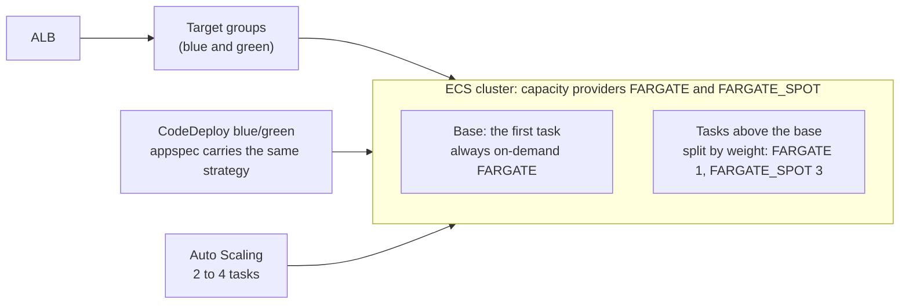

# Fargate and Fargate Spot: capacity providers, strategy and high availability

The service can run on a **mix of on-demand Fargate and Fargate Spot** to lower the compute bill without giving up availability. It is controlled by one Terraform switch, `enable_fargate_spot`, which is **off by default**. This page explains the design, how to turn it on, how to check it, and what can go wrong. The general EC2/Fargate comparison is in [EC2_vs_Fargate.md](EC2_vs_Fargate.md).

> **Status (2026-11-02): enabled and tested live once; one high-availability gap found and open.** The service ran on one `FARGATE` and one `FARGATE_SPOT` task. Stopping the Spot task cost **no failed requests**, but both tasks sat in the **same Availability Zone**, so a zone failure would take the service down. See [Live test](#live-test-2026-11-02). Enabling it also exposed a missing-image problem, now fixed in the pipeline.

## What Fargate Spot is

Fargate Spot runs tasks on spare AWS capacity at a discount (AWS says up to about 70% off the on-demand Fargate price). The catch: AWS can take that capacity back. When it does, the task gets a **two-minute warning** (a `SIGTERM` to the container, and an EventBridge task state change event) and is then stopped. Spot is meant for work that tolerates interruption, which a stateless web service with more than one task does, as long as some capacity cannot be taken away.

## The design



| Piece | Where | What it does |
|---|---|---|
| Capacity providers | `aws_ecs_cluster_capacity_providers` in `terraform/ecs.tf` | Registers `FARGATE` and `FARGATE_SPOT` on the cluster (free). The cluster default strategy is on-demand `FARGATE` only, so nothing lands on Spot unless it asks for it |
| Strategy | `local.capacity_provider_strategy` in `ecs.tf` | `base` of `fargate_base` tasks on `FARGATE`, then the remaining tasks split by `fargate_weight` and `fargate_spot_weight` |
| Service | `aws_ecs_service.app` and `aws_ecs_service.blue_green` | With the switch on, the service uses the strategy instead of `launch_type = "FARGATE"` (a service uses one or the other) |
| Deployments | `scripts/render-appspec.py`, `.github/workflows/deploy.yml` | The deploy job reads the strategy from the service and copies it into the appspec, so CodeDeploy's replacement tasks use the same mix |
| Permission | `terraform/bootstrap/main.tf` | The deploy role may call `ecs:DescribeServices` on this one service to read the strategy |

### Defaults and what they give you

`fargate_base = 1`, `fargate_weight = 1`, `fargate_spot_weight = 3`. ECS fills the base first, then splits the rest 1 : 3.

| Running tasks | On-demand `FARGATE` | `FARGATE_SPOT` |
|---|---|---|
| 2 (the minimum) | 1 | 1 |
| 3 | 1 or 2 | 2 or 1 |
| 4 (the maximum) | 1 to 2 | 2 to 3 |

ECS rounds each split, so the exact counts at 3 and 4 tasks vary. The base task is always on-demand.

### Why base 1 and a 1 : 3 split

- **High availability needs a floor that cannot be reclaimed.** The base task is on-demand, so a Spot interruption can remove at most the Spot tasks; the service never drops to zero. `fargate_base` is validated to be at least 1.
- **Tasks are spread over two Availability Zones** (they were already, and `verify-deployment.sh` checks it), so one zone's Spot shortage does not take out both.
- **The 1 : 3 weight favours Spot above the base** because that is where the saving is. Raise `fargate_weight` or `fargate_base` for more safety, lower them for more saving.

## What it saves in this project

Roughly: one 0.25 vCPU, 512 MB task costs about $0.012 an hour on-demand, so moving one task of two to Spot saves on the order of $0.009 an hour, about **$6 a month**. The whole stack costs about $0.16 to $0.20 an hour, dominated by the NAT gateway, load balancer and database. So the saving here is small; the value is the pattern, and it grows with the number of tasks. Prices vary and are approximate; check the current Fargate pricing page.

## High availability: what can go wrong

| Situation | What happens | What to know |
|---|---|---|
| A Spot task is reclaimed | The task gets `SIGTERM` and two minutes' warning. This service's server exits within a few seconds of `SIGTERM`, so the task leaves the load balancer early. The service keeps running on the other tasks and ECS starts a replacement | Capacity drops for about a minute or two. With 2 tasks, half of it |
| Spot capacity is not available for the replacement | **ECS does not fall back to on-demand.** It keeps retrying on Spot | The service runs on its remaining tasks until Spot capacity returns. This is the main risk, and why the on-demand base matters |
| Load rises while Spot is short | Auto Scaling asks for more tasks. Tasks above the base are mostly Spot, and may not start | The on-demand base carries the load. For a service that cannot tolerate this, raise `fargate_base` or the Auto Scaling minimum |
| A deployment starts while Spot is short | CodeDeploy's replacement tasks cannot all start, so the health check does not pass and the deployment fails and rolls back | Safe: traffic stays on the old tasks. Retry later |
| Several Spot tasks are reclaimed at once | Same as above, for more tasks | Another reason to keep a base of at least 1, and 2 or more for traffic that cannot dip |

Not suitable for Spot: single-task services, tasks that hold state in memory or on local disk, long jobs that cannot resume. The one-off migration task is always on-demand (`--launch-type FARGATE`), so it is not affected.

## Turn it on

Do the steps in this order. The first two are needed even if you never enable Spot, because the deploy workflow now reads the service's strategy.

1. **Give the deploy role the new read permission** (adds `ecs:DescribeServices` on this one service; apply by hand, as before):
   ```bash
   cd terraform/bootstrap
   terraform plan  -var 'github_sub_prefix=<your repo prefix>'     # expect: 0 add, 1 change, 0 destroy
   terraform apply -var 'github_sub_prefix=<your repo prefix>'
   ```
2. **Merge the pull request** that adds this feature. If you merge before step 1, the next deploy fails at the new `describe-services` call with `AccessDenied`.
3. **Register the capacity providers** (a harmless change; the service is not touched with the switch off):
   ```bash
   cd terraform
   terraform plan      # expect: 2 to add (the cluster capacity providers and a marker), 0 change, 0 destroy
   terraform apply
   ```
4. **Enable Spot.** This **replaces the ECS service** (a short outage), because a service cannot change between a launch type and a strategy in place, and a CodeDeploy-controlled service cannot change its strategy at all. `-replace` makes it explicit:
   ```bash
   terraform plan  -var enable_fargate_spot=true -replace='aws_ecs_service.blue_green[0]'   # expect: 1 add, 1 change, 1 destroy
   terraform apply -var enable_fargate_spot=true -replace='aws_ecs_service.blue_green[0]'
   ```
   The one change is the marker resource (`terraform_data.capacity_strategy`) getting its new value; the add and the destroy are the service. (If you skipped step 3 the plan shows 3 adds and 1 destroy, because the capacity providers and the marker are created in the same run.) If the apply stops with `Unable to Start a service that is still Draining`, wait until the old service shows `INACTIVE`, then run the same apply **without** `-replace`.
   Two things to expect after the replacement: the Application Auto Scaling target and policies are dropped by AWS when the service is deleted, so run `terraform plan` (it shows 3 to add) and `terraform apply` again; and a service that Terraform creates starts from Terraform's task definition, which names the `:latest` image, so that tag **must exist in ECR** (the deploy workflow keeps it up to date; if it is missing the tasks fail with `CannotPullContainerError`). Check with `aws ecr describe-images --repository-name product-service --image-ids imageTag=latest`.
5. **Keep it on:** add `enable_fargate_spot = true` to `terraform/demo.auto.tfvars` (git-ignored), then `terraform plan` should say no changes.
6. **Deploy once** (`gh workflow run deploy.yml`) so the application runs through the appspec path with the strategy, and check the log line `Capacity provider strategy: [...]` in the `Start the CodeDeploy blue/green deployment` step.

Changing `fargate_base` or either weight later replaces the service the same way (`terraform_data.capacity_strategy` triggers it). To go back: `terraform apply -var enable_fargate_spot=false` after the same wait for `INACTIVE`.

## Check it

```bash
export AWS_REGION=us-east-1
# the service's strategy
aws ecs describe-services --cluster product-service-cluster --services product-service \
  --query 'services[0].capacityProviderStrategy' --output json

# which provider each running task is on, and where
aws ecs describe-tasks --cluster product-service-cluster \
  --tasks $(aws ecs list-tasks --cluster product-service-cluster --service-name product-service --query taskArns --output text) \
  --query 'tasks[].[capacityProviderName,availabilityZone,lastStatus]' --output text

# the cluster's providers
aws ecs describe-clusters --clusters product-service-cluster --query 'clusters[0].capacityProviders'

./scripts/verify-deployment.sh --skip-plan
```

`verify-deployment.sh` has these checks in its Fargate section: tasks run in at least two Availability Zones; the cluster owns no EC2 capacity and only the two Fargate providers; and, only when Spot is enabled, the strategy has an on-demand base of at least 1, a Spot share, and an on-demand task is running. With Spot off the last one is reported as skipped.

### Interruptions

```bash
# tasks that stopped because Spot capacity was reclaimed (recent ones)
aws ecs list-tasks --cluster product-service-cluster --desired-status STOPPED --query taskArns --output text \
  | xargs -r aws ecs describe-tasks --cluster product-service-cluster --tasks \
      --query 'tasks[?stopCode==`SpotInterruption` || stopCode==`TerminationNotice`].[taskArn,stoppedAt,stoppedReason]' --output text
```

AWS documents the stop code as `SpotInterruption` in some places and `TerminationNotice` in others, so the query accepts both. Stopped tasks stay visible for about an hour.

You cannot trigger a real Spot interruption on demand. To test how the service copes with losing a task, stop one by hand (`aws ecs stop-task`) and watch ECS replace it and the target group recover. That tests recovery and the on-demand floor, not the two-minute warning.

## Live test (2026-11-02)

Enabled with `terraform apply -var enable_fargate_spot=true -replace='aws_ecs_service.blue_green[0]'` on the running stack, with a request every 2 seconds recording availability.

| What | Result |
|---|---|
| The strategy | `FARGATE` (base 1, weight 1) and `FARGATE_SPOT` (weight 3); the two tasks ran one on each provider |
| Outage while replacing the service | About 9.5 minutes (00:42 to 00:52 UTC). About 7 of them were the missing `:latest` image (below); without it, expect about 3 to 4 minutes (old service deleted, new tasks started) |
| Stopping the Spot task by hand | **41 of 41 requests returned 200** (`/health` and `/products`). The on-demand task served alone; ECS noticed in about 33 seconds, started a replacement on Spot, and it was running about 85 seconds after the stop |
| **Zone spread** | **Both tasks were in `us-east-1b`, three times running** (the first placement, 14 minutes of waiting for ECS to rebalance, and the Spot replacement). Zone rebalancing was `ENABLED` and did nothing |

**The missing image.** The new service started from Terraform's task definition, which names `:latest`. That tag no longer existed: the ECR rule "keep the last 10 images" had expired it, because the pipeline pushes only commit-SHA tags. Tasks failed with `CannotPullContainerError ... failed to resolve ref`. The tag was re-created by hand on the running image (a few seconds, and the tasks started within a minute), and the deploy workflow now moves `:latest` to every successfully deployed image so it cannot happen again.

**The zone gap.** My explanation, not proven: ECS spreads tasks across zones within a capacity provider, and with one task per provider each is placed on its own, so both can land in one zone. This means the default (`fargate_base = 1`) survives a Spot reclaim, which was tested, but **not** the loss of a zone. Options: keep it and accept the risk; set `fargate_base = 2` so two on-demand tasks (one provider, which can spread them) are always running, with Spot only above two tasks (no saving at the two-task baseline, and the zone spread is untested); or turn Spot off. Changing the base replaces the service again.

## Limits and next steps

- **Tested once, on two tasks.** Enabling it and stopping a Spot task were tested live (see above); a real Spot reclaim, the two-minute warning, and scale-out onto Spot have not been seen. The first test found the missing `:latest` image and the zone-spread gap.
- **Strategy changes replace the service** (a short outage), like the blue/green switch.
- **No fallback to on-demand** when Spot is short. A CloudWatch alarm on running tasks below the minimum would tell you; there are no alarms yet.
- **No interruption alerts.** An EventBridge rule on `ECS Task State Change` with the Spot stop code could write interruptions to a log group or send a notification; not built.
- **The CPU and request scaling policies are unchanged.** Scale-out above the base mostly starts Spot tasks, which may be slow or unavailable in a shortage.
