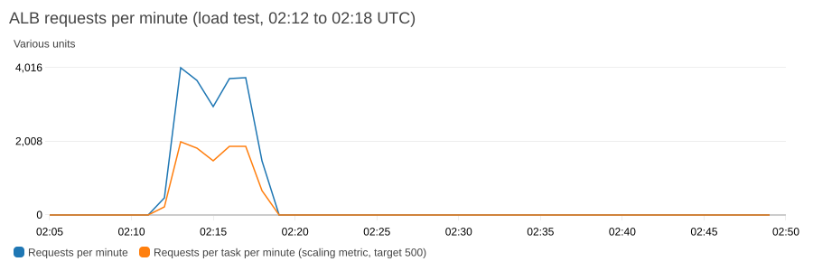
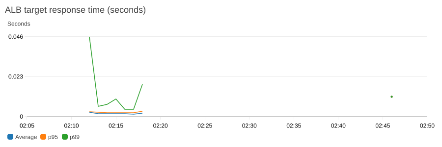
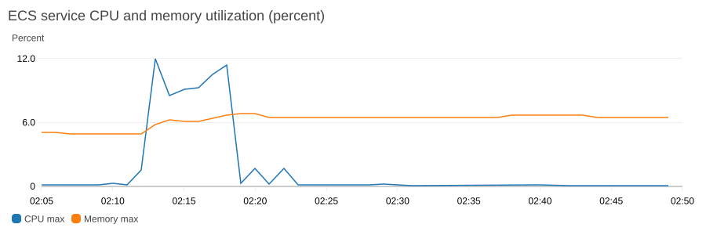
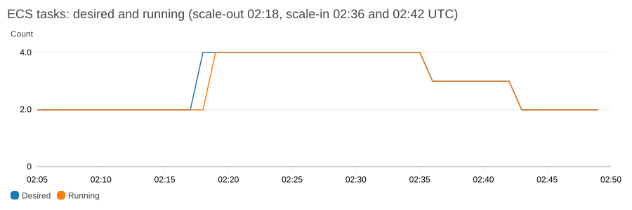

# Load test and optimization

What the service does under load, with the CloudWatch numbers, and every optimization made to it so far. The failure-side evidence (a broken release) is in [Rollback_Test.md](Rollback_Test.md). The first two load tests (2026-10-31, local time, on the original rolling-update setup) are summarised in the [README](../README.md#known-limitations-and-roadmap) and [E2E_Test_Results.md](E2E_Test_Results.md); this page records the third, run on 2026-11-02 (UTC) after blue/green, Fargate Spot, runtime secrets and the scaling fix. The behaviour matches the earlier tests: scale-out to 4 tasks within minutes of the load starting, and the first scale-in step about 18 minutes after the load ended (17.5 here).

## The load test of 2026-11-02

**Method.** 20 parallel workers on a laptop, each in a loop, sent `GET /products` (which queries the database) to the load balancer for about 6 minutes: 8 workers from 02:12:30 UTC, 12 more about 35 seconds later. The service started at 2 tasks (both on-demand Fargate, 0.25 vCPU and 512 MB each, in two zones). The load ran from outside AWS, through the public load balancer.

| | Result |
|---|---|
| Requests sent | **20,056**, all returned **200** (client side) |
| Rate | about **56 requests a second** (about 3,300 a minute) |
| ALB `RequestCount` per minute, 02:13 to 02:18 | 4,016 (peak), 3,671, 2,952, 3,728, 3,756, 1,472 (last, partial) |
| ALB 5XX | **0 from the application, 0 from the load balancer** |
| `TargetResponseTime` | average **2 ms**, p95 2 to 3 ms, p99 4 to 19 ms (server side, load balancer to app and back) |
| Service CPU | peak **8.4% average, 12% maximum** |
| Service memory | peak **6.8%** of 512 MB |

*Requests per minute peaked at 4,016. Per task, the scaling metric reached about 2,000 a minute against the target of 500.*

*CPU and memory stayed low: the request policy, not the CPU policy, did the work.*

### Scaling

| Time (UTC) | Event |
|---|---|
| 02:12:30 | Load starts |
| 02:18:06 | **Scale-out:** desired count 2 to 4, triggered by the **request-based policy** (`product-service-requests`, `AlarmHigh`) |
| 02:18:35 | Load ends |
| 02:19:25 | All 4 tasks running and healthy: three on-demand and **one on Fargate Spot**, two in each zone |
| 02:36:05 | **Scale-in 4 to 3**, by the request policy's `AlarmLow` (an on-demand task was removed) |
| 02:42:12 | **Scale-in 3 to 2**, by the CPU policy's `AlarmLow` (the Spot task was removed) |

What this shows:

- **Scale-out works and is decisive,** but not instant: about 5.5 minutes after the load began. Target-tracking alarms need several consecutive one-minute datapoints above the target, plus the delay before CloudWatch publishes the metric.
- **Scale-in is slow on purpose:** the first step came about 17.5 minutes after the load ended, and the service was back at 2 about 24 minutes after. Scale-in needs a long run of low datapoints and a 5-minute cooldown between steps. This protects against flapping and costs a little extra.
- **Spot was used above the base,** as designed: the third and fourth tasks were one on-demand and one Spot. The scale-in removed an on-demand task first and the Spot task second, ending on the two on-demand base tasks.
- **No request failed during any of it.**
- **Only the request-based policy fired on the way up.** The CPU policy never needed to: 56 requests a second used about 8% of the CPU. The new metric-math request policy (see below) was therefore the one exercised against real traffic.

### A second run: a rotation under load

The same day a second, heavier run (20 workers, about 86 requests a second, 5,448 requests in the peak minute) was combined with a forced database password rotation. 33,754 of 33,755 requests returned 200, and Auto Scaling added tasks in the middle of the rotation. Details and the chart are in [Secrets.md](Secrets.md#rotation-under-sustained-load). It was planned as 15 minutes, but the load generator's machine went to sleep after 6.5 minutes. A third run, a rotation during a deployment ([Secrets.md](Secrets.md#rotation-during-a-bluegreen-deployment)), then ran **20.5 minutes without a gap** at a lighter rate (about 13 requests a second, 15,953 requests): no 5XX apart from two requests inside the rotation window, and 0 unhealthy hosts. So the longest clean run is now 20.5 minutes; the highest rate is the 86 requests a second of the second run.

### What the test does not show

- **A client on a laptop** produced the load, from about 250 ms away; the rate (56 requests a second) was limited by the client, not the service. The service had a lot of headroom (CPU 8%).
- **Not tested:** p99 latency under much heavier load, database saturation (a db.t4g.micro), a longer run than 6 minutes, and the CPU policy scaling up.
- **The 2 ms is server side.** From the laptop one request took about 250 ms in total (network distance); the CloudWatch figure excludes that.

### Tuning options the test points to (not applied)

- The request target (500 a minute per task) is very conservative: the service scaled out at about 17 requests a second in total while using 8% CPU. A higher target (for example 1,500 to 2,000 a minute) would delay scale-out and save task-hours; the lower one scales earlier. It is a cost and latency choice.
- Scale-out takes about 5.5 minutes. Faster reaction needs step scaling with fewer evaluation periods, or a higher minimum capacity.
- The tasks are small enough (0.25 vCPU) that two handle this load comfortably.

## Optimizations made so far

### Image and startup

| Change | Effect |
|---|---|
| Multi-stage Dockerfile on plain Alpine, production dependencies only, only the `node` binary copied | Image **258 MB to 220 MB** (239 MB since the AWS SDK was added for runtime secrets); no npm, npx, corepack or yarn |
| Non-root user, read-only root filesystem, a container health check | Smaller attack surface; failures are visible to the orchestrator |
| Patched base image and dependencies | 17 scan findings fixed, **0 HIGH or CRITICAL** now (Trivy, Checkov, `npm audit`, Semgrep run on every pull request) |

### Request path and stability

| Change | Effect |
|---|---|
| Node `keepAliveTimeout` 65 s and `headersTimeout` 66 s (above the load balancer's 60 s idle timeout) | Removes the cause of an intermittent 502 seen in the first load test. A repeat 8-minute test (33,600 requests) and this 6-minute test (20,056 requests) had **zero 5XX** |
| Graceful shutdown on `SIGTERM` (finish in-flight requests, 10 s cap) | Clean task stops during deployments and scale-in |
| Target group: deregistration delay 30 s (default 300 s), health check on `/health`, 60-second health-check grace period | Faster, safer rollouts; new tasks are not judged before they start |
| Database pool: at most 10 connections, 30 s idle timeout, 5 s connect timeout; prices cast in SQL (`price::float8`) | Bounded database load; numeric JSON values |
| Credentials read at runtime with one retry after a rotation | A password rotation no longer breaks running tasks (tested live: 100 of 100 parallel requests succeeded after a forced rotation) |

### Scaling

| Change | Effect |
|---|---|
| Application Auto Scaling, 2 to 4 tasks, two target-tracking policies: CPU 60% and 500 requests per task per minute; scale-out cooldown 60 s, scale-in 300 s | Scales out fast, in slowly |
| Request policy rewritten as a metric-math expression over **both** blue and green target groups, divided by running tasks | After blue/green, the built-in metric watched only one target group and stopped reacting; confirmed working in the load test above |
| Dashboard charts show both target groups | No blind spot after a deployment |

### Cost

| Change | Effect |
|---|---|
| Fargate sizing 0.25 vCPU / 512 MB per task | About $0.012 an hour per task |
| Capacity providers `FARGATE` and `FARGATE_SPOT`, base 2 on-demand | Spot is used above two tasks (seen in the load test); the base keeps the service up and spread over two zones. With a base of 2 nothing runs on Spot at the baseline, so the saving is small ([Fargate_Spot.md](Fargate_Spot.md)) |
| S3 gateway endpoint (free) | Image layers come from S3 without the NAT gateway |
| One NAT gateway, single-AZ database | Cheapest for a demo (the trade-off is in the README) |
| CloudWatch log retention 14 days; S3 log expiry; CloudTrail, RDS logs and S3 access logs off by default (switches) | Logging cost stays small |
| ECR lifecycle: keep the last 10 images; the deploy workflow keeps `:latest` pointing at a deployed image | Low storage cost, and a recreated service can always pull |

### Deployment and observability

| Change | Effect |
|---|---|
| CodeDeploy blue/green, 10% of traffic per minute, old tasks kept 5 minutes, automatic rollback | Gradual, reversible releases; the rollback is proven in [Rollback_Test.md](Rollback_Test.md) |
| Image tagged with the commit SHA; scan gate stops on CRITICAL findings | Every running image maps to one commit |
| The listener is replaced together with the service (Terraform) | A replaced service starts with the listener on the right target group (found after 8 minutes of 503) |
| Structured JSON logs with a request ID (the load balancer's trace ID), quiet successful health checks | A request can be followed through the load balancer and the app |
| 8-chart CloudWatch dashboard, Container Insights, and a 35-check read-only verify script | One command shows whether the stack is healthy |

## CloudWatch metrics used

| Namespace and metric | Used for |
|---|---|
| `AWS/ApplicationELB` `RequestCount`, `RequestCountPerTarget` | Load, and the request scaling metric |
| `AWS/ApplicationELB` `TargetResponseTime` (average, p95, p99) | Latency |
| `AWS/ApplicationELB` `HTTPCode_Target_2XX_Count`, `HTTPCode_Target_5XX_Count`, `HTTPCode_ELB_5XX_Count` | Errors |
| `AWS/ApplicationELB` `HealthyHostCount`, `UnHealthyHostCount` (per target group) | Deployment health ([Rollback_Test.md](Rollback_Test.md)) |
| `AWS/ECS` `CPUUtilization`, `MemoryUtilization` | Headroom, and the CPU scaling metric |
| `ECS/ContainerInsights` `RunningTaskCount`, `DesiredTaskCount` | Scaling activity |

The charts on this page were generated from CloudWatch with `aws cloudwatch get-metric-widget-image` for the test window. The dashboard itself is the `dashboard_url` Terraform output.
