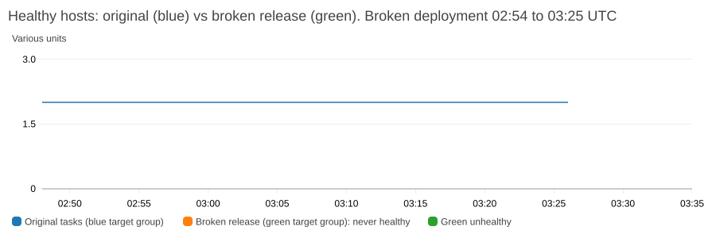
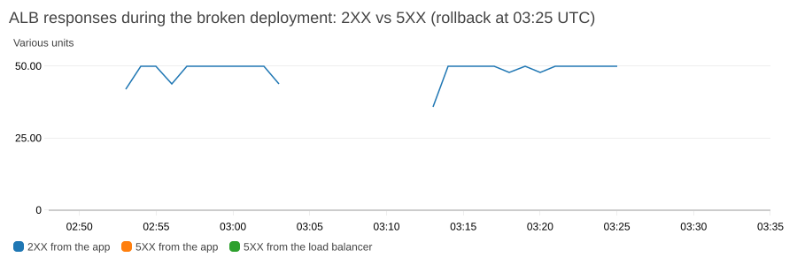

# Rollback test: a broken release, proven in AWS

This page is the evidence that the CodeDeploy blue/green deployment protects users from a bad release. A release whose container crashes at start-up was deployed to the live service. **No user request failed**, the broken tasks never received traffic, and an automatic rollback restored the original state in about 35 seconds.

**Date:** 2026-11-02 (times are UTC). **Stack:** the live `product-service` stack in us-east-1, with the pipeline described in [CICD.md](CICD.md).

## Summary

| Question | Answer |
|---|---|
| Did the broken release pass the pipeline's checks? | **Yes**: 28 unit tests, the secret scan and the image build and ECR scan all passed. It is the kind of bad release only a deployment can catch. |
| Did any user request fail? | **No request failed among those sent.** 593 of 593 probe requests (`/health` and `/products`) returned 200, and CloudWatch saw 1,162 requests, all 2XX, **0 target 5XX and 0 load-balancer 5XX**. **Caveat:** the probe has a 9-minute hole (03:03:56 to 03:13:03) because the laptop running it went to sleep, so no request was sent in that gap. The gap is covered by the load balancer's health metrics instead (next row). |
| Did the broken tasks ever receive traffic? | **No.** The listener stayed 100% on the original (blue) target group. The new (green) target group never had a healthy host. These facts come from AWS itself (CloudWatch `HealthyHostCount` in every minute, ECS events and the CodeDeploy record), so they hold across the probe's gap. |
| Did CodeDeploy fail the deployment by itself? | **Not within 30 minutes.** It kept retrying the crashing tasks. This is a finding (see below). |
| Did the rollback work? | **Yes.** Stopping the deployment with automatic rollback created rollback deployment `d-M280998LM`, which succeeded in 3 seconds; the broken task set was gone about 35 seconds after the stop. |
| Was the final state correct? | **Yes.** The service is back on its original task set (task definition 7), 2 tasks steady, and the `latest` image tag did not move. |

## How the test was set up

- **The broken release.** A throwaway branch (`test/rollback-broken-entrypoint`, never merged, deleted afterwards) changed one line of the Dockerfile so the container starts `node src/server-BROKEN-ROLLBACK-TEST.js`, a file that does not exist. The unit tests run from the source tree, so they still pass, and the image builds and passes the scan. The container exits immediately with `MODULE_NOT_FOUND`.
- **How it was deployed.** The real `Deploy` workflow was started by hand (`workflow_dispatch`) from that branch, so the whole pipeline ran as for any release: tests, build, push, scan, a new task definition revision and a CodeDeploy blue/green deployment. `main` never contained the bad commit.
- **What was measured.** A request to `/health` and `/products` about every 3 seconds from outside AWS, a recorder of the CodeDeploy status, task sets, listener weights and target health every 20 seconds, and the CloudWatch metrics below. **Data gap:** the laptop running the probe and the recorder was asleep from 03:03:56 to about 03:13:03 (the recorder's gap was 608 seconds). Nothing was sent or recorded from this machine in that window, which is also why the 2XX line in the second chart below is broken there. The AWS-side evidence (CloudWatch metrics, ECS service events, the CodeDeploy deployment record) is not affected.
- **Baseline.** Before the test: last good deployment `d-OXODRM5LM`, one PRIMARY task set with 2 running tasks (task definition 7), the listener 100% on the blue target group, and the `latest` image digest `sha256:c3886422908a5f9b…`.

## Timeline

| Time (UTC) | Event |
|---|---|
| 02:52:58 | Baseline recorded, probe started: all 200 |
| 02:53:34 | `Deploy` workflow started from the broken branch |
| 02:54:49 | CodeDeploy deployment `d-9KEB1B7LM` created: a green task set with 0 tasks, still `STABILIZING` |
| 02:54:59 | ECS starts 2 tasks in the green task set |
| 02:55 onward | The tasks crash at once (`Error: Cannot find module '/app/src/server-BROKEN-ROLLBACK-TEST.js'`, `MODULE_NOT_FOUND`). ECS keeps retrying with a back-off: a pair of tasks about every 5 minutes (pending 2, then running 0, repeat). **14 crashed tasks** in 7 pairs by 03:25, all exit code 1, all from the broken task definition (revision 12). The listener stays 100% on blue; the green target group has no healthy host |
| 03:25:02 | **30 minutes: the deployment is still `InProgress`.** CodeDeploy has not failed it. The test limit is reached |
| 03:25:05 | `aws deploy stop-deployment --auto-rollback-enabled` (the deployment group rolls back on `DEPLOYMENT_FAILURE` and `DEPLOYMENT_STOP_ON_REQUEST`) |
| 03:25:06 | CodeDeploy creates rollback deployment `d-M280998LM` ("triggered automatically to roll back the deployment d-9KEB1B7LM") |
| 03:25:08 | The rollback deployment is `Succeeded` (3 seconds) |
| 03:25:19 | The green (broken) task set is `DRAINING` |
| 03:25:39 | Only the original task set remains (PRIMARY, steady, 2 tasks) |
| 03:26 | Final probe samples: still 200 |

The GitHub run ended **red** at the step "Wait for the deployment", and the step "Mark the deployed image as latest" was **skipped**, so the broken image never became `latest`.

## CloudWatch evidence



*The original (blue) target group had exactly 2 healthy hosts in every minute from 02:53 to 03:27. The green group, which held the broken release, never had a healthy host: there are no healthy datapoints for it.*



*Every response through the load balancer was a 2XX. There are no 5XX from the application and none from the load balancer. The line is broken from about 03:03 to 03:13 because no requests were sent in that window (the machine running the probe was asleep); the 5XX series has no datapoints at all.*

| Metric (window 02:48 to 03:35 UTC) | Result |
|---|---|
| `HealthyHostCount`, blue target group (minimum per minute) | **2 in every minute** |
| `HealthyHostCount`, green target group | **No datapoints: never healthy** |
| `HTTPCode_Target_2XX_Count` / `RequestCount` | 1,162 / 1,162 |
| `HTTPCode_Target_5XX_Count`, `HTTPCode_ELB_5XX_Count` | **0, 0** |
| `TargetResponseTime` (average per minute) | 1.5 to 2.2 ms, unchanged by the event |
| `RunningTaskCount` (Container Insights) | **2 throughout** |

## Findings

1. **The protection works.** A release that passes every pipeline check but cannot start never reaches a user. The old tasks keep serving until the new ones are healthy, and they never were.
2. **CodeDeploy does not give up quickly.** With tasks that crash instead of merely failing the health check, the deployment was still `InProgress` after 30 minutes, retrying while the old tasks served. This is safe for users, but a bad release can sit "in progress" for a long time, and the GitHub run stays running. I could not find a documented timeout, so the real limit is unknown. The test ended at 30 minutes by a manual stop.
3. **The automatic rollback works, and is fast.** Once triggered it took about 3 seconds for the rollback deployment and about 35 seconds until the broken task set was gone.
4. **This test used a manual stop to trigger the rollback**, so what is proven is: the broken release never serves traffic, and the rollback restores the original state. What is **not** proven is that CodeDeploy fails a bad deployment **by itself** quickly.

## Limits and next steps

- **Add a deployment timeout or an alarm.** To make a bad release fail fast without a human, add a CloudWatch alarm to the deployment group (for example on healthy hosts, or a pre-traffic hook that calls `/health`) so CodeDeploy rolls back on its own, and consider a workflow timeout for the "Wait for the deployment" step (it currently allows up to 45 minutes).
- **One failure mode tested.** A crashing container. A container that starts but fails its health check, or a slow start, were not tested and may behave differently.
- **Cost.** The test left 14 crashed tasks (each billed for the seconds it ran) and one extra image in ECR. The lifecycle rule will expire the image.

## How to repeat the test

```bash
# 1. throwaway branch with a one-line break in product-service/Dockerfile (a missing file in CMD), pushed to GitHub
# 2. deploy it with the real workflow (nothing is merged)
gh workflow run deploy.yml --ref <the throwaway branch>
# 3. watch: the deployment stays InProgress, the new tasks crash, the original tasks keep serving
aws deploy list-deployments --application-name product-service --deployment-group-name product-service-dg --query 'deployments[0]'
# 4. roll back
aws deploy stop-deployment --deployment-id <id> --auto-rollback-enabled
# 5. clean up: delete the branch, confirm the service is on its original task set and `latest` did not move
```

Run a request probe against the load balancer throughout, and capture the CodeDeploy, task set and CloudWatch data as above.
