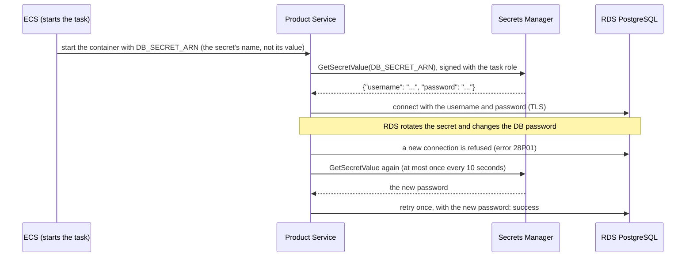
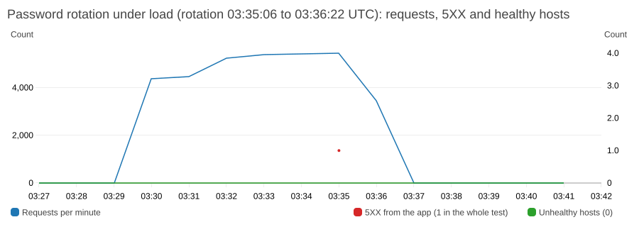

# Database credentials in AWS Secrets Manager

The database credentials live in an AWS Secrets Manager secret, and the application fetches them itself at runtime. No password or username is in the source code, the Docker image, the task definition, the Terraform variables or the Terraform state, and none is passed to the container as an environment variable.

> **Status (2026-11-01): deployed and tested live, including a forced password rotation.** The tasks read the secret themselves (rollout and phase 2 done, verify checks pass). A first rotation test found a retry race that lost 6 of 40 parallel requests; after the fix, a second rotation test returned 100 of 100 parallel requests and 39 of 39 steady requests with status 200. Details in [Live rotation test](#live-rotation-test).

## The secret

The secret is created and managed by RDS: `manage_master_user_password = true` in `terraform/rds.tf`. RDS generates the password, stores it in a Secrets Manager secret (named `rds!db-…`), and rotates it automatically (every 7 days here). The secret holds a small JSON document with `username` and `password`.

I use the RDS-managed secret and do not create a separate `aws_secretsmanager_secret`. A secret that Terraform creates needs the password to come from somewhere (a variable or a `random_password`), and then the value sits in the Terraform state in plaintext. With the managed secret the password never passes through Terraform at all. The Terraform output `db_secret_arn` gives the secret's name (ARN).

## How the app gets the credentials



| Piece | Where | What it does |
|---|---|---|
| `DB_SECRET_ARN` | task definition (`terraform/ecs.tf`) | The **name** of the secret. Not sensitive: it identifies the secret but grants nothing |
| `src/db-secret.js` | the app | Fetches the secret with the AWS SDK, keeps it in memory, parses it, and refreshes it on demand. Never logs a value (and a unit test checks that) |
| `src/db.js` | the app | Builds the connection pool with the username from the secret and a `password` function that the pool calls for every new connection. When a login fails with `28P01` (invalid password) it refreshes the secret and retries once |
| Task role | `terraform/ecs.tf` | One permission: `secretsmanager:GetSecretValue` on **this one secret**. It is the app's own identity, used by the SDK through the container credentials endpoint |
| `DB_USER`, `DB_PASSWORD` | local development and the tests only | Used when `DB_SECRET_ARN` is not set, so the app still runs on a laptop without AWS |

Everything else about the connection (`DB_HOST`, `DB_PORT`, `DB_NAME`, `DB_SSL`) is configuration, not a secret, and stays in plain environment variables. `AWS_REGION` is set explicitly so the SDK knows where to call.

### Why the app reads it instead of ECS injecting it

ECS can also inject a secret into a container with the `secrets` field of the task definition (this project did that before). That keeps the value out of the task definition and the code, and it is a fine pattern, but it has two drawbacks here:

| | ECS injects the secret (`secrets` field) | The app reads it at runtime (this design) |
|---|---|---|
| In the task definition and in source | No (only the secret's name) | No (only the secret's name) |
| Inside the running container | **As an environment variable**, visible to every process in the container and to anything that dumps its environment | In the app's memory only; no environment variable holds it |
| After a rotation | The running task keeps the **old** password until it is restarted, so new database connections fail | The app fetches the new password on the first failed login and carries on |
| Who needs permission to read | The task **execution** role | The task role (one permission); the execution role needs none |
| Cost | None | The AWS SDK package in the image (about 16 MB of dependencies), a few more lines of code and tests |

Because the secret rotates every 7 days, the second row is the deciding one: with injection every rotation would break the running tasks until they were replaced.

## IAM: who can read the secret

| Role | Before | After |
|---|---|---|
| Task execution role (ECS uses it to start the task) | The ECS execution policy, plus read on the one secret | The ECS execution policy only |
| Task role (the app's identity) | No permissions | `secretsmanager:GetSecretValue` on the one secret, nothing else |

So the app is no longer permission-free, and the documentation that said so is updated. The grant is as small as it can be: one action on one resource, and the secret holds only this database's credentials. The roles' trust policies still allow only ECS in this account (confused-deputy conditions).

The secret is encrypted with the AWS-managed key `aws/secretsmanager`, which needs no extra permission. A customer-managed key would need `kms:Decrypt` on the task role as well.

## Roll it out

The change is in two phases, because tasks that were started from the old task definition still ask ECS to inject the password, which needs the execution role's permission. Removing that permission at the same time as adding the new one would stop any task launched from the old definition (a scale-out or a replacement) from starting.

**Phase 1: this change (both roles can read the secret for now)**

1. Merge the pull request. The deploy workflow builds the new image and deploys it. The new image falls back to `DB_USER` and `DB_PASSWORD` when `DB_SECRET_ARN` is not set, so it works with the **old** task definition.
2. Apply Terraform:
   ```bash
   cd terraform
   terraform plan      # expect: 3 add, 0 change, 2 destroy: two task definitions replaced (new revisions) and the task role's read policy added
   terraform apply
   ```
   The new task definition revisions carry `DB_SECRET_ARN` and no password. The running service keeps its current revision (the service ignores task-definition changes; the pipeline owns them).
3. Deploy once more: `gh workflow run deploy.yml`. The workflow copies the latest task definition revision (the new one) and swaps in the image, so the tasks now read the secret themselves.
4. Check (next section).

**Phase 2: a follow-up change (done in its own pull request)**

5. Remove `aws_iam_role_policy.read_db_secret` (the execution role's copy) from `terraform/ecs.tf` and apply:
   ```bash
   cd terraform
   terraform plan      # expect: 0 add, 0 change, 1 destroy: aws_iam_role_policy.read_db_secret (the execution role's policy)
   terraform apply
   ```
   After this the execution role cannot read the secret, and `verify-deployment.sh` checks for it. Do it only once the service runs the new task definition (the `verify-deployment.sh` check "The running task definition holds no credentials" passes) and no old revision is started by hand.

If `enable_blue_green` is **off** (rolling updates), the service uses the Terraform-created revision directly, so push the new image as `:latest` **before** step 2 (see [runbook.md](runbook.md#4-deploy-a-new-version)); otherwise the apply would start old-image tasks with the new definition.

Do not deploy an **old** image with the **new** task definition: the old image expects `DB_PASSWORD`. The pipeline always pairs a new image with the latest revision, so this only happens if you start a service by hand from the Terraform-created revision with an old image.

## Check it

```bash
export AWS_REGION=us-east-1
# the running task definition holds no credential: no "secrets", no DB_USER or DB_PASSWORD, only DB_SECRET_ARN
TD=$(aws ecs describe-services --cluster product-service-cluster --services product-service \
      --query "services[0].taskSets[?status=='PRIMARY'].taskDefinition | [0]" --output text)
aws ecs describe-task-definition --task-definition "$TD" \
  --query 'taskDefinition.containerDefinitions[0].[environment[].name,secrets]' --output json

# the task role can read exactly one secret
aws iam get-role-policy --role-name product-service-task --policy-name read-db-secret --query PolicyDocument

# the app loaded the credentials (this log line contains no value)
aws logs tail /ecs/product-service --since 15m --filter-pattern '"Database credentials loaded"'

# the service works end to end
curl -s http://$(terraform -chdir=terraform output -raw alb_dns_name)/products | head -c 200

./scripts/verify-deployment.sh --skip-plan
```

`verify-deployment.sh` has three checks for this: the task role can only read the one database secret, the running task definition holds no credentials, and (as advice, not a failure) the execution role no longer has the permission.

### Test a rotation

This forces a rotation now. Running tasks should log one `Database login failed, retrying with the current secret` warning and carry on; `/health` and `/products` should keep returning 200 (a request in flight at that exact moment can fail once).

```bash
aws rds modify-db-instance --db-instance-identifier product-service-db --rotate-master-user-password --apply-immediately
aws logs tail /ecs/product-service --since 10m --filter-pattern '"retrying with the current secret"'
curl -s -o /dev/null -w "%{http_code}\n" http://$(terraform -chdir=terraform output -raw alb_dns_name)/health
```

The unit tests cover the retry logic with fakes; only a live test shows the behaviour against real RDS and Secrets Manager. It was run once, with the result below. To exercise the retry path, send a burst of parallel requests right after the rotation (for example `seq 1 40 | xargs -P 20 -I{} curl -s -o /dev/null -w "%{http_code}\n" http://$ALB/products | sort | uniq -c`): a steady trickle of requests keeps the one open database connection busy, and an open connection stays valid after a rotation, so nothing would fail.

## Live rotation test

Run on 2026-11-01 against the deployed service (2 tasks), with `modify-db-instance --rotate-master-user-password --apply-immediately`.

| | Result |
|---|---|
| The rotation | Took about 70 seconds. The secret got a new `AWSCURRENT` version and kept the old one as `AWSPREVIOUS`. The database stayed `available` |
| A request every 2 seconds during it | All returned 200 (51 of 51): the open connection kept working, because a rotation does not end existing sessions |
| A burst of 40 requests, 20 at a time, right after | **34 returned 200 and 6 returned 500** (`password authentication failed`). The app logged the refresh (`Database credentials loaded from Secrets Manager`) and `Database login failed, retrying with the current secret` |

**The bug:** the burst makes the pool open new connections, which log in with the old cached password and fail. The first failure fetched the new secret, and the retry worked. But requests that failed a moment later found the secret already fetched within the last 10 seconds, so the refresh step said "no need to fetch again" and the code also skipped the retry, even though a retry would have succeeded. Those requests returned 500.

**The fix:** the credentials module counts how many times the secret has been loaded (`version()`). A failed query now retries if the secret changed since the query started, and only fetches when it had not. Two new unit tests cover it; the one that reproduces the case fails on the old code and passes on the new code. The re-test after the fix is below.

### Re-test after the fix

Run on 2026-11-01 against the deployed fix (task definition revision 9), same method: force a rotation, a request every 2 seconds in the background, then bursts of parallel requests right after the secret became `active`.

| | Before the fix | After the fix |
|---|---|---|
| Steady requests during the rotation | 51 of 51 returned 200 | 39 of 39 returned 200 |
| Burst of 40 requests, 20 at a time | 34 × 200 and **6 × 500** | **40 × 200** |
| Burst of 60 requests, 30 at a time | not run | **60 × 200** |
| App log | refresh and retries, plus `Failed to fetch products` errors | 2 credential loads (one per task) and 9 `retrying with the current secret` warnings, no errors |

So the retries that used to be lost now all recover. The rotation took about 70 seconds again. This covers a burst of up to 30 parallel requests against 2 tasks right after a rotation. A rotation under sustained load is below; a rotation during a deployment is not yet tested.

### Rotation under sustained load

Run on 2026-11-02: 20 workers sent `GET /products` as fast as they could (about 86 requests a second, 5,448 in the peak minute) and a rotation was forced in the middle of it (`modify-db-instance --rotate-master-user-password`, requested 03:35:06 UTC, complete 03:36:22, 76 seconds). The service started at 2 tasks, and **Auto Scaling added 2 more at 03:35:06, in the middle of the rotation**, so new tasks started and read the new secret while the others retried.



| | Result |
|---|---|
| Requests in the valid window (03:30:06 to 03:36:37, 391 seconds) | 33,755: **33,754 returned 200 and 1 returned 500** (0.003%) |
| CloudWatch | 1 target 5XX (at 03:35), 0 load-balancer 5XX, **0 unhealthy hosts** in any minute |
| App log | 13 `retrying with the current secret` warnings, 7 credential loads, 1 failed request, 2 `Database unavailable` health-state logs (no target was marked unhealthy) |
| Scaling | 2 to 4 tasks during the rotation; the new tasks started and served without errors |

The one failed request is the window described in the limits below: a request that reaches the database in the moment RDS has changed the password but the retry has not yet fetched the new one. Everything else recovered by retrying once.

**What the run did not cover.** It was planned as 15 minutes of load but the machine running the load generator went to sleep at 03:36:37 for about 29 minutes (the 20 `000` results at that second are the suspended client, not the service, and were left out of the counts). So the valid window is 6.5 minutes, 75 seconds of it after the rotation finished.

**What this says about the original design:** a plain rotation is harmless for a service with a steady trickle of requests, because open connections keep working. The risk is the moment the pool needs a new connection (a burst of traffic, an idle connection timing out, a database restart or failover) while the cached password is stale. That is what the retry covers.

## Debug

| Symptom | Likely cause | What to do |
|---|---|---|
| `/health` is 503 and the log shows `AccessDeniedException` for `GetSecretValue` | The task role lacks the policy, or the task is still using the old role | Check `aws iam get-role-policy --role-name product-service-task --policy-name read-db-secret`; run `terraform apply` |
| Log shows `Region is missing` or `could not load credentials` | `AWS_REGION` not set, or the task cannot reach the container credentials endpoint | Check the task definition has `AWS_REGION`; the task needs its task role (`taskRoleArn`) |
| Timeouts calling Secrets Manager | No network path to the Secrets Manager endpoint (the NAT gateway is the path; there is no VPC endpoint) | Check the private route table and the app security group's outbound 443 |
| `The database secret is not valid JSON` or `has no username and password` | `DB_SECRET_ARN` points at the wrong secret | Use the `db_secret_arn` Terraform output |
| `password authentication failed` keeps repeating | The secret was just refreshed (refresh is limited to once every 10 seconds) and the database still rejects it; or the secret and the database are out of step | Wait a minute; if it persists, check the secret's rotation status in Secrets Manager and `aws rds describe-db-instances` for a pending password change |
| The task fails to start with a secrets error from ECS | An old task definition still asks ECS to inject the password and the execution role lost its permission (phase 2 done too early) | Deploy so the service uses the new task definition, or restore the execution role policy |
| Local development cannot connect | `DB_SECRET_ARN` is set in your shell, so the app tries Secrets Manager | Unset it and use `DB_USER` and `DB_PASSWORD` (see `.env.example`) |

## Security notes

- **Nothing sensitive is logged.** The app logs that the credentials were loaded and when a login is retried, never a value. A unit test fails if the password appears in any log line, and the existing log test checks that no log line contains a credential.
- **Who read the secret is recorded.** With CloudTrail on (`enable_cloudtrail`), every `GetSecretValue` call is logged with the calling role.
- **The secret stays in memory.** The container has a read-only root filesystem and no ECS Exec, so there is no shell to read it from and nowhere to write it to disk.
- **The task role is the only reader.** The execution role no longer has any access to it (phase 2).
- **TLS to the database** is on (`DB_SSL`), but the server certificate is not verified yet; see the README gaps.

## Limits and next steps

- **Tested live, with limits.** Three forced rotations (a burst test that found a retry race, a re-test after the fix, and one under sustained load), and the scheduled 7-day rotation has not yet run with this code. Not tested: a rotation during a deployment.
- **The retry covers one failed login per request.** A request that arrives in the brief window while RDS changes the password can still fail once; the next request recovers. In the live tests after the fix, 100 of 100 burst requests and 33,754 of 33,755 requests under sustained load succeeded; the one failure is the window described here, so assume a rotation can cost one request in a busy service.
- **No VPC endpoint for Secrets Manager.** Calls go out through the NAT gateway. An interface endpoint would keep the traffic inside the VPC and costs about $0.01 an hour per endpoint per zone.
- **No resource policy on the secret.** Access is controlled by IAM only. A policy that denies everyone but the task role (and administrators) would be a second lock.
- **The username is read from the secret once per task start.** RDS does not change the master username, so this is enough.
