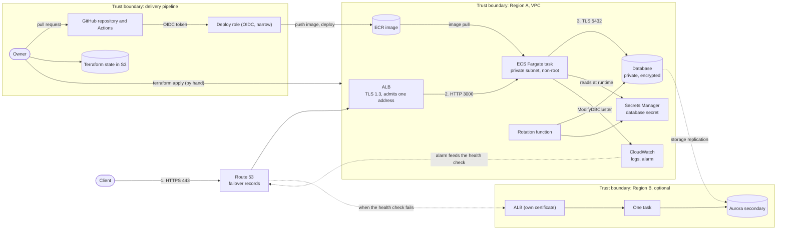

# Threat model

A STRIDE threat model of the Product Service stack, its optional disaster recovery Region, and the pipeline that deploys it. It lists what is
protected, where the trust boundaries are, which threats apply, which control covers each one, and what is still open. Ratings are the author's
judgement for this project at its current size, not a formal score. Controls named here exist in the code; gaps are listed, not hidden. Test
evidence is in [Application_Security_Testing.md](Application_Security_Testing.md), the gap table is in the [README](../README.md#open-security-gaps).

**Scope:** the Region A stack in `terraform/` (ALB, ECS on Fargate, the database, the secret and its rotation function, ECR, logging), the
optional Region B stack in `terraform/region-b/` with Route 53 failover, the GitHub repository and Actions pipeline, and the Terraform state.
**Out of scope:** the security of AWS and GitHub themselves, takeover of the owner's AWS or GitHub account, physical access, and the other
projects that share the AWS account, the Route 53 zone and the state bucket (except where they widen the blast radius, T25).

**What the service is:** three read-only routes (`GET /health`, `GET /products`, `GET /`) over HTTPS. There is **no authentication**: access is
controlled by which address the load balancer admits. That single fact drives most of the ratings below.

## Assets

| Asset | Why it matters |
|---|---|
| Product data (`products` table) | Sample data, low sensitivity, but its integrity is what the service returns |
| Database credentials (Secrets Manager) | Full access to the database; rotated every 7 days with Aurora |
| The container image (ECR) | Whatever runs in the task is what the image says; a swapped image is code execution in the VPC |
| The AWS account and the deploy role | Compromise would allow changes to every resource |
| Terraform state | Describes every resource; the password is write-only and is not stored in it |
| Source repository and workflows | Whoever controls `deploy.yml` on `main` controls what is deployed |
| The DNS names and certificates | Control of the Route 53 records redirects users; the ACM certificates prove the name |
| Availability of the service | A demo, but also the subject of the failover drills |

## Actors

| Actor | Trust |
|---|---|
| Client (browser, `curl`) | **Untrusted.** Reaches the ALB only from `alb_ingress_cidr` by default (the owner's address); anyone, if `allow_public_alb` is set |
| The app task (Node.js) | Trusted to run reviewed code, but treated as compromisable: it has one narrow role and no internet-facing listener of its own |
| Other principals in the AWS account and other projects | Partly trusted. They share the account, the hosted zone and the state bucket |
| Repository owner | Trusted, and the only person with write access |
| GitHub Actions runner | Trusted only while running reviewed workflow code, and only for the `dev` environment |
| Engineer (SSO, PowerUserAccess plus a scoped IAM policy) | Trusted; applies Terraform by hand |

## Data flow and trust boundaries

## Threats

Rating is the residual risk after the listed controls: **Low**, **Medium** or **High**.

### Request path and the running service

| ID | STRIDE | Threat | Existing controls | Residual | Open item |
|---|---|---|---|---|---|
| T1 | Spoofing, Information disclosure | Someone who should not read the products does so, because the API has no authentication | The ALB security group admits only `alb_ingress_cidr`; there is no default, and `0.0.0.0/0` is refused unless `allow_public_alb = true` (tested on live plans). Only three read-only routes exist; the data is sample data | **Medium** | No authentication or authorisation, no WAF. If the address restriction is lifted, anyone can read `/products`. A Cognito or JWT authorizer is the planned fix |
| T2 | Information disclosure | Traffic is read or altered in transit | HTTPS with an ACM certificate (TLS 1.3) at the ALB; port 80 only redirects; the database connection uses TLS; Secrets Manager and ECR are called over HTTPS | Low | With `enable_https` off (the code default) the ALB is HTTP only. The ALB to task hop is plain HTTP inside the VPC. The database certificate is not verified (T11) |
| T3 | Tampering | Injection through request data | The only query is a fixed `SELECT` with no user input; no route takes a body; Semgrep (OWASP Top 10 set) and CodeQL run on every change and found nothing open | Low | None |
| T4 | Information disclosure | Errors or banners reveal internals | Errors return generic messages and the database error is logged server-side only; `x-powered-by` is disabled; `GET /` shows no version or infrastructure detail | Low | None |
| T5 | Denial of service | A flood of requests exhausts the service or raises cost | The security group limits who can reach the ALB; Auto Scaling keeps 2 to 4 tasks (CPU 60 percent, 500 requests per task per minute); in the load test it took the service from 2 to 4 tasks ([Load_Test_and_Optimization.md](Load_Test_and_Optimization.md)) | Low (restricted) to **Medium** (if opened to the internet) | No WAF, no per-client rate limit |
| T6 | Repudiation | Nobody can say who made a request | ALB access logs are always on, in one private S3 bucket (30-day expiry); there is no caller identity to log | Medium | CloudTrail, S3 access logs and RDS logs are off by default (switches); no VPC flow logs |
| T7 | Denial of service | Failures go unnoticed | CloudWatch dashboard and Container Insights; the `no-running-tasks` alarm (when DR failover is on) | Medium | No alarms for 5XX errors or unhealthy targets |

### The container and its permissions

| ID | STRIDE | Threat | Existing controls | Residual | Open item |
|---|---|---|---|---|---|
| T8 | Elevation of privilege | The app is exploited and the attacker moves on | Tasks run in private subnets with no public IP; the container is non-root with a read-only root filesystem; the task role can only read one secret (and, with Aurora, decrypt its key through Secrets Manager); egress is limited to TCP 443 and PostgreSQL; the execution role cannot read the secret | Low | Egress on 443 goes to anywhere, so tasks can reach AWS endpoints through the NAT (interface endpoints would remove it) |
| T9 | Tampering | A vulnerable base image or dependency is shipped | Trivy on every pull request (fails on HIGH or CRITICAL with a fix) and weekly; `npm audit`; Dependabot; ECR scan on push gates the deploy on CRITICAL; the runtime image has no npm (this removed 17 findings) | Low | One MEDIUM (`zlib`) is open; the base image is pinned by tag, not digest; the Brotli CVE fix is not tested |
| T10 | Tampering | The image behind a tag is replaced | The pipeline pushes unique commit-SHA tags and a scan runs on every push; ECR is private and only the execution role pulls from it | Medium | ECR tags are mutable and the Terraform task definition starts from `latest`, so `latest` could be overwritten by anyone with push rights |
| T11 | Spoofing | Someone inside the VPC impersonates the database | The database is private and its security group admits only the app group; the connection is encrypted | Low | The app does not verify the database certificate (`rejectUnauthorized` defaults to false); needs a network position inside the VPC |
| T12 | Spoofing | Another principal assumes a task role | Both ECS roles trust only ECS in this account (`aws:SourceAccount` and `aws:SourceArn` conditions) | Low | None |

### Data, secrets and recovery

| ID | STRIDE | Threat | Existing controls | Residual | Open item |
|---|---|---|---|---|---|
| T13 | Information disclosure | The database password leaks | It is never in code, variables, the image, the task definition, the environment or Terraform state (write-only argument with Aurora; RDS-managed otherwise); the app reads it at runtime with its task role; it is rotated every 7 days with Aurora; real rotations were tested under load | Low | The scheduled 7-day rotation has never run (only manual ones); the customer-managed key for Region A is written but not applied; the Region B replica uses the AWS-managed key |
| T14 | Tampering, Denial of service | The rotation breaks the database login | The function is idempotent, labels its steps, and clears leftovers; 16 offline tests; the first Aurora rotation found a livelock that was fixed and re-tested (104 s, no failed request) | Low | A rotation that fails mid-way would leave the app on the old password until it is retried |
| T15 | Denial of service, Integrity | Data loss or a database failure | Aurora Serverless v2 with 7-day backups; encrypted storage; the demo data is reloaded by the migration task | Medium | Deletion protection is off and there is no final snapshot (demo); RDS is single-AZ without the DR option; backups were never restored in a test |
| T16 | Denial of service | A whole Region fails | Optional pilot-light Region B, Aurora Global Database, Route 53 failover with an alarm-fed health check. Drilled on 2026-11-07: database failover in 31 to 38 s with 0 of 20,764 rows lost; the main name moved to Region B in 42 to 56 s | Medium | A real Region outage cannot be simulated; database promotion and scaling Region B up are manual; a database failover caused about 2 min 48 s of failed requests |
| T17 | Information disclosure | A failover leaves a copy of the data behind | The runbook's teardown lists the `rds:unplanned-global-failover-...` snapshot and the leftover checks in both Regions | Low | After the 2026-11-08 teardown no such snapshot was found; why is not known |
| T18 | Spoofing | The DNS records are changed to redirect users | The stack manages only its own records and only reads the shared hosted zone; the ACM certificates are validated by DNS records in the stack | Low | Anyone with Route 53 write access to the zone, including other projects, can redirect the name |

### Pipeline and infrastructure

| ID | STRIDE | Threat | Existing controls | Residual | Open item |
|---|---|---|---|---|---|
| T19 | Elevation of privilege | Someone other than the owner's reviewed code assumes the deploy role | OIDC trust pins the repository by its immutable owner and repository IDs and the `dev` environment, which accepts only protected branches (`prod` also needs the owner's approval); no stored AWS keys; `deploy.yml` runs only on pushes to `main` that change the app or on demand; the role can only push to one ECR repository, register task definitions, pass the two ECS roles and run the CodeDeploy deployment | Low | The owner can still merge a change to a workflow |
| T20 | Tampering | A change reaches `main` without review or checks | `main` accepts changes only through a pull request with six passing required checks (Terraform validate, secret scan, unit tests, image build and scan, Semgrep, Checkov), the branch up to date, administrators included; no force pushes or deletions | Low | Zero approving reviews are required (single owner); conversation resolution is not required |
| T21 | Tampering | A compromised action, tool or dependency | Every action is pinned to a full commit SHA (the repository refuses unpinned ones), Dependabot proposes grouped weekly updates, tool and scanner versions are pinned, the default Actions token is read-only and Actions cannot approve pull requests | Low | Transitive dependencies of the scanners are not pinned; they run without AWS credentials |
| T22 | Information disclosure | Secrets, personal data or account details reach the public repository | The pre-commit hook, the required CI secret scan (every file and every added line), GitHub secret scanning with push protection, git-ignored state, plan and variable files, placeholders in all docs ([SECRET_SCANNING.md](SECRET_SCANNING.md)) | Low | The hook can be skipped; `secret-scan: allow` is honoured in CI; no rule for public IPs or domains (the private block list covers them); no one-off full-history scan with a second tool |
| T23 | Information disclosure | Terraform state leaks | A private, versioned, encrypted S3 bucket with native locking and TLS only | Low | The bucket is shared with other projects; the bootstrap stack's state is a local file |
| T24 | Tampering | A mistaken or malicious apply changes the infrastructure | Terraform is applied by hand after the plan is read; destroys use saved plans; the safeguards in the code (no default for `alb_ingress_cidr`, listener dependencies) came from real mistakes | Medium | Single operator, no second reviewer, and no automated plan check; one incident opened the ALB to the internet for a short window (fixed, [E2E_Test_Results.md](E2E_Test_Results.md)) |
| T25 | Elevation of privilege | Another project, or a leftover, widens the blast radius | The scoped IAM policy limits role creation to `product-service-*` roles | Medium | One AWS account, one hosted zone and one state bucket are shared with other projects, there is no permissions boundary on the roles, and a non-project WAF charge in the account is not yet explained |
| T26 | Repudiation | Who changed what | Every change is a pull request with a workflow run log; the deploy session is traceable in CloudTrail if it is on | Medium | CloudTrail is off by default; the hand-run Terraform applies leave no pull request |
| T27 | Denial of service | A forgotten stack keeps billing | Cost is stated up front (about $0.14 an hour, about $0.35 to $0.50 with the whole DR design on); a budget alert; teardown checklist and leftover checks in the runbook, and the stack was destroyed after the session | Low | The budget alert only notifies; nothing destroys the stack automatically |
| T28 | Information disclosure | The commit history or GitHub account exposes personal details | Scans cover file contents and every added line | Medium | GitHub account checks (email privacy, two-factor authentication, keys) have not been recorded as done |

## Residual risk summary

Closed or reduced since the first version of this model: **HTTP only** (HTTPS with TLS 1.3), **no scanning in CI** (Semgrep, CodeQL, Trivy, Checkov
and the secret scan, all required), **no static analysis** (Semgrep and CodeQL), **`main` not protected** (protected, public, administrators
included), **image findings** (17 removed with the runtime image change), **the open load balancer** (guard, T1) and **the rotation retry
livelock** (T14).

Highest open risks, in order:

1. **T1: no authentication.** Acceptable while the load balancer admits one address; add an authorizer and a WAF before any public exposure.
2. **T16: a real Region outage is unproven.** The drills covered the parts, not a Region going dark, and promotion is manual.
3. **T10: mutable image tags** and the task definition starting from `latest`.
4. **T15: no deletion protection or final snapshot, and backups never restored.** Fine for sample data, not for real data.
5. **T24 and T25: single operator, shared account.** The safeguards are in code and docs; there is no second reviewer.

Smaller, planned: database certificate verification (T11), the `zlib` finding (T9), the scheduled rotation and the Region A key (T13), alarms
for errors and unhealthy targets (T7), and the GitHub account checks (T28).

## Keeping it current

Review this file when a component is added, a boundary changes (an authorizer, a second environment), or a gap above is closed. Closing a gap
should update its row, the summary here and the README gap table in the same pull request. Last reviewed: 2026-11-08, after the disaster
recovery drills and the security re-scan.
