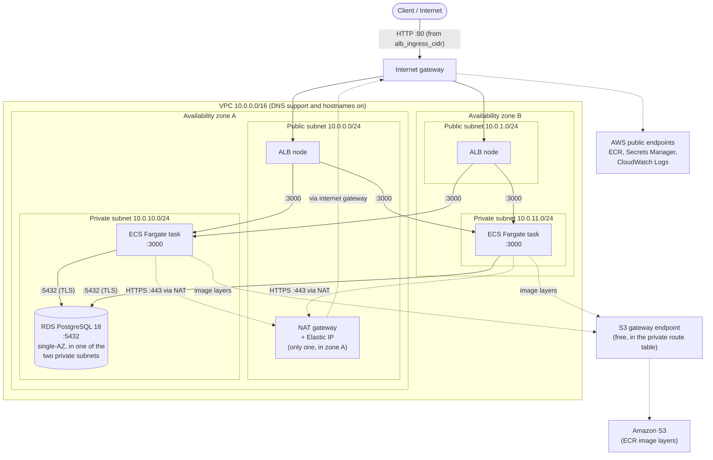
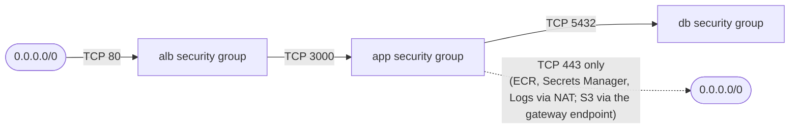

# Terraform – Product Service on AWS

Infrastructure for the Product Service: a Node.js REST API running on ECS Fargate behind an
Application Load Balancer, backed by Amazon RDS for PostgreSQL.

## Network diagram

The CIDRs below are the defaults (`vpc_cidr = 10.0.0.0/16`). Public subnets are `cidrsubnet(vpc_cidr, 8, 0..1)` and private subnets are
`cidrsubnet(vpc_cidr, 8, 10..11)`. The two availability zones are the first two available in the region (for example `us-east-1a` and `us-east-1b`).



The ALB spans both public subnets, and the service registers one task in each private subnet when `desired_count = 2`. The database
subnet group covers both private subnets (RDS requires two zones), but with `multi_az = false` the instance itself runs in one of them.

### Routing

| Route table | Associated subnets | Routes |
|---|---|---|
| Public | `10.0.0.0/24`, `10.0.1.0/24` | `10.0.0.0/16` local, `0.0.0.0/0` → internet gateway |
| Private | `10.0.10.0/24`, `10.0.11.0/24` | `10.0.0.0/16` local, `0.0.0.0/0` → NAT gateway |

Private subnets have no route to the internet gateway, so nothing on the internet can start a connection to a task or the database.
The tasks reach out through the NAT gateway to pull images from ECR, read the database secret from Secrets Manager and write logs to CloudWatch.

### Security groups

Each layer accepts traffic only from the layer in front of it.



| Security group | Inbound | Outbound |
|---|---|---|
| `alb` | TCP 80 from `alb_ingress_cidr` (required; `0.0.0.0/0` is refused unless `allow_public_alb = true`) | TCP 3000 to the VPC CIDR (`10.0.0.0/16`) |
| `app` | TCP 3000 from the `alb` group only | TCP 443 to `0.0.0.0/0` (AWS services), and TCP 5432 to the `db` group. Nothing else. |
| `db` | TCP 5432 from the `app` group only | None defined (Terraform removes the default allow-all rule, but replies to allowed inbound traffic still work) |

### Where each resource sits

| Resource | Subnets | Public IP |
|---|---|---|
| Application Load Balancer | Both public | Yes (one address per zone) |
| NAT gateway | Public subnet in zone A | Yes (Elastic IP) |
| ECS Fargate tasks | Both private | No (`assign_public_ip = false`) |
| RDS instance | One of the two private subnets | No (`publicly_accessible = false`) |

### Known network limits

- **Single NAT gateway:** if zone A fails, tasks in zone B lose outbound access (image pulls, secret reads, logs). One NAT per zone fixes this at about $0.045/hr more each.
- **HTTP only:** the listener is on port 80 with no TLS between the client and the ALB.
- **Single-AZ database:** a zone failure takes the database down until RDS recovers it; set `multi_az = true` for a standby.
- **Outbound HTTPS to the whole internet:** the `app` group allows TCP 443 to `0.0.0.0/0` (and PostgreSQL to the database group, nothing else), because the targets are AWS public endpoints behind a NAT. Interface VPC endpoints for ECR, Secrets Manager and CloudWatch Logs would let you remove even that, at about $0.01 an hour per endpoint per zone.

## Requirements

- Terraform >= 1.5
- AWS credentials with permission to create VPC, RDS, ECR, ECS, ELB, IAM and CloudWatch resources. The AWS-managed **PowerUserAccess** permission set covers everything except IAM, so
  the stack's two ECS roles fail with `AccessDenied` on `iam:CreateRole` unless the permission set also includes
  [docs/iam/product-service-iam-policy.json](../docs/iam/product-service-iam-policy.json), a scoped policy limited to roles named `product-service-*`.
- Docker (to build and push the application image)

## Files

| File | Contents |
|---|---|
| `versions.tf` | Terraform (>= 1.10) and AWS provider versions, default tags |
| `backend.tf` | S3 remote state with native locking; the bucket name comes from `backend.hcl` (git-ignored, copy `backend.hcl.example`) |
| `variables.tf` | Input variables |
| `network.tf` | VPC, public/private subnets, IGW, NAT, route tables, security groups |
| `rds.tf` | DB subnet group and PostgreSQL 18 instance (password managed by Secrets Manager) |
| `ecr.tf` | ECR repository and lifecycle policy |
| `ecs.tf` | Log group, cluster, IAM roles, task definition, service, ALB, target group, listener |
| `logging.tf` | Central private, encrypted S3 log bucket with per-prefix expiry, a bucket policy with one statement per writer, ALB logs (always on), and the optional CloudTrail trail and S3 access logging (switches) |
| `monitoring.tf` | CloudWatch dashboard: ECS reserved and utilized CPU and memory, desired, running and pending task counts, ALB request count, 4XX and 5XX errors, response time and target health |
| `autoscaling.tf` | Application Auto Scaling target (2 to 4 tasks) and two target-tracking policies: average CPU and ALB requests per task (a metric-math expression over both target groups when `enable_blue_green` is on) |
| `codedeploy.tf` | Only with `enable_blue_green`: the green target group, the CodeDeploy-controlled ECS service, the CodeDeploy application, deployment group and service role |
| `bootstrap/` | Separate stack, applied by hand with local state: the GitHub OIDC deploy role the pipeline assumes (see [docs/CICD.md](../docs/CICD.md)) |
| `migrate.tf` | One-off Fargate task definition that runs `node src/migrate.js` from the app image to load `db/schema.sql` into the private database (run by hand with `aws ecs run-task`) |
| `outputs.tf` | ALB DNS name, ECR URL, RDS endpoint, DB secret ARN |

## Variables

| Name | Default | Description |
|---|---|---|
| `aws_region` | `us-east-1` | Region to deploy into |
| `project_name` | `product-service` | Prefix for resource names |
| `vpc_cidr` | `10.0.0.0/16` | VPC CIDR |
| `db_name` | `products` | Initial database name |
| `db_username` | `product_app` | Master username |
| `db_instance_class` | `db.t4g.micro` | RDS instance class |
| `image_tag` | `latest` | ECR image tag to deploy |
| `desired_count` | `2` | Starting number of Fargate tasks. Auto Scaling takes over afterwards, and Terraform ignores later changes to it. |
| `autoscaling_min_capacity` | `2` | Fewest tasks (two keeps one in each availability zone) |
| `autoscaling_max_capacity` | `4` | Most tasks. Each task opens up to 10 database connections. |
| `autoscaling_cpu_target` | `60` | Average CPU percent the scaler tries to hold |
| `autoscaling_requests_per_target` | `500` | Requests per task per minute through the ALB that the scaler tries to hold |
| `log_retention_days` | `30` | Days ALB and S3 access logs are kept in the central log bucket |
| `cloudtrail_log_retention_days` | `90` | Days CloudTrail logs are kept |
| `enable_blue_green` | `false` | Deploy with CodeDeploy blue/green (started by GitHub Actions) instead of ECS rolling updates. **Replaces the ECS service** (short outage). Creates a second target group, the CodeDeploy application, deployment group and service role. See [docs/CICD.md](../docs/CICD.md) |
| `codedeploy_deployment_config` | `CodeDeployDefault.ECSLinear10PercentEvery1Minutes` | How CodeDeploy shifts traffic (only with `enable_blue_green`) |
| `codedeploy_blue_termination_minutes` | `5` | Minutes the old tasks keep running after the switch, for an instant rollback |
| `enable_cloudtrail` | `false` | Create a multi-region CloudTrail trail (account-wide; the first trail's management events are free) |
| `enable_s3_access_logging` | `false` | Record who reads or changes the central log bucket's files (S3 server access logs), in a separate small bucket |
| `enable_rds_logs` | `false` | Export PostgreSQL and upgrade logs to CloudWatch Logs (14-day retention) |
| `alb_ingress_cidr` | **none (required)** | CIDR allowed to reach the load balancer on port 80. Set it to your own address as a `/32` (in the untracked `terraform/demo.auto.tfvars`, or with `-var`; never commit your address). `0.0.0.0/0` is refused unless `allow_public_alb` is true. |
| `allow_public_alb` | `false` | Set to `true` to allow `alb_ingress_cidr = "0.0.0.0/0"`, which opens the load balancer to the whole internet. Off by default, so an open load balancer is always deliberate. |

## Usage

**Keep your settings in an untracked file.** Put `alb_ingress_cidr` (your address as a `/32`) and any `enable_*` switches in `terraform/demo.auto.tfvars`, which Terraform loads automatically and `.gitignore` excludes (`*.tfvars`).
`alb_ingress_cidr` has **no default**, so a plan made without it stops with an error ("No value for required variable") instead of silently opening the load balancer, and `0.0.0.0/0` is refused unless you also set `allow_public_alb = true`. (Before this safeguard, a plan without the settings file fell back to an open default and was applied during the AWS test.)
A `-var` option still applies to one run only, so keep the `enable_*` switches in the file too. Still read every plan and confirm `aws_security_group.alb` isn't changing in a way you didn't intend.
The file and the checks are in [docs/Logging_Runbook.md](../docs/Logging_Runbook.md#step-0-set-variables).

Run from the repository root (`-chdir=terraform` runs Terraform in this directory without changing yours):

```bash
terraform -chdir=terraform init
terraform -chdir=terraform fmt -check -recursive
terraform -chdir=terraform validate
terraform -chdir=terraform plan -out=tfplan
terraform -chdir=terraform apply tfplan
terraform -chdir=terraform output
```

Override variables for a single run with `-var`, or keep them in a git-ignored `terraform.tfvars`:

```bash
terraform -chdir=terraform plan -out=tfplan \
  -var="aws_region=us-east-1" \
  -var="desired_count=1" \
  -var="db_instance_class=db.t4g.micro" \
  -var="image_tag=latest"
```

| Option | What it does |
|---|---|
| `-chdir=terraform` | Runs the command in the `terraform` directory |
| `-backend=false` (`init`) | Skips backend setup; enough for `validate` without AWS access |
| `-check -recursive` (`fmt`) | Fails if any file is unformatted instead of rewriting it |
| `-out=tfplan` (`plan`) | Saves the plan so `apply tfplan` runs exactly what you reviewed, with no extra prompt |
| `-var="name=value"` | Overrides a variable for this run only |
| `-raw` (`output`) | Prints a bare string with no quotes, for use in `$(...)` |
| `-destroy` (`plan`) | Previews what `destroy` would delete |

Read a single output, for example the public URL:

```bash
terraform -chdir=terraform output -raw alb_dns_name
```

Tasks cannot start until an image exists in ECR. The recommended order is to create just the ECR repository first (`-target=aws_ecr_repository.app -target=aws_ecr_lifecycle_policy.app`),
push the image, then run the full apply; see [docs/ECR_Runbook.md](../docs/ECR_Runbook.md) for the ECR steps and [docs/runbook.md](../docs/runbook.md) for the full deployment procedure.
`-target` is meant for exceptions like this, and Terraform warns about it.

## Outputs

| Name | Description |
|---|---|
| `alb_dns_name` | Public URL of the service |
| `ecr_repository_url` | Where to push the image |
| `rds_endpoint` | Database host name |
| `db_secret_arn` | Secrets Manager secret holding the DB credentials |
| `log_bucket` | Central S3 log bucket (prefixes `alb/`, `cloudtrail/`) |
| `s3_access_log_bucket` | Separate bucket for the central bucket's S3 server access logs (empty when `enable_s3_access_logging` is off) |
| `dashboard_url` | Console link to the CloudWatch dashboard |
| `ecs_cluster_name` | Cluster to run the migration task in |
| `migrate_task_definition` | Family name of the one-off schema migration task |
| `private_subnet_ids` | Subnets for `aws ecs run-task` (the migration task) |
| `app_security_group_id` | Security group for `aws ecs run-task`; the only one the database accepts |

## Design notes

- **Network isolation:** security groups chain ALB → app (port 3000) → database (port 5432).
  The database is not publicly accessible.
- **No secrets in code or state files:** RDS generates the master password
  (`manage_master_user_password`); the app reads it itself at runtime with the task role (`DB_SECRET_ARN` names the secret; see [docs/Secrets.md](../docs/Secrets.md)).
- **Availability zones:** the first two standard (non-opt-in) AZs in the region are used.
- **CPU architecture:** the task definition sets `runtime_platform` to `X86_64`/`LINUX` explicitly. It must match the platform the image is built for (`docker build --platform linux/amd64`).
- **IAM:** two roles. The execution role (pulls the image, writes logs) has the AWS-managed ECS execution policy, plus a temporary inline policy to read the database secret that is removed once the rollout in [docs/Secrets.md](../docs/Secrets.md) is finished; the task role, which is the app's own identity, has one inline policy: read the one database secret.
- **Schema migration:** a one-off task, not a service. It runs the application's own image with the command `node src/migrate.js`, which loads `db/schema.sql` through the `pg` driver using the same `DB_*`
  settings and secret as the app. The official `postgres` image was rejected because it carried 85 known vulnerabilities (see the scan report); reusing the app image adds no new image to pull or scan.
  The seed insert only runs when the table is empty, so the task is safe to run again.
- **Central log bucket:** one private S3 bucket (`logging.tf`) holds the file-based logs, one prefix per source: `alb/` (always on) and `cloudtrail/` (a switch, off by default). The bucket policy is merged from one statement per
  writer: the regional Elastic Load Balancing account for `alb/`, `cloudtrail.amazonaws.com` limited to this trail's ARN, plus a deny for non-TLS access. The whole bucket uses
  SSE-S3, because ALB log delivery supports nothing else and S3 access logs can't be written to a KMS bucket. Each prefix expires on its own schedule, and `force_destroy = true` lets `terraform destroy` remove it with the logs (turn that off for production).
  ALB logs record each request's client, target, status codes, timings and, for a 502, 503 or 504, an `error_reason`, which the metrics can't show. CloudTrail is account-wide, so check `aws cloudtrail describe-trails` first: the first trail's management
  events are free and a second copy costs about $2 per 100,000 events. The S3 access-log switch writes to a **separate small bucket** (also private, SSE-S3, TLS-only, 30-day expiry), because AWS allows logging a bucket into itself but warns it can produce log records of the logs; the policy there lets only
  `logging.s3.amazonaws.com` write, and only for the central bucket and this account. S3 access logging doesn't check its permissions when it is created, so a wrong policy fails silently: check that files appear.
  RDS logs go to CloudWatch Logs (`enable_rds_logs`), not S3, because RDS can't export to S3 directly; sending them on to the bucket (CloudWatch Logs to Firehose to S3) is planned but not built.
- **Monitoring and the Lambda note:** the dashboard charts what exists for a Fargate service. `CPUReservation` and `MemoryReservation` are only published for EC2-backed ECS clusters (confirmed: zero such metrics on this
  cluster), so it uses Container Insights' `CpuReserved`, `MemoryReserved` and `DesiredTaskCount` instead, plus ALB `RequestCount` and `HTTPCode_Target_4XX_Count`. **There is no Lambda function in this project**, so the Lambda
  `Invocations` and `Errors` metrics and X-Ray tracing on a Lambda function don't apply and were not added; the reasoning and what a Lambda would need are in the header comment of `monitoring.tf`.
- **Auto Scaling:** two target-tracking policies on one scalable target. They add tasks quickly (60-second cooldown) and remove them slowly (300 seconds), so brief dips don't shrink the service. The service
  ignores `desired_count` after creation so Terraform doesn't fight the scaler. The scaling alarms are created and managed by Application Auto Scaling (about $0.10 per alarm per month, a few cents for a short test),
  and the service-linked role it needs is created by AWS automatically. The 4-task ceiling keeps database connections within bounds (10 per task).
- **AWS best practices applied:**
  - *Least-privilege egress:* the app security group allows only TCP 443 and PostgreSQL to the database group. The two rules are separate `aws_vpc_security_group_egress_rule` resources, because inline rules would create a dependency cycle with the database group.
  - *S3 gateway endpoint (free):* ECR layers are stored in S3, so image pulls bypass the NAT gateway.
  - *Confused-deputy protection:* both ECS roles' trust policies require `aws:SourceAccount` and `aws:SourceArn` for ECS in this account and region. This is the documented AWS pattern; if tasks ever fail to start with an "unable to assume role" error, check these conditions first.
  - *Safe deployments:* a 60-second health-check grace period and a 30-second connection drain. With rolling updates the ECS service has a deployment circuit breaker with automatic rollback; with `enable_blue_green` CodeDeploy shifts traffic gradually and rolls back automatically (the circuit breaker is not available with that controller).
- **Security groups and ALB hardening:** every security group and rule has a description, the VPC's default security group is emptied, and the ALB drops invalid headers.
- **Single NAT gateway and single-AZ RDS** keep the demo cheap. See "Production hardening".

## Cost

Roughly $0.14/hour (about $3.30/day) while running; the NAT gateway and ALB bill even with no
traffic. Run `terraform destroy` when finished.

## Production hardening

- HTTPS listener with an ACM certificate, and redirect HTTP to HTTPS
- One NAT gateway per AZ
- `multi_az = true`, `deletion_protection = true`, `skip_final_snapshot = false` on RDS
- A dedicated state bucket per project (state is already in S3 with locking, in a shared bucket)
- Pin `engine_version` to a specific minor version
- CloudWatch alarms for 5xx responses and unhealthy targets (target tracking creates its own scaling alarms, but nothing notifies a person)
- Immutable image tags (git SHA) instead of `latest`

## Cleanup

```bash
terraform -chdir=terraform plan -destroy
terraform -chdir=terraform destroy
```

`plan -destroy` previews what will be deleted; `destroy` asks you to type `yes`. The database is deleted with its data
(`skip_final_snapshot = true`), and the ECR repository is deleted with its images (`force_delete = true`), so push the image again after the next apply.

## Remote state

State is stored in S3 (`backend.tf`) with native locking (`use_lockfile`, Terraform 1.10 or later), so no DynamoDB table is needed. Key: `secure-containerized-microservices-app-aws/terraform.tfstate`. The `terraform/bootstrap` stack deliberately keeps **local** state (applied by hand, never by the pipeline).

The bucket name is not hard-coded because it contains the AWS account ID. The state bucket must have versioning, encryption and all public access blocked. The sibling project's existing shared bucket meets this; otherwise create one first.

**Status: migrated on 2026-10-31.** The live stack's 63 resources are in the remote state, `terraform plan` showed no changes afterwards, and locking was verified (the lock was acquired and released). The local `terraform.tfstate*` files are leftovers. To migrate another clone or stack, the steps were:

```bash
cd terraform
cp backend.hcl.example backend.hcl            # then set the real bucket name (backend.hcl is git-ignored)
terraform init -backend-config=backend.hcl -migrate-state     # answer "yes" to copy the local state
terraform plan                                # expect: no changes
aws s3 ls s3://<bucket>/secure-containerized-microservices-app-aws/    # confirm the state object exists
```

Only after that, delete the leftover local `terraform.tfstate*` files (keep a copy until a plan shows no changes). After this, every `terraform` command needs the same `-backend-config=backend.hcl` at `init`; the CI validate job uses `-backend=false` and needs no bucket.

State can still be lost by emptying the bucket by hand. Keep versioning on, and do not grant the pipeline's deploy role access to the bucket (it never runs Terraform).
